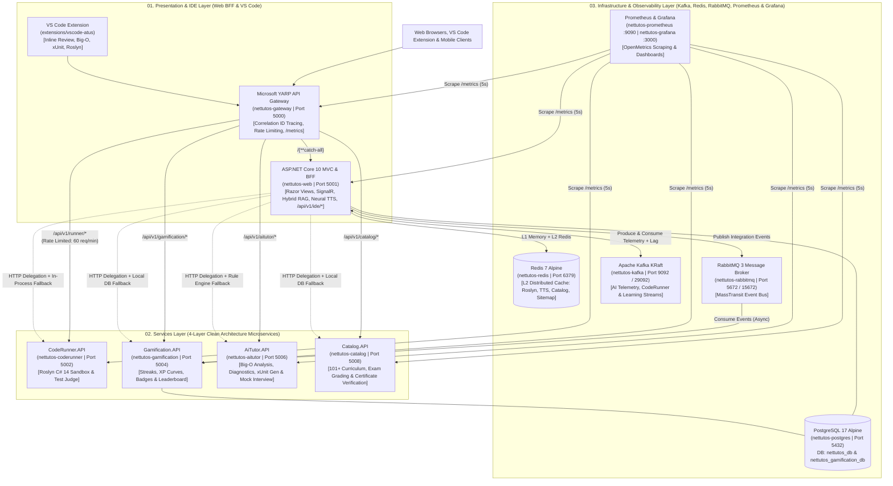

# NET-Tutos

[](https://dotnet.microsoft.com/)
[](https://learn.microsoft.com/dotnet/csharp/)
[](docs/09_microservices_architecture_and_migration.md)
[](src/Gateways/Gateway)
[](src/Infrastructure/EventBus)
[](docker-compose.yml)
[](observability/)
[](extensions/vscode-atus)
[](src/Presentation/Mobile)
[](src/Orchestration/NET-Tutos.AppHost)
[](tests/)
[](docker-compose.yml)
[](LICENSE)

**NET-Tutos** is an enterprise-grade, distributed educational ecosystem and Learning Management System (LMS) engineered on **.NET 10** and **C# 14**. Built using **Microservices Architecture**, **4-Layer Clean Architecture (DDD + CQRS)**, and the **Strangler Fig Pattern**, the platform unites a **Microsoft YARP API Gateway**, an **ASP.NET Core 10 MVC** web application (BFF) with **Geo-IP Region Language Detection (`VN` -> `vi`, Outside `VN` -> `en`)**, **Automated Technical SEO & Dynamic OG SVG Engine**, **Hybrid L1/L2 Redis 7 Distributed Caching**, **Apache Kafka KRaft Real-Time Event Streaming**, **Prometheus + Grafana Cloud-Native Observability**, a **VS Code Extension (`Atus .NET Pair Programmer`)**, **Multi-Source Hybrid RAG (175+ documents)**, **Live Coding Whiteboard & Neural TTS**, isolated **CodeRunner**, **Gamification**, **AiTutor (Atus)**, and **Catalog & Assessment** microservices, **MassTransit + RabbitMQ**, and **PostgreSQL 17** persistence with automatic zero-downtime fallback. (The `.NET MAUI 10` Mobile client follows its own dedicated mobile roadmap.)

---

## Table of Contents

- [1. Distributed Microservices Architecture](#1-distributed-microservices-architecture)
  - [System Topology Diagram](#system-topology-diagram)
  - [Core Architectural Pillars](#core-architectural-pillars)
- [2. Solution Structure (`NET-Tutos.slnx`)](#2-solution-structure-net-tutosslnx)
- [3. Microservices & Bounded Contexts](#3-microservices--bounded-contexts)
  - [3.1. Microsoft YARP API Gateway (`NET-Tutos.YarpGateway`)](#31-microsoft-yarp-api-gateway-net-tutosyarpgateway)
  - [3.2. CodeRunner Microservice (`NET-Tutos.CodeRunner.*`)](#32-coderunner-microservice-net-tutoscoderunner)
  - [3.3. Gamification Microservice (`NET-Tutos.Gamification.*`)](#33-gamification-microservice-net-tutosgamification)
  - [3.4. AiTutor Microservice (`NET-Tutos.AiTutor.*`)](#34-aitutor-microservice-net-tutosaitutor)
  - [3.5. Shared BuildingBlocks (`Common` & `EventBus`)](#35-shared-buildingblocks-common--eventbus)
- [4. Key Platform Features](#4-key-platform-features)
- [5. API Reference (Gateway, Microservices & Mobile)](#5-api-reference-gateway-microservices--mobile)
- [6. Technology Stack](#6-technology-stack)
- [7. Getting Started](#7-getting-started)
  - [Option A: Run Full Microservices & Observability Ecosystem via Docker Compose (Recommended)](#option-a-run-full-microservices--observability-ecosystem-via-docker-compose-recommended)
  - [Option B: Run Standalone Web App with Automatic Resilient Fallback](#option-b-run-standalone-web-app-with-automatic-resilient-fallback)
  - [Option C: Run the .NET MAUI Mobile Application (Separate Mobile Roadmap)](#option-c-run-the-net-maui-mobile-application-separate-mobile-roadmap)
  - [Option D: Run the VS Code Extension (Atus .NET Pair Programmer)](#option-d-run-the-vs-code-extension-atus-net-pair-programmer)
- [8. Automated Testing & CI Quality Gates (210/210 Passing)](#8-automated-testing--ci-quality-gates-210210-passing)
- [9. Enterprise Documentation Suite (`docs/`)](#9-enterprise-documentation-suite-docs)
- [10. License](#10-license)

---

## 1. Distributed Microservices Architecture

### System Topology Diagram



### Core Architectural Pillars
1. **Single External Ingress (Microsoft YARP Gateway):** All external requests enter through `NET-Tutos.YarpGateway` on port `5000`, which stamps `X-Correlation-ID` headers for distributed tracing and enforces fixed-window rate limiting (`60 req/min`) on compute-heavy Roslyn compilation routes.
2. **Enterprise 4-Layer Clean Architecture per Microservice:** Each extracted microservice (`CodeRunner`, `Gamification`, `AiTutor`) is strictly partitioned into `Domain`, `Application`, `Infrastructure`, and `API` projects with zero leaky abstractions.
3. **Event-Driven Architecture (MassTransit + RabbitMQ):** Domain actions (solving coding challenges, completing lessons, passing exams) emit integration events (`ChallengeSolvedIntegrationEvent`, `LessonCompletedIntegrationEvent`, `ExamPassedIntegrationEvent`) consumed asynchronously by `Gamification.API`.
4. **Strangler Fig Resilient Delegation (Zero-Downtime Fallback):** `CodeExecutionService`, `StreakService`, and `AiTutorService` in the Web BFF delegate to their respective microservices over HTTP with aggressive timeouts (5s–8s). If any microservice or Docker container is offline during local development, the Web App automatically falls back to in-process execution and local SQLite storage with **zero user disruption**.

---

## 2. Solution Structure (`NET-Tutos.slnx`)

The repository is organized into 5 explicit architectural folders inside `NET-Tutos.slnx`:

```text
d:\NET-Tutos\
├── NET-Tutos.slnx                              # .NET 10 XML Solution (25 Projects across 5 Layers)
├── docker-compose.yml                          # 12-Container Orchestration (+ Kafka, Prometheus, Grafana)
├── observability/                              # Prometheus scrape config & pre-provisioned Grafana dashboards
├── extensions/vscode-atus/                     # TypeScript VS Code Extension ("Atus .NET Pair Programmer")
├── deploy/helm/nettutos/                       # Kubernetes Helm Chart
├── README.md                                   # Microservices & Platform Documentation
├── docs/                                       # Single Source of Truth (SSOT) Architecture & BRD/NFR Specifications
│
├── src/
│   ├── Gateways/                               # [00. Gateways Layer]
│   │   └── Gateway/                            # Microsoft YARP API Gateway, Rate Limiter, CorrelationId & /metrics
│   │
│   ├── Presentation/                           # [01. Presentation Layer]
│   │   ├── Web/                                # ASP.NET Core 10 MVC, BFF, SignalR, Hybrid RAG, Neural TTS & IDE APIs
│   │   └── Mobile/                             # Cross-Platform .NET MAUI 10 Native Client (Separate Roadmap)
│   │
│   ├── Services/                               # [02. Services Layer — 4-Layer Clean Architecture Microservices]
│   │   ├── CodeRunner/                         # Isolated Roslyn C# 14 Compilation & Online Judge Microservice
│   │   ├── Gamification/                       # Event-Driven Streaks, XP, Badges & Leaderboard Microservice
│   │   ├── AiTutor/                            # Algorithmic Big-O, Diagnostics, xUnit Gen & Mock Interview Microservice
│   │   └── Catalog/                            # Curriculum, Learning Tracks & Certification Microservice
│   │
│   ├── Orchestration/                          # [05. Orchestration Layer — .NET Aspire 13 AppHost]
│   │   └── NET-Tutos.AppHost/                  # Unified local orchestrator (Postgres pgvector, Redis, RabbitMQ, Kafka, 6 .NET services)
│   │
│   └── Infrastructure/                         # [03. Infrastructure Layer — Shared BuildingBlocks]
│       ├── Common/                             # ApiResponse<T>, Result<T>, ServiceTelemetry & PrometheusMetricsBuilder
│       └── EventBus/                           # Integration events (RabbitMQ/MassTransit) & Apache Kafka streams
│
└── tests/                                      # [04. Tests Layer — 205 .NET Tests + 5 VS Code Node Tests = 210]
    ├── NET-Tutos.Gateway.Tests/                # YARP Gateway routing, status, /metrics & X-Correlation-ID tests
    ├── NET-Tutos.CodeRunner.Tests/             # Roslyn sandbox, AST security blacklist & timeout tests
    ├── NET-Tutos.Gamification.Tests/           # Streak domain rules, XP ledger & MassTransit consumer tests
    ├── NET-Tutos.AiTutor.Tests/                # Big-O complexity rules, 3D rubric value objects & AI engine tests
    ├── NET-Tutos.Catalog.Tests/                # 7-stage curriculum, learning track estimation & certificate tests
    ├── NET-Tutos.UnitTests/                    # Web BFF, Prometheus Exporter, Multi-Source RAG, TTS, Kafka, Stage Lock & Arena tests
    └── NET-Tutos.IntegrationTests/             # End-to-end HTTP pipeline, /metrics, /api/v1/ide/*, Stage Lock & Whiteboard tests
```

---

## 3. Microservices & Bounded Contexts

### 3.1. Microsoft YARP API Gateway (`NET-Tutos.YarpGateway`)
- **Port:** `5000` (External Ingress)
- **Responsibilities:**
  - Reverse proxies `/api/v1/runner/{**catch-all}` ➔ `coderunner-cluster` (`:5002`)
  - Reverse proxies `/api/v1/gamification/{**catch-all}` ➔ `gamification-cluster` (`:5004`)
  - Reverse proxies `/api/v1/aitutor/{**catch-all}` ➔ `aitutor-cluster` (`:5006`)
  - Reverse proxies `/{**catch-all}` ➔ `web-cluster` (`:5001`)
  - Injects and propagates `X-Correlation-ID` across upstream HTTP calls (`CorrelationIdMiddleware`).
  - Enforces `runner-policy` Fixed-Window Rate Limiting (`60 requests/minute`) on code execution routes.

### 3.2. CodeRunner Microservice (`NET-Tutos.CodeRunner.*`)
- **Port:** `5002` (`nettutos-coderunner`)
- **Architecture:**
  - **Domain:** `SourceCode` and `ExecutionTimeout` Value Objects, `ExecutionConstraints` blacklist blocking `System.IO`, `System.Diagnostics.Process`, `System.Net.Sockets`, `System.Reflection.Emit`, and `Environment.Exit`.
  - **Application:** `ICodeRunnerEngine`, `ExecuteScriptCommand`, `EvaluateChallengeCommand`.
  - **Infrastructure:** `RoslynCodeRunnerEngine` powered by `Microsoft.CodeAnalysis.CSharp.Scripting` 5.0 with deterministic cancellation tokens and stdout capture.
  - **API:** Minimal API endpoints (`/api/v1/runner/execute`, `/api/v1/runner/evaluate`, `/healthz`) and RFC 7807 `GlobalExceptionHandlerMiddleware`.

### 3.3. Gamification Microservice (`NET-Tutos.Gamification.*`)
- **Port:** `5004` (`nettutos-gamification`)
- **Database:** Isolated PostgreSQL database (`nettutos_gamification_db`) with EF Core 10 Fluent API `IEntityTypeConfiguration<T>` mappings.
- **Architecture:**
  - **Domain:** Aggregate roots & entities (`UserStreak`, `DailyCheckIn`, `Badge`, `UserBadge`, `UserXpRecord`), Value Objects (`XpValue`, `StreakCount`), and domain events (`StreakMilestoneReachedDomainEvent`, `BadgeUnlockedDomainEvent`).
  - **Application:** CQRS handlers (`CheckInCommand`, `AwardXpCommand`, `GetUserStreakQuery`, `GetUserBadgesQuery`, `GetLeaderboardQuery`).
  - **Infrastructure:** `GamificationDbContext` and **MassTransit RabbitMQ Consumers** (`ChallengeSolvedConsumer`, `LessonCompletedConsumer`, `ExamPassedConsumer`).
  - **API:** Modular Minimal API groups (`/api/v1/gamification/streak/*`, `/api/v1/gamification/badges`, `/api/v1/gamification/leaderboard`).

### 3.4. AiTutor Microservice (`NET-Tutos.AiTutor.*`)
- **Port:** `5006` (`nettutos-aitutor`)
- **Architecture:**
  - **Domain:** `EfficiencyScore` and `InterviewRubricScore` (weighted 50% Technical Accuracy, 25% Clarity & Structure, 25% Practical Depth) Value Objects, `ComplexityTier` & `InterviewReadinessTier` enums, and `AiAnalysisRules` static complexity detector.
  - **Application:** `IAiTutorEngine`, CQRS command handlers (`AnalyzeComplexityCommand`, `ExplainErrorCommand`, `GenerateUnitTestCommand`, `DiagnoseTestFailureCommand`, `EvaluateInterviewCommand`).
  - **Infrastructure:** `DeterministicAiTutorEngine` delivering bilingual (Vietnamese & English) Big-O analysis, compiler error remediation (`CS0103`, `CS0029`, `CS1002`, etc.), xUnit AAA test synthesis, Socratic hints, and 3D technical interview grading.
  - **API:** Minimal API endpoints under `/api/v1/aitutor/*` and `/api/v1/aitutor/interview/*`.

### 3.5. Shared BuildingBlocks (`Common` & `EventBus`)
- **`NET-Tutos.BuildingBlocks.Common`:** Standardized `ApiResponse<T>` JSON envelope and `Result<T>` functional error-handling primitives shared across all services.
- **`NET-Tutos.BuildingBlocks.EventBus`:** Strongly-typed integration event records (`IIntegrationEvent`, `ChallengeSolvedIntegrationEvent`, `LessonCompletedIntegrationEvent`, `ExamPassedIntegrationEvent`) published over RabbitMQ.

---

## 4. Key Platform Features

1. **101-Lesson Curriculum, 8-Stage Roadmap & Stage-by-Stage Lock/Unlock:** Structured progression from C# 14 Fundamentals ➔ OOP, Memory & LINQ ➔ DSA & Design Patterns ➔ EF Core 10 ➔ ASP.NET Core 10 Web API ➔ Microservices & DevOps, enforcing sequential stage unlocking once 100% of the prerequisite stage is completed (`/Tutorials`, `/Roadmap`, `/Account/ToggleLesson`).
2. **In-Browser Monaco IDE & Online Judge:** VS Code's Monaco Editor with keyboard shortcuts (`Ctrl+Enter` to run, `Ctrl+I` for AI Mentor), hidden unit test cases, execution timing, and automated XP rewards.
3. **"Atus" Autonomous AI Agent:** Multi-turn conversational AI Mentor with persistent chat history (`AiConversation`), internal **Function Calling (Tools)** (`execute_csharp_code`, `search_curriculum`, `get_challenge_details`), Big-O complexity analyzer, test failure diagnostics, and xUnit generator.
4. **AI Tech Lead Mock Interview, Live Coding Whiteboard & Neural TTS:** Timed 5-question technical interviews plus an integrated **Pair-Programming Live Coding Whiteboard** (`/Interview/Mock`, `POST /Interview/EvaluateLiveCoding`), Web Speech API (STT), cached Vietnamese/English **Neural TTS** (`/api/tts/speak` backed by Redis 7), 3-dimensional rubric grading, and 5-dimension competency reports.
5. **Multi-Source Hybrid RAG Knowledge Engine:** Sparse hashed TF-IDF vector index indexing **175+ knowledge documents** across 4 platform sources (`Curriculum`, `Tutorial` Markdown bodies, `CodingChallenge`, `InterviewFlashcard`) at `/api/search/knowledge`, wired into Atus AI answers and VS Code quick search.
6. **Apache Kafka Telemetry & AI Adaptive Learning:** High-throughput KRaft event streams (`nettutos.atus.ai-telemetry`, `nettutos.coderunner.executions`, `nettutos.learning.user-activities`), real-time `/Admin/Telemetry` dashboard with partition consumer lag, and personalized challenge generation (`/api/adaptive/challenge`).
7. **Prometheus + Grafana Cloud-Native Observability:** Zero-dependency OpenMetrics `/metrics` across all 6 `.NET` services (`Web`, `Gateway`, `CodeRunner`, `Gamification`, `AiTutor`, `Catalog`), live TTS cache hit-rate & AI latency gauges, Prometheus (`:9090`), and pre-provisioned Grafana dashboard `nettutos-overview` (`:3000`).
8. **VS Code Extension (`Atus .NET Pair Programmer`):** TypeScript IDE extension ([`extensions/vscode-atus/`](extensions/vscode-atus)) with Sidebar Chat, inline C# review diagnostics, Lightbulb Quick Fixes, Big-O analysis, xUnit test synthesis, Roslyn sandbox execution, and Multi-Source RAG lookup over `/api/v1/ide/*`.
9. **Timed Certification Exams, Vector PDF & QR Verification:** Dynamic exam pools, instant grading, vector PDF certificates generated via **QuestPDF**, and cryptographic **QRCoder** verification (`/verify-certificate/{code}`).
10. **Real-Time 1v1 Coding Arena, SignalR Q&A & Cross-Platform Mobile:** SignalR coding battles (`/coding-arena`), live discussion threads (`DiscussionHub`), Capstone Project Studio, public developer portfolios (`/u/{username}`), and `.NET MAUI 10` mobile app (maintained on a dedicated mobile roadmap).

---

## 5. API Reference (Gateway, Microservices & Mobile)

| Service / Layer | Endpoint | Method | Description |
| :--- | :--- | :---: | :--- |
| **YARP Gateway** | `/healthz` | `GET` | Gateway liveness & readiness health check |
| **YARP Gateway** | `/api/v1/gateway/status` | `GET` | Returns active YARP reverse proxy clusters and route topology |
| **YARP Gateway** | `/metrics` | `GET` | Prometheus OpenMetrics telemetry for YARP ingress & runtime |
| **Web BFF (IDE Bridge)** | `/api/v1/ide/{status,search,chat,review,explain-error,generate-tests,complexity,execute}` | `GET / POST` | Stateless CSRF-free REST bridge powering the VS Code Extension |
| **Web BFF (RAG & TTS)** | `/api/search/knowledge`, `/api/tts/speak` | `GET` | Multi-Source Hybrid RAG search (`175+` docs) & cached VI/EN Neural TTS |
| **Web BFF (Telemetry & Kafka)** | `/metrics`, `/api/telemetry/diagnostics`, `/api/kafka/analytics`, `/api/adaptive/challenge` | `GET / POST` | Prometheus scrape endpoint, OpenTelemetry snapshot, Kafka analytics & adaptive challenges |
| **Catalog.API** | `/api/v1/catalog/{overview,sections,tracks/estimate,certificates/verify/{code}}` | `GET` | Curriculum structure, learning track estimation & certificate verification |
| **CodeRunner.API** | `/api/v1/runner/execute` | `POST` | Compiles and executes C# 14 code in an isolated Roslyn sandbox |
| **CodeRunner.API** | `/api/v1/runner/evaluate` | `POST` | Judges a coding challenge submission against public/hidden test cases |
| **Gamification.API** | `/api/v1/gamification/streak/{userId}` | `GET` | Retrieves current/longest streak and next milestone countdown |
| **Gamification.API** | `/api/v1/gamification/streak/check-in` | `POST` | Records daily check-in, increments streak, and awards bonus XP |
| **Gamification.API** | `/api/v1/gamification/badges` | `GET` | Lists achievement badge catalog and user unlock status |
| **Gamification.API** | `/api/v1/gamification/leaderboard` | `GET` | Retrieves global top learners ranked by total XP and streak |
| **AiTutor.API** | `/api/v1/aitutor/chat` | `POST` | Conversational C#/.NET mentorship with Atus AI engine |
| **AiTutor.API** | `/api/v1/aitutor/analyze-complexity` | `POST` | Evaluates algorithmic Big-O time/space complexity & efficiency score |
| **AiTutor.API** | `/api/v1/aitutor/explain-error` | `POST` | Diagnoses C# compiler (`CSxxxx`) or runtime errors with fixes |
| **AiTutor.API** | `/api/v1/aitutor/diagnose-failure` | `POST` | Identifies root cause (Edge Case, Off-by-one, Logic Flaw) of failed tests |
| **AiTutor.API** | `/api/v1/aitutor/generate-unit-test` | `POST` | Generates xUnit (`[Fact]`, `[Theory]`) AAA unit test suites |
| **AiTutor.API** | `/api/v1/aitutor/interview/evaluate` | `POST` | Scores interview answers across Technical, Clarity, and Depth rubrics |
| **AiTutor.API** | `/api/v1/aitutor/interview/report` | `POST` | Synthesizes a 5-dimension interview readiness report & study plan |
| **Mobile API (BFF)** | `/api/mobile/auth/login` | `POST` | Authenticates mobile user and issues stateless JWT Bearer token |
| **Mobile API (BFF)** | `/api/mobile/tutorials` | `GET` | Returns paginated lessons, categories, roadmaps, and completion states |
| **Mobile API (BFF)** | `/api/mobile/flashcards` | `GET` | Retrieves spaced-repetition technical interview flashcards |

---

## 6. Technology Stack

| Layer | Technologies |
| :--- | :--- |
| **Runtime & Language** | **.NET 10.0 (`net10.0`)**, **C# 14** |
| **API Gateway & Ingress** | **Microsoft YARP (Yet Another Reverse Proxy)**, ASP.NET Core RateLimiting, Correlation ID Tracing |
| **Microservices & Web BFF** | **ASP.NET Core 10 Minimal APIs** (Microservices) & **ASP.NET Core 10 MVC / Razor** (Web BFF) |
| **Event-Driven & Streaming** | **MassTransit 8.3**, **RabbitMQ 3 Management Alpine** (AMQP 0-9-1), **Apache Kafka** (KRaft mode via `Confluent.Kafka`) |
| **Observability Stack** | **Prometheus** (`prom/prometheus`), **Grafana** (`grafana/grafana`), `System.Diagnostics.Metrics` + `ActivitySource` |
| **IDE Extension** | **VS Code Extension API** (TypeScript 5.7, Webview CSP, `DiagnosticCollection`, `CodeActionProvider`) |
| **Databases & Cache** | **Entity Framework Core 10.0**, **PostgreSQL 17 Alpine** (Primary), **Redis 7 Alpine** (L2 Cache), **SQLite** (Fallback) |
| **Code Compilation Sandbox** | **Roslyn Scripting API** (`Microsoft.CodeAnalysis.CSharp.Scripting` 5.0) |
| **AI Agent & Intelligence** | **Atus AI Agent** (Function Calling + Multi-Model Fallback Chain + Deterministic Rule Engine) |
| **Mobile Client** | **.NET MAUI 10.0** (Android API 21–36, iOS, Windows), `CommunityToolkit.Mvvm` 8.4 |
| **Real-Time & Documents** | **ASP.NET Core SignalR**, **QuestPDF** (Vector PDF), **QRCoder**, **Markdig** |
| **Frontend UI & Editor** | Bootstrap 5.3, **Monaco Editor**, Prism.js, Web Speech API (STT/TTS), Service Worker PWA |
| **Quality & Testing** | **xUnit 2.9**, **FluentAssertions 7.2**, **Moq 4.20**, **Coverlet**, `WebApplicationFactory`, GitHub Actions CI |

---

## 7. Getting Started

### Prerequisites
- [.NET 10.0 SDK](https://dotnet.microsoft.com/download/dotnet/10.0)
- [Docker Desktop](https://www.docker.com/products/docker-desktop/) (for full 12-container microservices, Kafka & observability orchestration)
- [Node.js 20+](https://nodejs.org/) *(optional — only needed to build/run the VS Code Extension under `extensions/vscode-atus`)*
- *(Optional)* `.env` file at repository root with `GEMINI_API_KEY=<your-gemini-api-key>` to enable live cloud LLM responses alongside the built-in offline engine.

---

### Option A: Run Full Microservices & Observability Ecosystem via Docker Compose (Recommended)

Launch all 12 containers (`gateway`, `web`, `coderunner`, `gamification`, `aitutor`, `catalog`, `prometheus`, `grafana`, `kafka`, `redis`, `rabbitmq`, `postgres`) with a single command:

```powershell
docker compose up -d --build
```

| Container Name | Service Role | Host Port | Internal URL |
| :--- | :--- | :---: | :--- |
| **`nettutos-gateway`** | **YARP API Gateway (Main Entry Point)** | **`http://localhost:5000`** | `http://gateway:8080` |
| **`nettutos-web`** | ASP.NET Core 10 MVC Web App, OAuth 2.0 SSO, RAG, TTS & Swagger | `http://localhost:5001` | `http://web:5000` |
| **`nettutos-coderunner`** | Roslyn Code Execution & Judge Microservice | `http://localhost:5002` | `http://coderunner:8080` |
| **`nettutos-gamification`** | Streaks, XP, Badges & Leaderboard Microservice | `http://localhost:5004` | `http://gamification:8080` |
| **`nettutos-aitutor`** | AI Complexity, Diagnostics & Interview Microservice | `http://localhost:5006` | `http://aitutor:8080` |
| **`nettutos-catalog`** | Catalog, Curriculum, Exam Grading & Certificate Microservice | `http://localhost:5008` | `http://catalog:8080` |
| **`nettutos-prometheus`** | Prometheus OpenMetrics Collector (`7` active targets) | **`http://localhost:9090`** | `http://prometheus:9090` |
| **`nettutos-grafana`** | Pre-Provisioned Observability Dashboards (`nettutos-overview`) | **`http://localhost:3000`** | `http://grafana:3000` |
| **`nettutos-kafka`** | Apache Kafka KRaft Streaming Broker | `localhost:29092` | `kafka:9092` |
| **`nettutos-redis`** | Redis 7 Alpine L2 Distributed Cache (`allkeys-lru` + AOF) | `localhost:6379` | `redis:6379` |
| **`nettutos-rabbitmq`** | RabbitMQ 3 Broker & Management Dashboard | `http://localhost:15672` | `amqp://rabbitmq:5672` |
| **`nettutos-postgres`** | PostgreSQL 17 Database Server | `localhost:5432` | `postgres:5432` |

---

### Option B: Run Standalone Web App with Automatic Resilient Fallback

Thanks to the **Strangler Fig Resilient Fallback** architecture, you can also run the Web Application directly with the .NET CLI without starting Docker—it will automatically fall back to local **SQLite** (`dotnet_tutorials.db`) and in-process engines:

```powershell
# 1. Build backend services and test projects
dotnet build src/Presentation/Web/web.csproj

# 2. Launch the Web Application
dotnet run --project src/Presentation/Web/web.csproj
```

Then open **`http://localhost:5001`** (or **`http://localhost:5262`**) and explore Swagger API docs at **`/swagger`**.

---

### Option C: Run the .NET MAUI Mobile Application (Separate Mobile Roadmap)

> **Note:** Active `.NET MAUI 10` mobile expansion is tracked on its own dedicated roadmap. See [`src/Presentation/Mobile`](src/Presentation/Mobile) and requires Android Java SDK configured locally.

1. Ensure the backend is running on port `5000` (Android emulators connect to host `localhost:5000` via `10.0.2.2:5000`).
2. Build and deploy the `.NET MAUI` Android client:
   ```powershell
   dotnet build src/Presentation/Mobile/NET_Tutos.Mobile.csproj -t:Run -f net10.0-android
   ```

---

### Option D: Run the VS Code Extension (Atus .NET Pair Programmer)

1. Ensure `web` (`:5001`) or `gateway` (`:5000`) is running.
2. Compile and run the extension unit tests:
   ```powershell
   cd extensions/vscode-atus
   npm install
   npm run lint
   npm test
   ```
3. Open [`extensions/vscode-atus`](extensions/vscode-atus) in VS Code and press **F5** to launch the Extension Development Host (Sidebar chat, inline C# Code Review + Big-O diagnostics, Lightbulb Quick Fixes, xUnit generator, Roslyn Sandbox runner, and Multi-Source RAG QuickPick).

---

### Authentication & OAuth 2.0 SSO (`GitHub` & `Google`)

Learners can sign in or register directly via **GitHub OAuth 2.0** (`/signin-github`), **Google OAuth 2.0** (`/signin-google`), or standard Email/Password authentication (receiving a **+50 XP** welcome bonus upon first registration). System administrators with the `Admin` role access cohort oversight and live Kafka telemetry via `/Admin/Telemetry`.

---

## 8. Automated Testing & CI Quality Gates (210/210 Passing)

Every microservice, gateway route, `.NET Aspire` AppHost & Helm deployment manifest, domain value object, hybrid Redis cache, Geo-IP detector, SEO engine, OAuth 2.0 SSO flow, Prometheus OpenMetrics exporter, Kafka analytics store, Neural TTS proxy, Persistent PostgreSQL SignalR coding arena, Hybrid `pgvector` Neural RAG engine, Stage-by-Stage Lock progression, Responsive Web Design, IDE Bridge API, and VS Code extension client is verified by **210 automated tests** (**205 `.NET` tests across 7 projects + 5 VS Code Node tests**, enforced via [`.github/workflows/ci.yml`](.github/workflows/ci.yml) and [`.github/workflows/helm-deploy.yml`](.github/workflows/helm-deploy.yml)):

```powershell
# 1. YARP API Gateway routing, topology, telemetry, /metrics, X-Correlation-ID & Aspire/Helm specs (7 tests)
dotnet test tests/NET-Tutos.Gateway.Tests/NET-Tutos.Gateway.Tests.csproj

# 2. CodeRunner microservice domain rules & Roslyn sandbox tests (11 tests)
dotnet test tests/NET-Tutos.CodeRunner.Tests/NET-Tutos.CodeRunner.Tests.csproj

# 3. Gamification microservice domain, streak & MassTransit consumer tests (16 tests)
dotnet test tests/NET-Tutos.Gamification.Tests/NET-Tutos.Gamification.Tests.csproj

# 4. AiTutor microservice Big-O rules, 3D rubric value objects & engine tests (16 tests)
dotnet test tests/NET-Tutos.AiTutor.Tests/NET-Tutos.AiTutor.Tests.csproj

# 5. Catalog & Assessment microservice domain, 7-stage curriculum & certification tests (17 tests)
dotnet test tests/NET-Tutos.Catalog.Tests/NET-Tutos.Catalog.Tests.csproj

# 6. Web BFF unit tests (Cache, Geo-IP, SEO, Observability, Prometheus Exporter, Stage Lock, Persistent Arena, Neural pgvector RAG, TTS, Kafka) (101 tests)
dotnet test tests/NET-Tutos.UnitTests/NET-Tutos.UnitTests.csproj

# 7. End-to-End HTTP integration pipeline (/metrics, /api/v1/ide/*, /api/search/knowledge, /api/search/embeddings/*, Persistent Arena, Stage Lock, Responsive UI, Whiteboard, TTS, OAuth, SEO) (37 tests)
dotnet test tests/NET-Tutos.IntegrationTests/NET-Tutos.IntegrationTests.csproj

# 8. VS Code Extension TypeScript client & C# review diagnostic mapper tests (5 tests)
npm --prefix extensions/vscode-atus test
```

---

## 9. Enterprise Documentation Suite (`docs/`)

Detailed architectural blueprints, sequence diagrams, ERDs, and requirements specifications are maintained in [`docs/`](docs/README.md):

- [**01. Business Overview & Value Proposition**](docs/01_business_overview.md)
- [**02. System Architecture Overview & Sequence Flows**](docs/02_system_architecture_overview.md)
- [**03. Functional Requirements Document (BRD)**](docs/03_functional_requirements_brd.md)
- [**04. Non-Functional Requirements (NFR) & SLAs**](docs/04_non_functional_requirements.md)
- [**05. Data Models (ERD) & RESTful API Specifications**](docs/05_data_models_and_api_specs.md)
- [**06. Clean Code Blueprint, 23-Table ERD & UI/UX Wireframes**](docs/06_architecture_and_design_blueprint.md)
- [**07. PostgreSQL 17 & Docker Compose Infrastructure**](docs/07_docker_and_database_setup.md)
- [**08. Automated Testing Strategy & Exception Matrix**](docs/08_testing_strategy_and_test_cases.md)
- [**09. Microservices Architecture, 4-Layer DDD & Strangler Fig Migration**](docs/09_microservices_architecture_and_migration.md)
- [**10. Master Project Roadmap & AI Context Memory (SSOT)**](docs/10_project_roadmap_and_ai_memory.md)
- [**DESIGN. Frontend Design System & Anti-AI-Slop Constitution**](docs/DESIGN.md)

---

## 10. License

**NET-Tutos** (`NET-Tutos.slnx` — 25 `.NET` Projects + `extensions/vscode-atus` across YARP Gateway, ASP.NET Core 10 MVC BFF, .NET MAUI 10 Mobile, `CodeRunner`, `Gamification`, `AiTutor`, `Catalog` Microservices, and Shared BuildingBlocks) is licensed under the **MIT License**.

**Copyright © 2026 Khải Võ & NET-Tutos Engineering.** All rights reserved under the terms of the [MIT License](LICENSE).
