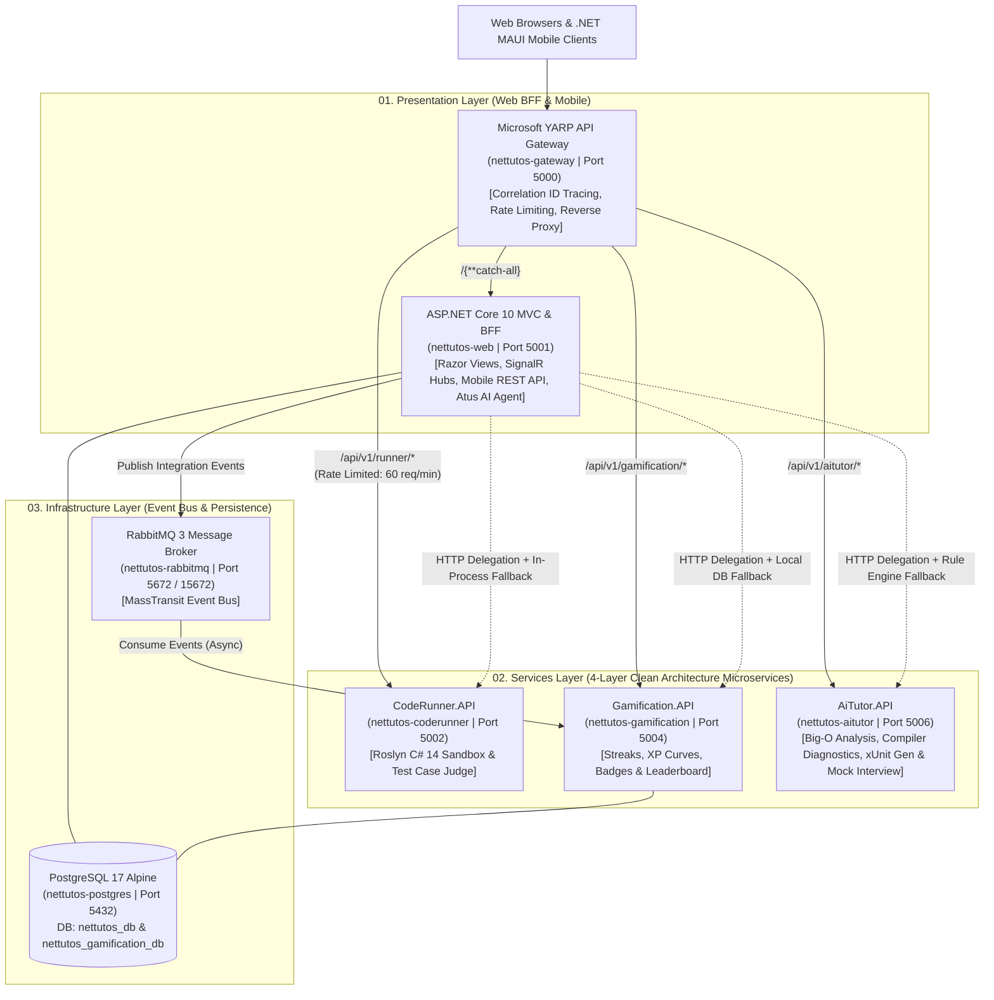

# NET-Tutos

[](https://dotnet.microsoft.com/)
[](https://learn.microsoft.com/dotnet/csharp/)
[](docs/09_microservices_architecture_and_migration.md)
[](src/Gateways/Gateway)
[](src/Infrastructure/EventBus)
[](docker-compose.yml)
[](src/Presentation/Mobile)
[](tests/)
[](LICENSE)

**NET-Tutos** is an enterprise-grade, distributed educational ecosystem and Learning Management System (LMS) engineered on **.NET 10** and **C# 14**. Built using **Microservices Architecture**, **4-Layer Clean Architecture (DDD + CQRS)**, and the **Strangler Fig Pattern**, the platform unites a **Microsoft YARP API Gateway**, an **ASP.NET Core 10 MVC** web application (BFF), a cross-platform **.NET MAUI 10** mobile client, isolated **Roslyn**, **Gamification**, and **AI Tutor (Atus)** microservices, **MassTransit + RabbitMQ** event-driven messaging, and **PostgreSQL 17** persistence with automatic zero-downtime fallback.

---

## Table of Contents

- [1. Distributed Microservices Architecture](#1-distributed-microservices-architecture)
  - [System Topology Diagram](#system-topology-diagram)
  - [Core Architectural Pillars](#core-architectural-pillars)
- [2. Solution Structure (`NET-Tutos.slnx`)](#2-solution-structure-net-tutosslnx)
- [3. Microservices & Bounded Contexts](#3-microservices--bounded-contexts)
  - [3.1. Microsoft YARP API Gateway (`NET-Tutos.YarpGateway`)](#31-microsoft-yarp-api-gateway-net-tutosyarpgateway)
  - [3.2. CodeRunner Microservice (`NET-Tutos.CodeRunner.*`)](#32-coderunner-microservice-net-tutoscoderunner)
  - [3.3. Gamification Microservice (`NET-Tutos.Gamification.*`)](#33-gamification-microservice-net-tutosgamification)
  - [3.4. AiTutor Microservice (`NET-Tutos.AiTutor.*`)](#34-aitutor-microservice-net-tutosaitutor)
  - [3.5. Shared BuildingBlocks (`Common` & `EventBus`)](#35-shared-buildingblocks-common--eventbus)
- [4. Key Platform Features](#4-key-platform-features)
- [5. API Reference (Gateway, Microservices & Mobile)](#5-api-reference-gateway-microservices--mobile)
- [6. Technology Stack](#6-technology-stack)
- [7. Getting Started](#7-getting-started)
  - [Option A: Run Full Microservices Ecosystem via Docker Compose (Recommended)](#option-a-run-full-microservices-ecosystem-via-docker-compose-recommended)
  - [Option B: Run Standalone Web App with Automatic Resilient Fallback](#option-b-run-standalone-web-app-with-automatic-resilient-fallback)
  - [Option C: Run the .NET MAUI Mobile Application](#option-c-run-the-net-maui-mobile-application)
  - [Pre-Seeded Demo Accounts](#pre-seeded-demo-accounts)
- [8. Automated Testing & CI Quality Gates (112/112 Passing)](#8-automated-testing--ci-quality-gates-112112-passing)
- [9. Enterprise Documentation Suite (`docs/`)](#9-enterprise-documentation-suite-docs)
- [10. License](#10-license)

---

## 1. Distributed Microservices Architecture

### System Topology Diagram



### Core Architectural Pillars
1. **Single External Ingress (Microsoft YARP Gateway):** All external requests enter through `NET-Tutos.YarpGateway` on port `5000`, which stamps `X-Correlation-ID` headers for distributed tracing and enforces fixed-window rate limiting (`60 req/min`) on compute-heavy Roslyn compilation routes.
2. **Enterprise 4-Layer Clean Architecture per Microservice:** Each extracted microservice (`CodeRunner`, `Gamification`, `AiTutor`) is strictly partitioned into `Domain`, `Application`, `Infrastructure`, and `API` projects with zero leaky abstractions.
3. **Event-Driven Architecture (MassTransit + RabbitMQ):** Domain actions (solving coding challenges, completing lessons, passing exams) emit integration events (`ChallengeSolvedIntegrationEvent`, `LessonCompletedIntegrationEvent`, `ExamPassedIntegrationEvent`) consumed asynchronously by `Gamification.API`.
4. **Strangler Fig Resilient Delegation (Zero-Downtime Fallback):** `CodeExecutionService`, `StreakService`, and `AiTutorService` in the Web BFF delegate to their respective microservices over HTTP with aggressive timeouts (5s–8s). If any microservice or Docker container is offline during local development, the Web App automatically falls back to in-process execution and local SQLite storage with **zero user disruption**.

---

## 2. Solution Structure (`NET-Tutos.slnx`)

The repository is organized into 5 explicit architectural folders inside `NET-Tutos.slnx`:

```text
d:\NET-Tutos\
├── NET-Tutos.slnx                              # .NET 10 XML Solution (20 Projects across 5 Layers)
├── docker-compose.yml                          # 7-Container Orchestration (Gateway, Web, 3 Microservices, RabbitMQ, PostgreSQL)
├── README.md                                   # Microservices & Platform Documentation
├── docs/                                       # Single Source of Truth (SSOT) Architecture & BRD/NFR Specifications
│
├── src/
│   ├── Gateways/                               # [00. Gateways Layer]
│   │   └── Gateway/                            # Microsoft YARP API Gateway, Rate Limiter & CorrelationIdMiddleware
│   │
│   ├── Presentation/                           # [01. Presentation Layer]
│   │   ├── Web/                                # ASP.NET Core 10 MVC, BFF, SignalR Hubs & Mobile REST APIs
│   │   └── Mobile/                             # Cross-Platform .NET MAUI 10 Native Client (MVVM Toolkit)
│   │
│   ├── Services/                               # [02. Services Layer — 4-Layer Clean Architecture Microservices]
│   │   ├── CodeRunner/                         # Isolated Roslyn C# 14 Compilation & Online Judge Microservice
│   │   │   ├── NET-Tutos.CodeRunner.Domain/
│   │   │   ├── NET-Tutos.CodeRunner.Application/
│   │   │   ├── NET-Tutos.CodeRunner.Infrastructure/
│   │   │   └── NET-Tutos.CodeRunner.API/
│   │   ├── Gamification/                       # Event-Driven Streaks, XP, Badges & Leaderboard Microservice
│   │   │   ├── NET-Tutos.Gamification.Domain/
│   │   │   ├── NET-Tutos.Gamification.Application/
│   │   │   ├── NET-Tutos.Gamification.Infrastructure/
│   │   │   └── NET-Tutos.Gamification.API/
│   │   └── AiTutor/                            # Algorithmic Big-O, Diagnostics, xUnit Gen & Mock Interview Microservice
│   │       ├── NET-Tutos.AiTutor.Domain/
│   │       ├── NET-Tutos.AiTutor.Application/
│   │       ├── NET-Tutos.AiTutor.Infrastructure/
│   │       └── NET-Tutos.AiTutor.API/
│   │
│   └── Infrastructure/                         # [03. Infrastructure Layer — Shared BuildingBlocks]
│       ├── Common/                             # ApiResponse<T> & Result<T> functional primitives
│       └── EventBus/                           # IIntegrationEvent & MassTransit domain event contracts
│
└── tests/                                      # [04. Tests Layer — 112 Automated Tests]
    ├── NET-Tutos.Gateway.Tests/                # YARP Gateway routing, status & X-Correlation-ID tests
    ├── NET-Tutos.CodeRunner.Tests/             # Roslyn sandbox, AST security blacklist & timeout tests
    ├── NET-Tutos.Gamification.Tests/           # Streak domain rules, XP ledger & MassTransit consumer tests
    ├── NET-Tutos.AiTutor.Tests/                # Big-O complexity rules, 3D rubric value objects & AI engine tests
    ├── NET-Tutos.UnitTests/                    # Web BFF services, Atus AI Agent tool-calling & exam tests
    └── NET-Tutos.IntegrationTests/             # End-to-end HTTP pipeline, security & anti-forgery tests
```

---

## 3. Microservices & Bounded Contexts

### 3.1. Microsoft YARP API Gateway (`NET-Tutos.YarpGateway`)
- **Port:** `5000` (External Ingress)
- **Responsibilities:**
  - Reverse proxies `/api/v1/runner/{**catch-all}` ➔ `coderunner-cluster` (`:5002`)
  - Reverse proxies `/api/v1/gamification/{**catch-all}` ➔ `gamification-cluster` (`:5004`)
  - Reverse proxies `/api/v1/aitutor/{**catch-all}` ➔ `aitutor-cluster` (`:5006`)
  - Reverse proxies `/{**catch-all}` ➔ `web-cluster` (`:5001`)
  - Injects and propagates `X-Correlation-ID` across upstream HTTP calls (`CorrelationIdMiddleware`).
  - Enforces `runner-policy` Fixed-Window Rate Limiting (`60 requests/minute`) on code execution routes.

### 3.2. CodeRunner Microservice (`NET-Tutos.CodeRunner.*`)
- **Port:** `5002` (`nettutos-coderunner`)
- **Architecture:**
  - **Domain:** `SourceCode` and `ExecutionTimeout` Value Objects, `ExecutionConstraints` blacklist blocking `System.IO`, `System.Diagnostics.Process`, `System.Net.Sockets`, `System.Reflection.Emit`, and `Environment.Exit`.
  - **Application:** `ICodeRunnerEngine`, `ExecuteScriptCommand`, `EvaluateChallengeCommand`.
  - **Infrastructure:** `RoslynCodeRunnerEngine` powered by `Microsoft.CodeAnalysis.CSharp.Scripting` 5.0 with deterministic cancellation tokens and stdout capture.
  - **API:** Minimal API endpoints (`/api/v1/runner/execute`, `/api/v1/runner/evaluate`, `/healthz`) and RFC 7807 `GlobalExceptionHandlerMiddleware`.

### 3.3. Gamification Microservice (`NET-Tutos.Gamification.*`)
- **Port:** `5004` (`nettutos-gamification`)
- **Database:** Isolated PostgreSQL database (`nettutos_gamification_db`) with EF Core 10 Fluent API `IEntityTypeConfiguration<T>` mappings.
- **Architecture:**
  - **Domain:** Aggregate roots & entities (`UserStreak`, `DailyCheckIn`, `Badge`, `UserBadge`, `UserXpRecord`), Value Objects (`XpValue`, `StreakCount`), and domain events (`StreakMilestoneReachedDomainEvent`, `BadgeUnlockedDomainEvent`).
  - **Application:** CQRS handlers (`CheckInCommand`, `AwardXpCommand`, `GetUserStreakQuery`, `GetUserBadgesQuery`, `GetLeaderboardQuery`).
  - **Infrastructure:** `GamificationDbContext` and **MassTransit RabbitMQ Consumers** (`ChallengeSolvedConsumer`, `LessonCompletedConsumer`, `ExamPassedConsumer`).
  - **API:** Modular Minimal API groups (`/api/v1/gamification/streak/*`, `/api/v1/gamification/badges`, `/api/v1/gamification/leaderboard`).

### 3.4. AiTutor Microservice (`NET-Tutos.AiTutor.*`)
- **Port:** `5006` (`nettutos-aitutor`)
- **Architecture:**
  - **Domain:** `EfficiencyScore` and `InterviewRubricScore` (weighted 50% Technical Accuracy, 25% Clarity & Structure, 25% Practical Depth) Value Objects, `ComplexityTier` & `InterviewReadinessTier` enums, and `AiAnalysisRules` static complexity detector.
  - **Application:** `IAiTutorEngine`, CQRS command handlers (`AnalyzeComplexityCommand`, `ExplainErrorCommand`, `GenerateUnitTestCommand`, `DiagnoseTestFailureCommand`, `EvaluateInterviewCommand`).
  - **Infrastructure:** `DeterministicAiTutorEngine` delivering bilingual (Vietnamese & English) Big-O analysis, compiler error remediation (`CS0103`, `CS0029`, `CS1002`, etc.), xUnit AAA test synthesis, Socratic hints, and 3D technical interview grading.
  - **API:** Minimal API endpoints under `/api/v1/aitutor/*` and `/api/v1/aitutor/interview/*`.

### 3.5. Shared BuildingBlocks (`Common` & `EventBus`)
- **`NET-Tutos.BuildingBlocks.Common`:** Standardized `ApiResponse<T>` JSON envelope and `Result<T>` functional error-handling primitives shared across all services.
- **`NET-Tutos.BuildingBlocks.EventBus`:** Strongly-typed integration event records (`IIntegrationEvent`, `ChallengeSolvedIntegrationEvent`, `LessonCompletedIntegrationEvent`, `ExamPassedIntegrationEvent`) published over RabbitMQ.

---

## 4. Key Platform Features

1. **101-Lesson Curriculum & 4-Stage Mastery Roadmap:** Structured progression from C# 14 Fundamentals ➔ OOP, Memory & LINQ ➔ EF Core 10 & SQL Performance ➔ ASP.NET Core 10 MVC, Web API & Clean Microservices.
2. **In-Browser Monaco IDE & Online Judge:** VS Code's Monaco Editor with keyboard shortcuts (`Ctrl+Enter` to run, `Ctrl+I` for AI Mentor), hidden unit test cases, execution timing, and automated XP rewards.
3. **"Atus" Autonomous AI Agent:** Multi-turn conversational AI Mentor with persistent chat history (`AiConversation`), internal **Function Calling (Tools)** (`execute_csharp_code`, `search_curriculum`, `get_challenge_details`), Big-O complexity analyzer, test failure diagnostics, and xUnit generator.
4. **AI Tech Lead Mock Interview Simulator:** Timed 5-question technical interviews with **Web Speech API (Speech-to-Text)** voice dictation, 3-dimensional rubric grading, interactive follow-up challenges, and 5-dimension competency reports.
5. **Timed Certification Exams, Vector PDF & QR Verification:** Dynamic exam pools, instant grading, vector PDF certificates generated via **QuestPDF**, and cryptographic **QRCoder** verification (`/verify-certificate/{code}`).
6. **Real-Time SignalR Community Q&A & Activity Feed:** Live lesson discussion threads (`DiscussionHub`), peer upvoting, "Accepted Solution" rewards (+15 XP), and real-time notifications (`NotificationHub`).
7. **Cross-Platform .NET MAUI 10 Mobile App:** Native Android/iOS/Windows client with JWT authentication, lesson reading, 4-stage roadmap tracking, 3D flip interview flashcards (Leitner spaced repetition), and bidirectional streak/XP sync.
8. **Capstone Project Studio, Public Portfolios (`/u/{username}`) & Admin CMS:** Split-screen Markdown authoring studio, cohort KPI dashboard, capstone GitHub review workflow, Offline-First PWA, universal Command Palette (`Ctrl+K`), and full bilingual localization (Vietnamese & English).

---

## 5. API Reference (Gateway, Microservices & Mobile)

| Service / Layer | Endpoint | Method | Description |
| :--- | :--- | :---: | :--- |
| **YARP Gateway** | `/healthz` | `GET` | Gateway liveness & readiness health check |
| **YARP Gateway** | `/api/v1/gateway/status` | `GET` | Returns active YARP reverse proxy clusters and route topology |
| **CodeRunner.API** | `/api/v1/runner/execute` | `POST` | Compiles and executes C# 14 code in an isolated Roslyn sandbox |
| **CodeRunner.API** | `/api/v1/runner/evaluate` | `POST` | Judges a coding challenge submission against public/hidden test cases |
| **Gamification.API** | `/api/v1/gamification/streak/{userId}` | `GET` | Retrieves current/longest streak and next milestone countdown |
| **Gamification.API** | `/api/v1/gamification/streak/check-in` | `POST` | Records daily check-in, increments streak, and awards bonus XP |
| **Gamification.API** | `/api/v1/gamification/badges` | `GET` | Lists achievement badge catalog and user unlock status |
| **Gamification.API** | `/api/v1/gamification/leaderboard` | `GET` | Retrieves global top learners ranked by total XP and streak |
| **AiTutor.API** | `/api/v1/aitutor/chat` | `POST` | Conversational C#/.NET mentorship with Atus AI engine |
| **AiTutor.API** | `/api/v1/aitutor/analyze-complexity` | `POST` | Evaluates algorithmic Big-O time/space complexity & efficiency score |
| **AiTutor.API** | `/api/v1/aitutor/explain-error` | `POST` | Diagnoses C# compiler (`CSxxxx`) or runtime errors with fixes |
| **AiTutor.API** | `/api/v1/aitutor/diagnose-failure` | `POST` | Identifies root cause (Edge Case, Off-by-one, Logic Flaw) of failed tests |
| **AiTutor.API** | `/api/v1/aitutor/generate-unit-test` | `POST` | Generates xUnit (`[Fact]`, `[Theory]`) AAA unit test suites |
| **AiTutor.API** | `/api/v1/aitutor/interview/evaluate` | `POST` | Scores interview answers across Technical, Clarity, and Depth rubrics |
| **AiTutor.API** | `/api/v1/aitutor/interview/report` | `POST` | Synthesizes a 5-dimension interview readiness report & study plan |
| **Mobile API (BFF)** | `/api/mobile/auth/login` | `POST` | Authenticates mobile user and issues stateless JWT Bearer token |
| **Mobile API (BFF)** | `/api/mobile/tutorials` | `GET` | Returns paginated lessons, categories, roadmaps, and completion states |
| **Mobile API (BFF)** | `/api/mobile/flashcards` | `GET` | Retrieves spaced-repetition technical interview flashcards |

---

## 6. Technology Stack

| Layer | Technologies |
| :--- | :--- |
| **Runtime & Language** | **.NET 10.0 (`net10.0`)**, **C# 14** |
| **API Gateway & Ingress** | **Microsoft YARP (Yet Another Reverse Proxy)**, ASP.NET Core RateLimiting, Correlation ID Tracing |
| **Microservices & Web BFF** | **ASP.NET Core 10 Minimal APIs** (Microservices) & **ASP.NET Core 10 MVC / Razor** (Web BFF) |
| **Event-Driven Messaging** | **MassTransit 8.3**, **RabbitMQ 3 Management Alpine** (AMQP 0-9-1) |
| **Databases & ORM** | **Entity Framework Core 10.0**, **PostgreSQL 17 Alpine** (Primary), **SQLite** (Instant Fallback), SQL Server |
| **Code Compilation Sandbox** | **Roslyn Scripting API** (`Microsoft.CodeAnalysis.CSharp.Scripting` 5.0) |
| **AI Agent & Intelligence** | **Atus AI Agent** (Function Calling + Multi-Model Fallback Chain + Deterministic Rule Engine) |
| **Mobile Client** | **.NET MAUI 10.0** (Android API 21–36, iOS, Windows), `CommunityToolkit.Mvvm` 8.4 |
| **Real-Time & Documents** | **ASP.NET Core SignalR**, **QuestPDF** (Vector PDF), **QRCoder**, **Markdig** |
| **Frontend UI & Editor** | Bootstrap 5.3, **Monaco Editor**, Prism.js, Web Speech API (STT/TTS), Service Worker PWA |
| **Quality & Testing** | **xUnit 2.9**, **FluentAssertions 7.2**, **Moq 4.20**, **Coverlet**, `WebApplicationFactory`, GitHub Actions CI |

---

## 7. Getting Started

### Prerequisites
- [.NET 10.0 SDK](https://dotnet.microsoft.com/download/dotnet/10.0)
- [Docker Desktop](https://www.docker.com/products/docker-desktop/) (for full 7-container microservices orchestration)
- *(Optional)* `.env` file at repository root with `GEMINI_API_KEY=your_api_key` to enable live cloud LLM responses alongside the built-in offline engine.

---

### Option A: Run Full Microservices Ecosystem via Docker Compose (Recommended)

Launch all 7 containers (`gateway`, `web`, `coderunner`, `gamification`, `aitutor`, `rabbitmq`, `postgres`) with a single command:

```powershell
docker compose up -d --build
```

| Container Name | Service Role | Host Port | Internal URL |
| :--- | :--- | :---: | :--- |
| **`nettutos-gateway`** | **YARP API Gateway (Main Entry Point)** | **`http://localhost:5000`** | `http://gateway:8080` |
| **`nettutos-web`** | ASP.NET Core 10 MVC Web App & Swagger UI | `http://localhost:5001` | `http://web:5000` |
| **`nettutos-coderunner`** | Roslyn Code Execution & Judge Microservice | `http://localhost:5002` | `http://coderunner:8080` |
| **`nettutos-gamification`** | Streaks, XP, Badges & Leaderboard Microservice | `http://localhost:5004` | `http://gamification:8080` |
| **`nettutos-aitutor`** | AI Complexity, Diagnostics & Interview Microservice | `http://localhost:5006` | `http://aitutor:8080` |
| **`nettutos-rabbitmq`** | RabbitMQ 3 Broker & Management Dashboard | `http://localhost:15672` | `amqp://rabbitmq:5672` |
| **`nettutos-postgres`** | PostgreSQL 17 Database Server | `localhost:5432` | `postgres:5432` |

---

### Option B: Run Standalone Web App with Automatic Resilient Fallback

Thanks to the **Strangler Fig Resilient Fallback** architecture, you can also run the Web Application directly with the .NET CLI without starting Docker—it will automatically fall back to local **SQLite** (`dotnet_tutorials.db`) and in-process engines:

```powershell
# 1. Build the entire 20-project solution
dotnet build NET-Tutos.slnx

# 2. Launch the Web Application
dotnet run --project src/Presentation/Web/web.csproj
```

Then open **`http://localhost:5000`** (or **`http://localhost:5262`**) and explore Swagger API docs at **`/swagger`**.

---

### Option C: Run the .NET MAUI Mobile Application

1. Ensure the backend is running on port `5000` (Android emulators connect to host `localhost:5000` via `10.0.2.2:5000`).
2. Build and deploy the `.NET MAUI` Android client:
   ```powershell
   dotnet build src/Presentation/Mobile/NET_Tutos.Mobile.csproj -t:Run -f net10.0-android
   ```

---

### Pre-Seeded Demo Accounts

The platform automatically seeds all 101 lessons, coding challenges, interview flashcards, and demo accounts on startup (`DbInitializer.cs`):

| Role | Email | Password | Highlights |
| :--- | :--- | :--- | :--- |
| **Administrator** | `admin@nettutos.com` | `AdminPassword@123` | Full access to LMS Admin CMS Studio, analytics, quiz manager, capstone grading & user moderation. |
| **Demo Student** | `student@nettutos.com` | `StudentPassword@123` | Pre-enrolled learner with 350 XP, 5-day active streak, badges, and progress history. |

---

## 8. Automated Testing & CI Quality Gates (112/112 Passing)

Every microservice, gateway route, domain value object, and web service is verified by **112 automated tests** across 6 test projects (enforced on every push/PR via [`.github/workflows/ci.yml`](.github/workflows/ci.yml)):

```powershell
# 1. YARP API Gateway routing, topology & X-Correlation-ID tests (4 tests)
dotnet test tests/NET-Tutos.Gateway.Tests/NET-Tutos.Gateway.Tests.csproj

# 2. CodeRunner microservice domain rules & Roslyn sandbox tests (11 tests)
dotnet test tests/NET-Tutos.CodeRunner.Tests/NET-Tutos.CodeRunner.Tests.csproj

# 3. Gamification microservice domain, streak & MassTransit consumer tests (16 tests)
dotnet test tests/NET-Tutos.Gamification.Tests/NET-Tutos.Gamification.Tests.csproj

# 4. AiTutor microservice Big-O rules, 3D rubric value objects & engine tests (16 tests)
dotnet test tests/NET-Tutos.AiTutor.Tests/NET-Tutos.AiTutor.Tests.csproj

# 5. Web BFF unit tests (Streak, Exam, CodeExecution, AiTutor, Atus Agent) (53 tests)
dotnet test tests/NET-Tutos.UnitTests/NET-Tutos.UnitTests.csproj

# 6. End-to-End HTTP integration pipeline & security tests (12 tests)
dotnet test tests/NET-Tutos.IntegrationTests/NET-Tutos.IntegrationTests.csproj
```

---

## 9. Enterprise Documentation Suite (`docs/`)

Detailed architectural blueprints, sequence diagrams, ERDs, and requirements specifications are maintained in [`docs/`](docs/README.md):

- [**01. Business Overview & Value Proposition**](docs/01_business_overview.md)
- [**02. System Architecture Overview & Sequence Flows**](docs/02_system_architecture_overview.md)
- [**03. Functional Requirements Document (BRD)**](docs/03_functional_requirements_brd.md)
- [**04. Non-Functional Requirements (NFR) & SLAs**](docs/04_non_functional_requirements.md)
- [**05. Data Models (ERD) & RESTful API Specifications**](docs/05_data_models_and_api_specs.md)
- [**06. Clean Code Blueprint, 23-Table ERD & UI/UX Wireframes**](docs/06_architecture_and_design_blueprint.md)
- [**07. PostgreSQL 17 & Docker Compose Infrastructure**](docs/07_docker_and_database_setup.md)
- [**08. Automated Testing Strategy & Exception Matrix**](docs/08_testing_strategy_and_test_cases.md)
- [**09. Microservices Architecture, 4-Layer DDD & Strangler Fig Migration**](docs/09_microservices_architecture_and_migration.md)
- [**10. Master Project Roadmap & AI Context Memory (SSOT)**](docs/10_project_roadmap_and_ai_memory.md)
- [**DESIGN. Frontend Design System & Anti-AI-Slop Constitution**](docs/DESIGN.md)

---

## 10. License

**NET-Tutos** (`NET-Tutos.slnx` — 20 Projects across YARP Gateway, ASP.NET Core 10 MVC BFF, .NET MAUI 10 Mobile, `CodeRunner`, `Gamification`, `AiTutor` Microservices, and Shared BuildingBlocks) is licensed under the **MIT License**.

**Copyright © 2026 Khải Võ & NET-Tutos Engineering.** All rights reserved under the terms of the [MIT License](LICENSE).
