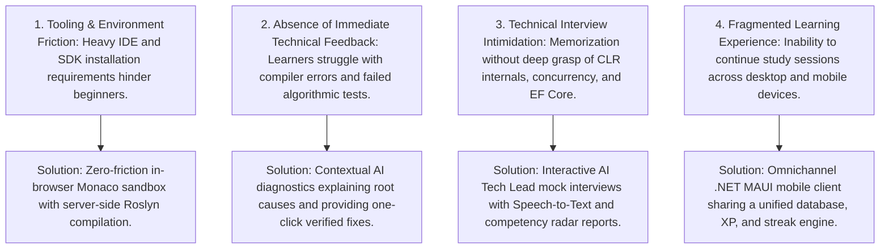

# 01. Business Overview & Value Proposition

Document Type: Business Requirements Specification  
Role: Senior Business Analyst  
System: .NET Tutos - Comprehensive .NET Learning & Assessment Platform  
Version: 2.0 (Integrated Web App, Mobile App, and AI Engine)  
Status: Approved  

---

## 1. Executive Summary

.NET Tutos is an enterprise-grade learning, hands-on practice, and technical assessment ecosystem built on modern Microsoft .NET technologies (.NET 10 / C# 14). The platform directly bridges the gap between academic theory and enterprise-level engineering standards.

The ecosystem comprises three synchronized components:
1. Web Application: Delivers a standardized 101-lesson curriculum, an in-browser Monaco Editor sandbox powered by the Roslyn Scripting API, an intelligent AI Mentor for algorithmic code review, an AI-driven technical interview simulator, and gamification mechanisms.
2. Mobile Client (.NET MAUI): Allows learners to read course materials, review concepts, maintain study streaks, and synchronize progress bidirectionally with the Web Application.
3. AI Assistance & Assessment Engine: Acts as a virtual Senior Tech Lead to analyze Big-O complexity, diagnose failing test cases, generate automated xUnit test suites, and assess candidates against industry hiring benchmarks.

---

## 2. Industry Context & Problem Statements



### Market Gaps Addressed
1. Setup and Environmental Overhead: Novice engineers frequently face configuration hurdles when installing multi-gigabyte SDKs and IDEs before writing their first line of executable C# code.
2. Passive Learning Limitations: Conventional educational portals offer static text or prerecorded videos without actionable feedback. When learners encounter runtime exceptions or algorithmic bottlenecks, they lack structured guidance on memory allocations, thread safety, or state mutations.
3. Employment Readiness Gap: Candidates often memorize syntactical definitions but fail technical hiring interviews due to unfamiliarity with production edge cases (such as N+1 query overhead, deadlocks in synchronization contexts, boxing/unboxing costs, and Large Object Heap allocations).
4. Low Retention and Completion Rates: Educational applications without gamified milestones or cross-platform continuity experience high drop-off rates.

---

## 3. Strategic Objectives & Value Propositions

| Dimension | Core Value Proposition | Key Performance Indicators (KPIs) |
| :--- | :--- | :--- |
| Zero-Friction Learning | Instant coding in modern C# 14 through an in-browser sandbox without requiring local runtime installations. | Time-to-first-execution < 60 seconds from initial registration. |
| Intelligent Immediate Feedback | Automated compilation error analysis, algorithmic Big-O complexity scoring, and dynamic xUnit test generation. | 75% reduction in learner block time during coding challenges. |
| Enterprise-Grade Interview Readiness | Interactive mock interviews conducted by an AI Tech Lead with verbal dictation, three-dimensional scoring, and targeted lesson recommendations. | 90% of active learners demonstrate passing scores on core .NET architectural topics. |
| Omnichannel Data Continuity | Seamless synchronization across Web and Mobile (.NET MAUI) clients powered by a single relational database and authentication pipeline. | 30-day learner retention rate exceeding 45%. |
| Gamified Engagement | Daily learning streaks, experience points (XP), leveled progressions, and a public Hall of Fame. | Average session duration > 25 minutes per active learner. |

---

## 4. Target User Personas

### Persona 1: University Student / Aspiring Junior .NET Developer
- Primary Objective: Master C# fundamentals and ASP.NET Core architecture to secure an entry-level engineering role.
- Pain Points: Overwhelmed by disparate online tutorials; lack of guided feedback when compiler diagnostics appear; anxiety regarding technical interview rounds.
- Platform Value: Structured 7-module curriculum, step-by-step Socratic hints in the coding playground, and spaced-repetition interview flashcards on mobile.

### Persona 2: Junior Developer Seeking Mid-to-Senior Advancement
- Primary Objective: Solidify knowledge of CLR internals, asynchronous concurrency patterns, and EF Core query tuning.
- Pain Points: Daily work is restricted to basic CRUD tasks; insufficient exposure to production trade-offs, architecture patterns, and memory optimization.
- Platform Value: In-depth Big-O complexity analysis, failure diagnostics on complex algorithmic challenges, and situational follow-up questioning from the AI Tech Lead.

### Persona 3: LMS Training Instructor / Enterprise Lead
- Primary Objective: Monitor learner cohorts, review capstone project submissions, and maintain high completion rates.
- Pain Points: Manual grading is time-consuming; difficult to identify individual knowledge gaps across large cohorts.
- Platform Value: Centralized administrative dashboard, automated challenge evaluation, and structured capstone submission workflows.

---

## 5. User Journey Map

```mermaid
journey
    title End-to-End Learner Journey on the .NET Tutos Platform
    section Discovery & Onboarding
      Access landing portal and review curriculum roadmap: 5: Learner
      Inspect interactive syllabus and read initial lesson: 5: Learner
      Register unified account via Web or Mobile client: 5: Learner
    section Hands-on Practice
      Launch Monaco Playground and execute initial C# script: 5: Learner
      Attempt coding challenge and encounter failing test case: 3: Learner
      Trigger AI Diagnostics and Big-O Complexity analyzer: 5: Learner, AI Mentor
      Apply verified fix, pass tests, and earn XP: 5: Learner
    section Technical Assessment
      Initiate AI Mock Technical Interview session: 5: Learner
      Dictate response via Web Speech microphone: 5: Learner
      Receive AI Tech Lead evaluation, tackle follow-up challenge: 5: Learner, AI Tech Lead
      Review comprehensive competency report and recommended lessons: 5: Learner
    section Continuity & Mastery
      Open .NET MAUI mobile app while commuting: 5: Learner
      Review daily flashcards and maintain learning streak: 5: Learner
      Verify synced XP and milestones across devices: 5: Learner
```
