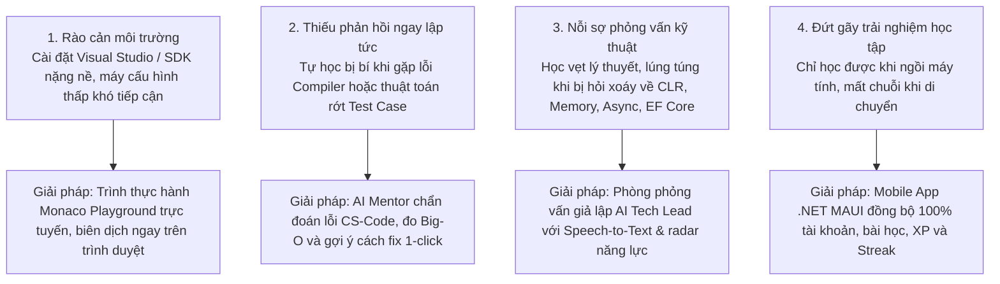
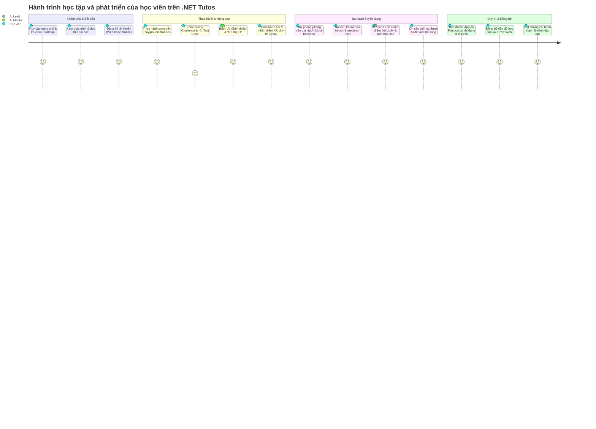

# 01. TỔNG QUAN KINH DOANH & ĐỀ XUẤT GIÁ TRỊ (BUSINESS OVERVIEW & VALUE PROPOSITION)

> **Tài liệu đặc tả phân tích nghiệp vụ (Business Analysis Specification)**  
> **Chức danh thực hiện:** Senior Business Analyst  
> **Hệ thống:** Nền tảng Học tập & Đào tạo Lập trình .NET Toàn diện (.NET Tutos Platform)  
> **Phiên bản:** 2.0 (Hợp nhất Web App, Mobile App & AI Assistant Engine)  
> **Ngày phê duyệt:** Tháng 10/2026  

---

## 1. Tóm tắt dự án (Executive Summary)

**.NET Tutos** là hệ sinh thái đào tạo, thực hành và sát hạch lập trình chuyên sâu chuẩn Microsoft .NET hiện đại (.NET 10 / C# 14). Hệ thống giải quyết khoảng cách cố hữu giữa kiến thức lý thuyết trong trường lớp và kỹ năng thực chiến tại các doanh nghiệp phần mềm.

Hệ thống bao gồm 3 trụ cột liên kết chặt chẽ:
1. **Nền tảng Web App:** Cung cấp lộ trình 101 bài học chuẩn hóa, trình biên dịch trực tuyến Monaco Sandbox (Roslyn Engine), trợ lý AI Mentor phân tích thuật toán, phòng phỏng vấn kỹ thuật giả lập (AI Mock Interview) và cơ chế Gamification thúc đẩy động lực.
2. **Ứng dụng Di động (Mobile App .NET MAUI):** Hỗ trợ học viên tra cứu giáo trình, ôn tập kiến thức, duy trì chuỗi Streak và đồng bộ dữ liệu hai chiều với Web App mọi lúc, mọi nơi.
3. **Bộ não Trợ lý AI (AI Tutor & Interview Engine):** Đóng vai trò Senior Mentor phản biện trực tiếp, phân tích độ phức tạp Big-O, tự động tạo bộ kiểm thử xUnit và chấm điểm sát hạch phỏng vấn theo chuẩn tuyển dụng thực tế.

---

## 2. Bối cảnh thị trường & Vấn đề thực tế (Problem Statements)

### Các khoảng trống thị trường (Market Gaps)
1. **Rào cản thiết bị & thiết lập:** Người mới bắt đầu thường gặp khó khăn với việc cấu hình SDK, runtime, tooling phức tạp trước khi viết được dòng code C# đầu tiên.
2. **Thiếu cơ chế phản biện có chiều sâu:** Các nền tảng học trực tuyến thông thường chỉ hiển thị video hoặc text tĩnh; khi gặp lỗi logic hoặc biên dịch, người học mất hàng giờ tìm kiếm mà không hiểu bản chất CLR hay nguyên lý hoạt động bên dưới.
3. **Thiếu sự chuẩn bị cho tuyển dụng thực tế:** Học viên có thể giải được bài tập cú pháp nhưng thất bại tại vòng Technical Interview do không biết cách diễn đạt, thiếu kiến thức về bẫy hiệu năng (N+1 query, deadlocks, boxing/unboxing, LOH allocations).
4. **Tỷ lệ bỏ dở cao (High Dropout Rate):** Thiếu cơ chế giữ chân (retention) bằng Gamification và thiếu sự đồng bộ liền mạch giữa các thiết bị di động.

---

## 3. Mục tiêu chiến lược & Đề xuất giá trị (Value Propositions & Strategic Goals)

| Khía cạnh | Đề xuất giá trị cốt lõi (.NET Tutos Value Proposition) | Chỉ số đo lường thành công (KPIs) |
| :--- | :--- | :--- |
| **Học tập không rào cản (Zero-friction Learning)** | Mở trình duyệt là code được ngay với Roslyn C# Sandbox (.NET 10), không cần cài đặt bất kỳ phần mềm nào. | Thời gian từ khi đăng ký đến dòng code chạy đầu tiên < 60 giây. |
| **Phản hồi tức thì với AI (Instant Intelligent Feedback)** | Nhận chẩn đoán lỗi biên dịch, phân tích độ phức tạp Big-O ($O(1) \dots O(2^N)$), và tạo mã xUnit tự động. | Giảm 75% thời gian bế tắc khi giải Coding Challenges. |
| **Sát hạch tuyển dụng chuẩn Senior (Recruitment Readiness)** | Phỏng vấn giả lập 1-1 với AI Lead Architect, hỗ trợ nói qua Micro, chấm điểm 3 tiêu chí và xuất báo cáo radar năng lực. | 90% học viên tự tin vượt qua vòng phỏng vấn kỹ thuật .NET. |
| **Đồng bộ đa nền tảng xuyên suốt (Omnichannel Continuity)** | Học trên Web tại văn phòng/ở nhà, ôn flashcards và duy trì Streak trên Mobile App khi đang di chuyển. | Tăng tỷ lệ giữ chân 30 ngày (Day-30 Retention) lên trên 45%. |
| **Động lực thông qua Gamification** | Hệ thống chuỗi học tập (Streak), điểm kinh nghiệm (XP), bảng vinh danh (Hall of Fame) và dự án Capstone thực tế. | Tăng thời gian tương tác trung bình mỗi phiên học lên > 25 phút. |

---

## 4. Chân dung người dùng mục tiêu (User Personas)

### Persona 1: Nguyễn Văn An - Sinh viên CNTT / Fresher .NET
- **Mục tiêu:** Nắm vững nền tảng C# và ASP.NET Core để xin việc thực tập hoặc vị trí Junior Developer.
- **Nỗi đau (Pain Points):** Chưa có kinh nghiệm thực chiến; sợ phỏng vấn lý thuyết; dễ nản khi gặp lỗi compiler mà không có ai hướng dẫn.
- **Giá trị nhận được từ hệ thống:**
  - Lộ trình 101 bài học chuẩn hóa từng bước.
  - Sát hạch code trong Playground có AI gợi ý Socratic hints.
  - Ôn luyện bộ câu hỏi phỏng vấn flashcards trên điện thoại mỗi ngày.

### Persona 2: Trần Thị Bích - Junior .NET Developer (1-2 năm kinh nghiệm)
- **Mục tiêu:** Nâng cấp năng lực chuyên sâu, chinh phục mức lương Middle / Senior .NET Developer.
- **Nỗi đau (Pain Points):** Chỉ biết làm CRUD thông thường; thiếu hiểu biết về bản chất CLR internals, tối ưu EF Core, xử lý Async/Concurrency và Clean Architecture.
- **Giá trị nhận được từ hệ thống:**
  - Thử thách Coding Challenge có đo đạc độ phức tạp thuật toán Big-O.
  - Phòng phỏng vấn giả lập AI Lead Architect với các câu hỏi xoáy thực chiến.
  - Đề xuất các bài học khắc phục chính xác điểm yếu kiến thức.

### Persona 3: Lê Hoàng Nam - Giảng viên / Quản trị viên đào tạo (Instructor / LMS Admin)
- **Mục tiêu:** Quản trị nội dung đào tạo, theo dõi tiến độ của học viên, đánh giá bài nộp dự án Capstone.
- **Nỗi đau (Pain Points):** Khó theo dõi tiến độ chi tiết của từng cá nhân; chấm bài tập thủ công tốn thời gian.
- **Giá trị nhận được từ hệ thống:**
  - Bảng điều khiển Quản trị LMS Admin trực quan.
  - Hệ thống tự động chấm điểm bài tập code và trắc nghiệm.
  - Quản lý quy trình duyệt dự án Capstone chuyên nghiệp.

---

## 5. Bản đồ hành trình người dùng (User Journey Map)

