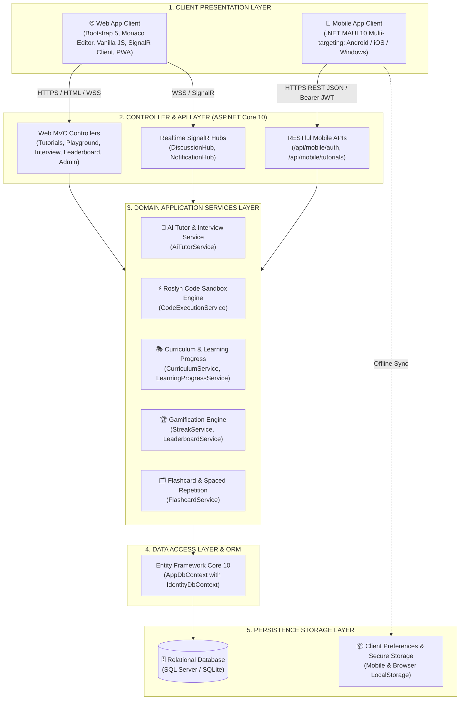
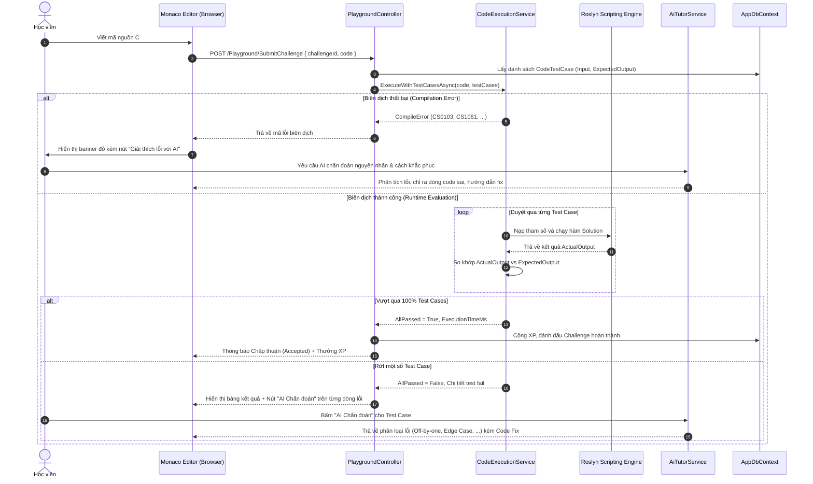
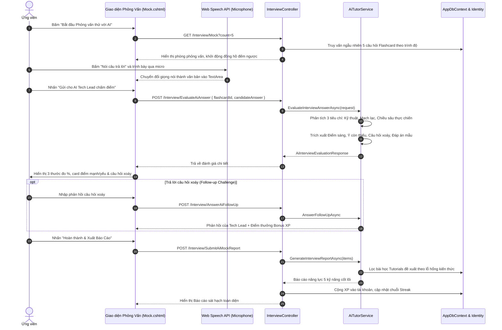
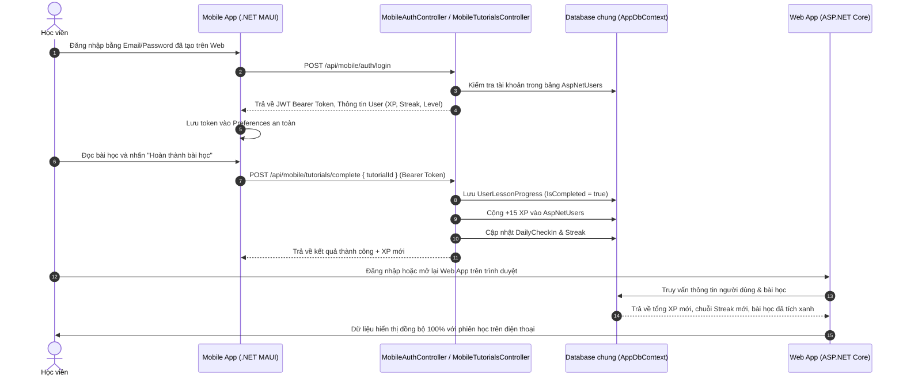

# 02. KIẾN TRÚC HỆ THỐNG TỔNG THỂ (SYSTEM ARCHITECTURE OVERVIEW)

> **Tài liệu đặc tả kiến trúc kỹ thuật & giải pháp (Technical Solution Architecture)**  
> **Chức danh thực hiện:** Senior Business Analyst / Solution Specialist  
> **Hệ thống:** Nền tảng Học tập & Đào tạo Lập trình .NET Toàn diện (.NET Tutos Platform)  
> **Phiên bản:** 2.0  

---

## 1. Cấu trúc hệ sinh thái tổng thể (System Ecosystem Topology)

Hệ sinh thái **.NET Tutos** được thiết kế theo mô hình kiến trúc phân tầng (Multi-tier N-Layered Architecture) kết hợp kiến trúc dịch vụ kết nối (Service-Oriented Core) để phục vụ đồng thời Web App và Mobile App trên cùng một nền tảng dữ liệu thống nhất:

---

## 2. Công nghệ cốt lõi & Tiêu chuẩn kỹ thuật (Tech Stack Specifications)

| Thành phần | Công nghệ / Framework | Phiên bản | Vai trò & Mục đích sử dụng |
| :--- | :--- | :--- | :--- |
| **Backend Framework** | ASP.NET Core MVC | .NET 10 | Máy chủ ứng dụng trung tâm, xử lý rendering giao diện Web và cung cấp REST API cho Mobile. |
| **Mobile Framework** | .NET MAUI (Multi-platform App UI) | .NET 10 | Ứng dụng di động đa nền tảng (Android, iOS, Windows) viết bằng C# và XAML. |
| **Data Access / ORM** | Entity Framework Core | 10.0 | Thao tác cơ sở dữ liệu hướng đối tượng, quản lý Migration, tối ưu hóa truy vấn qua `IQueryable` và `AsNoTracking`. |
| **Cơ sở dữ liệu** | Microsoft SQL Server / SQLite | 2022 / 3.x | Lưu trữ toàn bộ dữ liệu người dùng, bài học, quiz, tiến độ, coding challenge, điểm số và bài nộp. |
| **Trình soạn thảo Code** | Microsoft Monaco Editor | 0.45.0 | Trình soạn thảo mã nguồn trực tuyến trong Web (tương đương lõi VS Code), hỗ trợ C# syntax, phím tắt `Ctrl+I`, formatting. |
| **Biên dịch & Sandbox** | Roslyn Scripting API (`Microsoft.CodeAnalysis.CSharp.Scripting`) | 4.12+ | Trình biên dịch mã nguồn C# động trên bộ nhớ RAM, bắt lỗi compiler và thực thi sandbox có giới hạn an toàn. |
| **Giao tiếp Realtime** | ASP.NET Core SignalR | .NET 10 | Truyền thông thời gian thực hai chiều cho bảng tin hoạt động (Activity Feed) và thảo luận trực tiếp (Discussion Hub). |
| **Xác thực & Phân quyền** | ASP.NET Core Identity & JWT Bearer | .NET 10 | Quản lý người dùng, mật khẩu mã hóa, phân quyền Role (Learner, Admin), cấp phát JWT token an toàn cho Mobile. |
| **Giao diện Web** | Bootstrap 5, Bootstrap Icons, CSS Modern Variables | 5.3.3 | Giao diện chuẩn Responsive hiện đại, hỗ trợ Dark / Light theme toàn diện. |
| **Nhận diện giọng nói** | Web Speech API (`SpeechRecognition`) | W3C Standard | Chuyển giọng nói tiếng Việt và tiếng Anh thành văn bản trong phòng phỏng vấn kỹ thuật giả lập (AI Mock Interview). |

---

## 3. Kiến trúc luồng dữ liệu (Data Flow Diagrams)

### Luồng 1: Biên dịch và chấm điểm bài tập (Playground & Challenge Judge Engine)

### Luồng 2: Phỏng vấn kỹ thuật giả lập tương tác với AI (AI Mock Technical Interview)

### Luồng 3: Đồng bộ dữ liệu giữa Mobile App và Web App

---

## 4. Chiến lược bảo mật & kiểm soát rủi ro (Security & Isolation Strategy)

1. **Cô lập môi trường chạy mã (Roslyn Sandbox Execution Isolation):**
   - Không cho phép gọi các thư viện nguy hiểm (`System.IO`, `System.Diagnostics.Process`, `System.Reflection`, `System.Net.Sockets`).
   - Giới hạn thời gian thực thi (Execution Timeout $\le 3000\text{ms}$) để triệt tiêu các vòng lặp vô hạn hoặc đệ quy tràn bộ nhớ StackOverflow.
   - Bắt gọn `Console.SetOut()` vào luồng `StringWriter` để ngăn chặn rò rỉ dữ liệu hệ thống.
2. **Bảo mật xác thực & phân quyền (Authentication Security):**
   - Web App áp dụng Cookie Authentication kết hợp Token bảo vệ chống tấn công giả mạo yêu cầu chéo trang (CSRF Protection via AntiForgeryToken).
   - Mobile API áp dụng chuẩn JWT Bearer Token với thuật toán ký bí mật HMAC-SHA256, thời hạn hợp lệ rõ ràng.
3. **Bảo vệ toàn vẹn dữ liệu (Data Protection):**
   - Mã hóa mật khẩu chuẩn PBKDF2 thông qua ASP.NET Core Identity.
   - Chống tấn công SQL Injection bằng cách sử dụng 100% truy vấn tham số hóa (Parameterized Queries) trong Entity Framework Core.
   - Xử lý làm sạch nội dung hiển thị (XSS Sanitization) trên toàn bộ bài viết Markdown và mã HTML đầu ra.
