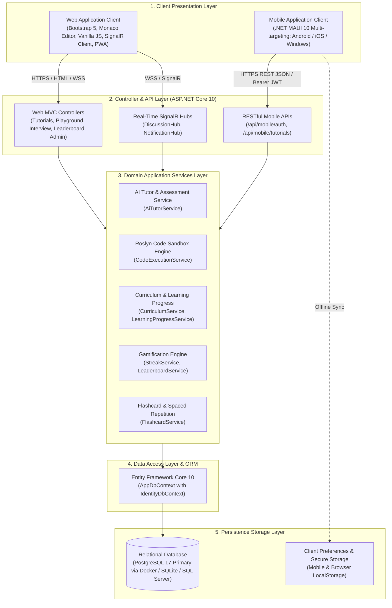
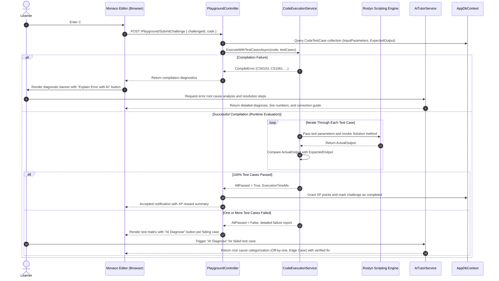
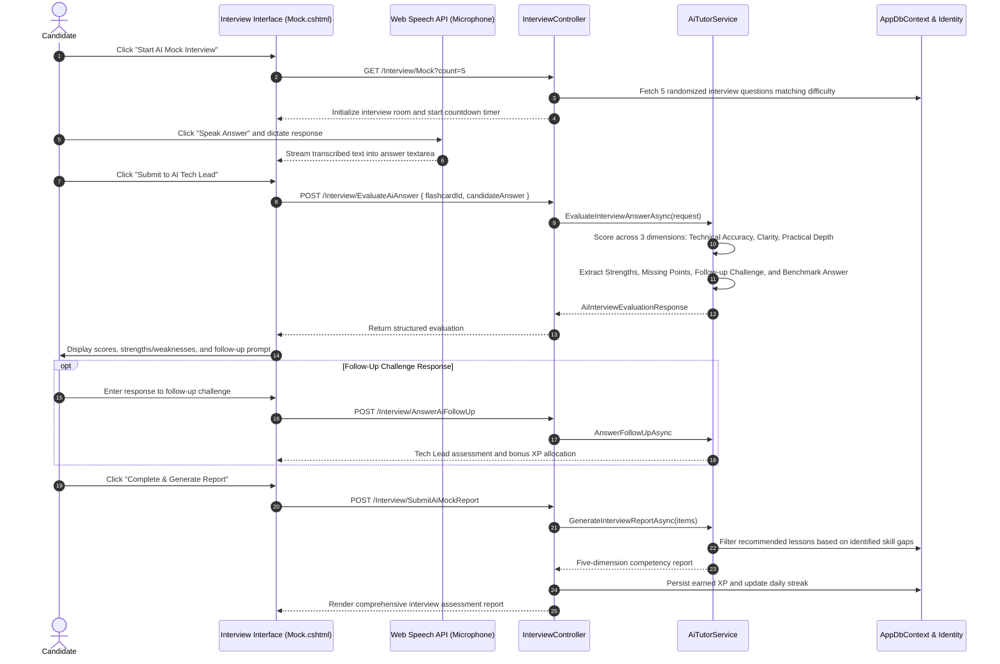
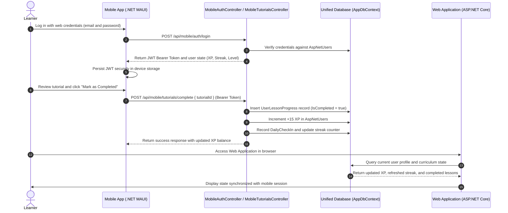

# 02. System Architecture Overview

Document Type: Technical Solution Architecture Specification  
Role: Senior Business Analyst / Enterprise Solution Specialist  
System: .NET Tutos - Comprehensive .NET Learning & Assessment Platform  
Version: 2.0  
Status: Approved  

---

## 1. System Ecosystem Topology

The **.NET Tutos** ecosystem is architected as an N-tier layered system integrated with domain-driven application services. This topology concurrently serves both the responsive Web Application and cross-platform Mobile Clients over a unified relational data tier:

---

## 2. Core Technologies & Technical Stack Specifications

| Component | Technology / Framework | Version | Role & Strategic Purpose |
| :--- | :--- | :--- | :--- |
| **Backend Framework** | ASP.NET Core MVC | .NET 10 | Central application server providing server-rendered HTML views and exposing RESTful APIs for mobile and background clients. |
| **Mobile Framework** | .NET MAUI (Multi-platform App UI) | .NET 10 | Native cross-platform mobile application (Android, iOS, Windows) implemented with C# and XAML. |
| **Data Access / ORM** | Entity Framework Core | 10.0 | Object-relational mapping, database migrations, and high-performance querying using compiled LINQ, `IQueryable`, and `AsNoTracking`. |
| **Relational Database** | PostgreSQL 17 (Primary via Docker Compose) / SQLite / SQL Server | 17.x / 3.x / 2022 | Persistent storage for users, curriculum, progress, coding challenges, test cases, and interview records via Npgsql EF Core. |
| **Containerization** | Docker & Docker Compose | 29.x / 5.x | Comprehensive orchestration for PostgreSQL 17 Alpine, ASP.NET Core 10 Web App, and pgAdmin 4 GUI. |
| **Code Editor** | Microsoft Monaco Editor | 0.45.0 | In-browser code editing engine (VS Code core) providing C# syntax highlighting, shortcut handling (`Ctrl+I`, `Ctrl+Enter`), and code formatting. |
| **Compiler & Sandbox** | Roslyn Scripting API (`Microsoft.CodeAnalysis.CSharp.Scripting`) | 4.12+ | In-memory dynamic compilation and isolated execution of C# code snippets with strict resource and security bounds. |
| **Real-Time Communication** | ASP.NET Core SignalR | .NET 10 | Bidirectional WebSocket transport for activity feeds, discussion threads, and real-time community interactions. |
| **Authentication & Identity** | ASP.NET Core Identity & JWT Bearer | .NET 10 | Secure user management, salted password hashing, role-based access control, and stateless JWT token issuance for mobile endpoints. |
| **Web Presentation** | Bootstrap 5, Bootstrap Icons, CSS Modern Variables | 5.3.3 | Responsive frontend presentation layer with system-wide Dark and Light theme adaptation. |
| **Speech Recognition** | Web Speech API (`SpeechRecognition`) | W3C Standard | Client-side speech-to-text dictation supporting English and Vietnamese during interactive AI mock technical interviews. |

---

## 3. Data Flow Architecture

### Flow 1: Compilation and Automated Code Assessment (Playground & Challenge Judge Engine)

### Flow 2: AI Mock Technical Interview

### Flow 3: Cross-Platform Data Synchronization (Mobile App & Web App)

---

## 4. Security, Isolation & Risk Mitigation Strategy

1. **Roslyn Sandbox Execution Isolation:**
   - **Namespace Blacklisting:** Strictly disallow loading dangerous or unrestricted namespaces, including `System.IO`, `System.Diagnostics.Process`, `System.Reflection.Emit`, and `System.Net.Sockets`.
   - **Execution Timeouts:** Hard timeout capped at $3000\text{ms}$ per execution to prevent infinite loops, thread locks, and stack overflow crashes.
   - **Standard Output Redirection:** Redirect `Console.SetOut()` to an isolated in-memory `StringWriter` with a $10,000$ character output ceiling to prevent memory bloating attacks.
2. **Authentication and Authorization Security:**
   - **Web Application:** Standard Cookie-based authentication paired with Anti-Forgery Tokens (`__RequestVerificationToken`) on all state-altering requests to protect against Cross-Site Request Forgery (CSRF).
   - **Mobile API Endpoints:** Stateless JWT Bearer tokens signed via HMAC-SHA256 with cryptographically robust keys and explicit expiration windows.
3. **Data Integrity and Protection:**
   - **Password Security:** Password hashing using standard PBKDF2 with HMAC-SHA256 through ASP.NET Core Identity.
   - **SQL Injection Defense:** Strict adherence to parameterized SQL queries via Entity Framework Core LINQ query translation.
   - **Cross-Site Scripting (XSS) Mitigation:** Context-aware HTML sanitization and encoding across all user-generated markdown tutorials, comments, and interview responses.
