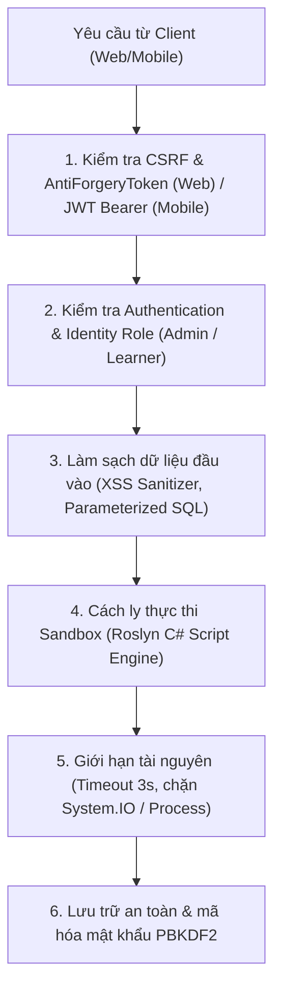
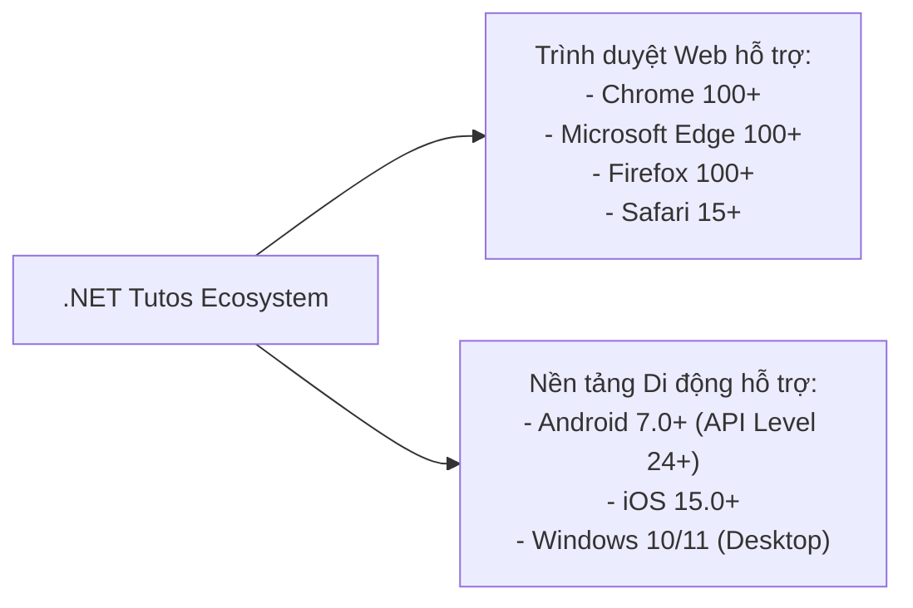

# 04. ĐẶC TẢ YÊU CẦU PHI CHỨC NĂNG (NON-FUNCTIONAL REQUIREMENTS - NFR)

> **Tài liệu đặc tả tiêu chuẩn chất lượng hệ thống (Quality Attributes & Service Level Objectives)**  
> **Chức danh thực hiện:** Senior Business Analyst / Technical Auditor  
> **Hệ thống:** Nền tảng Học tập & Đào tạo Lập trình .NET Toàn diện (.NET Tutos Platform)  
> **Mã tài liệu:** NFR-NET-TUTOS-2026-V2  

---

## 1. Hiệu năng & Khả năng đáp ứng (Performance & Responsiveness)

| Mã yêu cầu | Tiêu chí đánh giá | Chỉ số mục tiêu (Target SLA/SLO) | Phương pháp kiểm chứng |
| :--- | :--- | :--- | :--- |
| **NFR-PERF-01** | Thời gian phản hồi trang Web (Page Load Time) | $\le 1.2\text{s}$ cho lần tải đầu tiên, $\le 300\text{ms}$ khi đã có cache PWA. | Google Lighthouse Performance Audit (Điểm $\ge 90/100$). |
| **NFR-PERF-02** | Thời gian phản hồi REST API (Mobile/AJAX API Latency) | $95\%$ yêu cầu API hoàn thành trong $\le 150\text{ms}$ ở điều kiện tải chuẩn. | K6 / Apache JMeter load tests. |
| **NFR-PERF-03** | Thời gian biên dịch & chạy Sandbox Roslyn | $\le 1.5\text{s}$ cho script thông thường; Timeout ngắt cứng tại $3.0\text{s}$. | Automated Roslyn benchmark scripts. |
| **NFR-PERF-04** | Thời gian phản hồi phân tích AI Tutor & Mock Interview | $\le 2.0\text{s}$ cho các bài toán phân tích Big-O, chẩn đoán lỗi và chấm điểm phỏng vấn. | Kiểm thử tải API `/AiTutor/*` và `/Interview/EvaluateAiAnswer`. |
| **NFR-PERF-05** | Độ trễ thông báo thời gian thực SignalR | $\le 100\text{ms}$ từ máy chủ tới các máy khách kết nối đồng thời. | Đo độ trễ WebSocket qua Chrome DevTools Network Tab. |

---

## 2. Khả năng mở rộng & Chịu tải (Scalability & Throughput)

1. **Khả năng chịu tải đồng thời (Concurrent User Capacity):**
   - Hỗ trợ tối thiểu **1.000 người dùng trực tuyến đồng thời** (Concurrent Users) trên môi trường máy chủ tiêu chuẩn (4 vCPU, 8GB RAM).
   - Cơ chế ASP.NET Core Kestrel Web Server xử lý bất đồng bộ (`async`/`await`) xuyên suốt từ Controller đến Database qua Entity Framework Core.
2. **Tối ưu hóa cơ sở dữ liệu:**
   - Sử dụng `AsNoTracking()` cho 100% các thao tác đọc dữ liệu chỉ xem (Read-only queries) như đọc bài học, danh mục, bảng xếp hạng để giảm thiểu việc cấp phát bộ nhớ của Change Tracker.
   - Áp dụng phân trang (Pagination) bắt buộc tại tầng Database (`.Skip().Take()`) cho danh sách bài viết, bình luận và flashcards; không bao giờ nạp toàn bộ bảng vào RAM.

---

## 3. An toàn thông tin & Bảo mật (Security & Isolation)

1. **Cô lập Sandbox chạy mã nguồn (Code Execution Isolation):**
   - Tuyệt đối cấm nạp các thư viện có quyền can thiệp hệ thống máy chủ: `System.IO`, `System.Diagnostics.Process`, `System.Reflection.Emit`, `System.Net.Sockets`.
   - Vô hiệu hóa quyền ghi đè tệp tin và truy cập biến môi trường máy chủ.
   - Bắt trọn luồng xuất đầu ra `Console.SetOut()` và giới hạn độ dài đầu ra tối đa 10.000 ký tự để tránh tấn công tràn bộ nhớ đệm (Buffer Bloat).
2. **Bảo vệ xác thực (Authentication & Authorization):**
   - Mật khẩu học viên được băm và thêm muối (Salted Hash) bằng thuật toán chuẩn PBKDF2 với số vòng lặp an toàn qua ASP.NET Core Identity.
   - Khóa ký JWT Token cho Mobile API sử dụng thuật toán HMAC-SHA256 với chuỗi bí mật tối thiểu 256 bits, thời hạn token có kiểm soát và hỗ trợ thu hồi token.
3. **Phòng chống các lỗ hổng OWASP Top 10:**
   - **SQL Injection:** 100% truy vấn dữ liệu được điều khiển qua Entity Framework Core LINQ Parameterized Queries.
   - **Cross-Site Scripting (XSS):** Toàn bộ nội dung do người dùng nhập (bình luận, câu trả lời phỏng vấn) đều được mã hóa HTML Encoding (`escapeHtml`) trước khi hiển thị.
   - **Cross-Site Request Forgery (CSRF):** Toàn bộ Form POST và AJAX requests trên Web App đều bắt buộc gửi kèm `__RequestVerificationToken`.

---

## 4. Độ sẵn sàng & Chế độ ngoại tuyến (Reliability & Offline Mode)

1. **Khả năng hoạt động ngoại tuyến (Progressive Web App - PWA):**
   - Hệ thống Web App trang bị Service Worker chuẩn PWA, tự động lưu trữ bộ nhớ đệm (Cache Storage) các tài nguyên tĩnh (CSS, Fonts, Icons, JS) và các bài học người dùng đánh dấu "Lưu ngoại tuyến".
   - Khi mất kết nối Internet, thanh trạng thái chuyển sang màu cam *"Chế độ Ngoại tuyến (Offline Mode)"* và vẫn cho phép đọc bài bình thường.
2. **Khôi phục lỗi tự động (Graceful Degradation):**
   - Nếu dịch vụ AI tạm thời gián đoạn, hệ thống tự động hiển thị giải pháp dự phòng (Fallback Model Answers & Standard Error Explanations) để người dùng không bị gián đoạn bài học.

---

## 5. Khả năng tương thích đa nền tảng (Compatibility & Cross-Platform)

1. **Tương thích giao diện (Responsive Web Design):**
   - Giao diện Web hiển thị hoàn hảo trên 3 nhóm độ phân giải màn hình chuẩn:
     - **Desktop / Laptop:** $\ge 1200\text{px}$ (Bố cục 2 cột IDE chuyên nghiệp).
     - **Tablet:** $768\text{px} \dots 1199\text{px}$ (Bố cục co giãn linh hoạt, thanh công cụ thu gọn).
     - **Mobile Phone:** $< 768\text{px}$ (Monaco Editor co dãn chiều cao, terminal chuyển tab dưới).
2. **Hỗ trợ chế độ màu sắc (Theme Accessibility):**
   - Tương thích 100% chuẩn Dark Mode / Light Mode trên cả Web App và Mobile App.
   - Độ tương phản chữ (Color Contrast Ratio) đạt chuẩn WCAG 2.1 AA ($\ge 4.5:1$ đối với văn bản thông thường) giúp học viên không bị mỏi mắt khi học vào ban đêm.

---

## 6. Khả năng bảo trì & Tiêu chuẩn mã nguồn (Maintainability & Clean Architecture)

1. **Cấu trúc mã nguồn & Nguyên lý SOLID:**
   - Mã nguồn tuân thủ chặt chẽ mô hình phân tách trách nhiệm (Separation of Concerns).
   - Controller chỉ đóng vai trò tiếp nhận và điều phối HTTP request/response; 100% logic nghiệp vụ nằm trong tầng Services (`AiTutorService`, `FlashcardService`, `CodeExecutionService`).
2. **Kiểm thử tự động & CI/CD Readiness:**
   - Toàn bộ các API và DTOs được đóng gói rõ ràng, hỗ trợ biên dịch độc lập qua `dotnet build` với tiêu chí **0 Errors và 0 Warnings**.
   - Hỗ trợ chạy trên cả môi trường Windows, Linux và container Docker.
