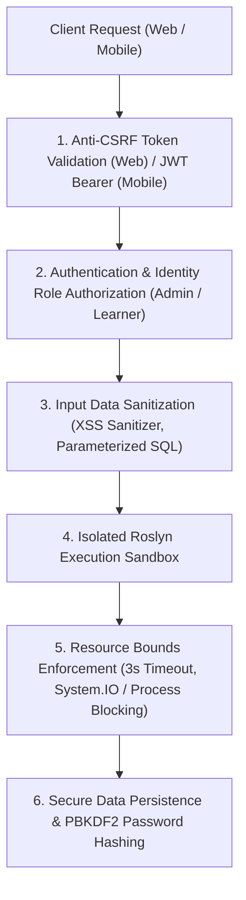
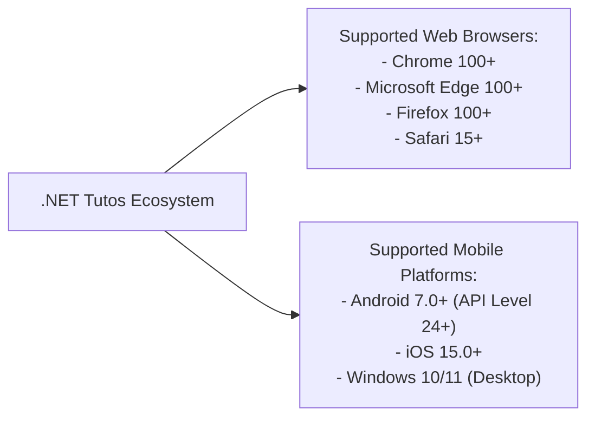

# 04. Non-Functional Requirements Document (NFR)

Document Type: Quality Attributes & Service Level Objectives Specification  
Role: Senior Business Analyst / Technical Auditor  
System: .NET Tutos - Comprehensive .NET Learning & Assessment Platform  
Document Identifier: NFR-NET-TUTOS-2026-V2  
Status: Approved  

---

## 1. Performance & Responsiveness

| Requirement ID | Evaluation Metric | Target SLA / SLO | Verification Method |
| :--- | :--- | :--- | :--- |
| **NFR-PERF-01** | Web Page Initial Load Time | $\le 1.2\text{s}$ for cold load; $\le 300\text{ms}$ on repeat visits with PWA cache enabled. | Google Lighthouse Performance Audit (Score $\ge 90/100$). |
| **NFR-PERF-02** | REST API Latency | $95\%$ of all Mobile and AJAX endpoints respond within $\le 150\text{ms}$ under standard workload. | Automated load testing via K6 and Apache JMeter. |
| **NFR-PERF-03** | Roslyn Sandbox Compilation & Execution | $\le 1.5\text{s}$ for standard C# scripts; hard timeout triggered at $3.0\text{s}$. | Automated Roslyn benchmark execution suites. |
| **NFR-PERF-04** | AI Analysis & Assessment Response Time | $\le 2.0\text{s}$ for Big-O complexity analysis, test case diagnostics, and interview scoring. | Integration latency profiling on `/AiTutor/*` and `/Interview/*` endpoints. |
| **NFR-PERF-05** | Real-Time SignalR Broadcast Latency | $\le 100\text{ms}$ from server dispatch to concurrent WebSocket clients. | Network tab latency inspection across Chrome DevTools. |

---

## 2. Scalability & System Throughput

1. **Concurrent User Capacity:**
   - The platform supports a minimum of **1,000 concurrent active users** on a standard baseline host specification (4 vCPU, 8GB RAM).
   - The ASP.NET Core Kestrel web server leverages non-blocking asynchronous programming (`async`/`await`) end-to-end from controllers down to Entity Framework Core database queries.
2. **Database Query Optimization:**
   - 100% of read-only queries (e.g., retrieving curriculum, lessons, rankings, and flashcard catalogs) utilize `AsNoTracking()` to eliminate Entity Framework change tracking overhead and minimize memory consumption.
   - Enforce mandatory database-level pagination (`.Skip().Take()`) on all listing endpoints (articles, comments, submissions, and flashcards) to prevent large collections from loading into memory.

---

## 3. Information Security & Isolation Architecture

1. **Roslyn Code Execution Sandbox Isolation:**
   - **Restricted Namespaces:** Prohibit loading namespaces that interact with server infrastructure: `System.IO`, `System.Diagnostics.Process`, `System.Reflection.Emit`, and `System.Net.Sockets`.
   - **Environment Protection:** Deny file system write operations and environment variable inspections.
   - **Output Buffer Clamping:** Capture output via `Console.SetOut()` and enforce a hard ceiling of 10,000 characters to prevent buffer exhaustion attacks.
2. **Authentication & Authorization Standards:**
   - Passwords are encrypted using salted PBKDF2 with HMAC-SHA256 via ASP.NET Core Identity.
   - JWT tokens for the mobile client use HMAC-SHA256 with 256-bit cryptographic secrets, bounded validity intervals, and token revocation mechanisms.
3. **OWASP Top 10 Vulnerability Defenses:**
   - **SQL Injection:** 100% of database access is mediated through Entity Framework Core parameterized LINQ queries.
   - **Cross-Site Scripting (XSS):** All user-submitted text (comments, interview answers, feedback) is encoded (`escapeHtml`) prior to client-side presentation.
   - **Cross-Site Request Forgery (CSRF):** All state-modifying POST actions on the Web Application require valid `__RequestVerificationToken` headers.

---

## 4. Reliability, Availability & Offline Capability

1. **Progressive Web App (PWA) Offline Resilience:**
   - The web client includes a Service Worker that caches static assets (CSS, fonts, icons, JavaScript) and lessons saved for offline viewing.
   - In disconnected conditions, a notification banner indicates "Offline Mode", permitting seamless reading of cached curriculum content.
2. **Graceful Service Degradation:**
   - If upstream AI services encounter intermittent disruptions, the system serves structured heuristic fallbacks (standardized benchmark answers and baseline diagnostic guidelines) to preserve educational continuity.

---

## 5. Cross-Platform Compatibility & Accessibility

1. **Responsive Web Presentation:**
   - Fully adaptive layout across three standard viewport ranges:
     - **Desktop / Laptop:** $\ge 1200\text{px}$ (Dual-pane IDE layout).
     - **Tablet:** $768\text{px} \dots 1199\text{px}$ (Flexible single-column stack with collapsable utility panels).
     - **Mobile Phone:** $< 768\text{px}$ (Auto-sized Monaco Editor with tabbed bottom console).
2. **Theme Accessibility:**
   - Cohesive Dark Mode and Light Mode support across Web and Mobile applications.
   - Adhere to WCAG 2.1 AA color contrast standards ($\ge 4.5:1$ for regular text) to prevent visual strain during extended study sessions.

---

## 6. Maintainability, Clean Architecture & CI/CD Standards

1. **Codebase Modularization & SOLID Principles:**
   - Enforce separation of concerns across layers.
   - Controllers handle HTTP routing, request binding, and response dispatching; domain logic resides entirely within service classes (`AiTutorService`, `FlashcardService`, `CodeExecutionService`).
2. **Build Quality & Automated CI/CD Readiness:**
   - Solution compiles cleanly via `dotnet build` with **0 Errors and 0 Warnings**.
   - Cross-platform support ensures native deployment across Windows, Linux distributions, and containerized Docker environments.
