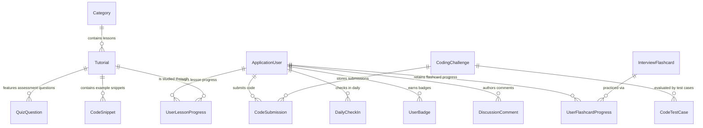

# 05. Data Models & API Specifications

Document Type: Data Schema & API Contract Specification  
Role: Senior Business Analyst / Data Architect  
System: .NET Tutos - Comprehensive .NET Learning & Assessment Platform  
Document Identifier: SPEC-API-DB-2026-V2  
Status: Approved  

---

## 1. Entity Relationship Diagram (ERD)



---

## 2. Domain Entity Specifications

### 1. Entity `ApplicationUser` (Inherits from `IdentityUser`)
- `Id` (GUID / String): Unique primary key.
- `UserName`, `Email`: Login and communication identifiers.
- `FullName` (NVarChar 150): Learner display name used across leaderboards and certificates.
- `AvatarUrl` (NVarChar 500): Profile image location.
- `ExperiencePoints` (Int): Cumulative experience points (XP) balance.
- `CurrentStreak` (Int): Number of consecutive active learning days.
- `LastActiveDate` (DateTime): Most recent timestamp of learning activity for streak determination.

### 2. Entities `Tutorial` & `Category`
- `Tutorial.Id` (Int, PK), `Title` (NVarChar 250), `Slug` (NVarChar 250, Unique Index).
- `Summary` (NVarChar 600): Brief overview of lesson objectives.
- `ContentMarkdown` (NVarChar MAX): Full lesson content in extended Markdown format.
- `EstimatedReadingMinutes` (Int): Estimated reading and practice duration.
- `Difficulty` (Enum: Beginner, Intermediate, Advanced).
- `CategoryId` (Int, FK): Foreign key mapping to parent `Category`.

### 3. Entities `CodingChallenge` & `CodeTestCase`
- `CodingChallenge`: `Id`, `Title`, `Slug`, `DescriptionMarkdown`, `DifficultyLevel`, `InitialCode`, `SolutionTemplate`, `XpReward`.
- `CodeTestCase`: `Id`, `ChallengeId` (FK), `InputParameters` (Json / String), `ExpectedOutput` (String), `IsHidden` (Boolean - anti-cheat evaluation flag).

### 4. Entities `InterviewFlashcard` & `UserFlashcardProgress`
- `InterviewFlashcard`: `Id`, `Slug`, `Topic` (Enum: CSharpCore, AsyncConcurrency, EfCoreDatabase, AspNetCoreWebAPI, ArchitectureCloud), `Difficulty`, `QuestionVi`, `QuestionEn`, `AnswerMarkdownVi`, `AnswerMarkdownEn`, `InterviewTipVi`, `InterviewTipEn`.
- `UserFlashcardProgress`: `Id`, `UserId` (FK), `FlashcardId` (FK), `BoxLevel` (1 - 5 in Leitner spaced repetition system), `ReviewCount`, `LastRating`, `NextReviewDate`, `IsMastered`.

---

## 3. RESTful API Specifications & Web/Mobile Contracts

### Group 1: Mobile Authentication & Account Management (`/api/mobile/auth`)

#### `POST /api/mobile/auth/login`
- **Description:** Authenticate from mobile devices using web credentials; issues a JWT Bearer Token.
- **Request Body (JSON):**
  ```json
  {
    "usernameOrEmail": "student@nettutos.com",
    "password": "Password123@"
  }
  ```
- **Response Success (200 OK):**
  ```json
  {
    "isSuccess": true,
    "message": "Authentication successful.",
    "token": "eyJhbGciOiJIUzI1NiIsInR5cCI6IkpXVCJ9...",
    "user": {
      "id": "user-uuid",
      "username": "student",
      "email": "student@nettutos.com",
      "fullName": "Alex Rivera",
      "avatarUrl": "/images/avatars/default.png",
      "totalXp": 450,
      "level": 5,
      "streakDays": 7,
      "completedLessonsCount": 18
    }
  }
  ```

#### `GET /api/mobile/auth/profile`
- **Description:** Retrieve current authenticated user profile.
- **Headers:** `Authorization: Bearer <token>`

---

### Group 2: Curriculum & Mobile Progress Synchronization (`/api/mobile`)

#### `GET /api/mobile/tutorials`
- **Description:** Retrieve paginated tutorial list with optional category and search filters.
- **Response (200 OK):** Array of tutorial summary objects including personalized `isCompleted` flags for the caller.

#### `POST /api/mobile/tutorials/complete`
- **Description:** Record lesson completion from mobile, persist progress in the database, award XP, and update streak records.
- **Headers:** `Authorization: Bearer <token>`
- **Request Body:** `{ "tutorialId": 14 }`
- **Response (200 OK):**
  ```json
  {
    "isSuccess": true,
    "tutorialId": 14,
    "isCompleted": true,
    "xpEarned": 15,
    "newTotalXp": 465,
    "streakDays": 7
  }
  ```

---

### Group 3: AI Mentor & Algorithmic Analysis (`/AiTutor`)

#### `POST /AiTutor/AnalyzeComplexity`
- **Description:** Compute algorithmic Big-O time and space complexity for code in Monaco Editor.
- **Request Body:** `{ "sourceCode": "for(int i=0; i<n; i++) { for(int j=0; j<n; j++) { ... } }" }`
- **Response (200 OK):**
  ```json
  {
    "success": true,
    "timeComplexity": "O(N^2)",
    "spaceComplexity": "O(1)",
    "efficiencyScore": 60,
    "summary": "The algorithm executes nested iterations over n elements, causing quadratic execution growth.",
    "bottlenecks": ["Nested loop structure causes computational time to scale quadratically with input size."],
    "optimizations": ["Consider using a Dictionary or HashSet lookup to reduce time complexity to O(N)."]
  }
  ```

#### `POST /AiTutor/DiagnoseTestFailure`
- **Description:** Diagnose root causes of failed challenge test cases and provide verified code corrections.
- **Request Body:**
  ```json
  {
    "challengeId": 3,
    "sourceCode": "public int[] TwoSum(int[] nums, int target) { ... }",
    "testIndex": 2,
    "inputParameters": "[3, 3], target = 6",
    "expectedOutput": "[0, 1]",
    "actualOutput": "[0, 0]"
  }
  ```
- **Response (200 OK):**
  ```json
  {
    "success": true,
    "failureCategory": "Duplicate Element / Index Reuse",
    "diagnosticTitle": "Self-referencing duplicate element reuse",
    "analysis": "The algorithm pairs element nums[0] with itself instead of searching for a distinct complementary index.",
    "guidanceHint": "Ensure distinct index verification: i != j when evaluating pairs.",
    "suggestedFixSnippet": "if (map.ContainsKey(diff) && map[diff] != i) return new int[] { map[diff], i };"
  }
  ```

---

### Group 4: AI Mock Technical Interview Simulator (`/Interview`)

#### `POST /Interview/EvaluateAiAnswer`
- **Description:** Evaluate candidate free-text answer across three technical hiring dimensions.
- **Request Body:**
  ```json
  {
    "flashcardId": 12,
    "question": "What is the key difference between value types and reference types in C#?",
    "candidateAnswer": "Value types reside on the stack and hold data directly, while reference types reside on the heap and store references.",
    "topic": "CSharpCore",
    "difficulty": "Intermediate"
  }
  ```
- **Response (200 OK):**
  ```json
  {
    "success": true,
    "overallScore": 82,
    "technicalAccuracyScore": 85,
    "clarityStructureScore": 80,
    "depthPracticalScore": 75,
    "performanceRating": "Mid-Level Competency (Solid)",
    "feedback": "Concise answer accurately distinguishing Stack versus Managed Heap allocations.",
    "strengths": [
      "Clear distinction between Stack and Managed Heap memory segments.",
      "Accurate differentiation between value copying and reference pointer copying."
    ],
    "missingPoints": [
      "Note that structs declared inside class instances are allocated on the Heap.",
      "Address performance overhead from boxing and unboxing under garbage collection."
    ],
    "followUpQuestion": "Tech Lead Follow-up: Under what conditions is a struct (Value Type) allocated on the Managed Heap?",
    "modelAnswerSample": "### Senior Benchmark Answer\nValue types (structs, primitives) are allocated inline within their enclosing storage context..."
  }
  ```

#### `POST /Interview/SubmitAiMockReport`
- **Description:** Aggregate answers across an interview session, generate a 5-dimension radar report, suggest remediation lessons, and credit XP.
- **Response (200 OK):**
  ```json
  {
    "success": true,
    "averageScore": 78,
    "readinessLevel": "Qualified for Mid-Level .NET Engineering Roles",
    "readinessBadgeClass": "primary",
    "executiveAssessment": "Demonstrates solid grasp of modern C# and ASP.NET Core fundamentals.",
    "skillBreakdowns": [
      { "skillName": "C# Internals & Memory Architecture", "score": 80, "level": "Senior" },
      { "skillName": "Asynchronous Concurrency & Threading", "score": 75, "level": "Mid" },
      { "skillName": "Entity Framework Core & Query Optimization", "score": 79, "level": "Mid" },
      { "skillName": "ASP.NET Core Architecture & Web API", "score": 82, "level": "Solid" },
      { "skillName": "Clean Architecture & Design Patterns", "score": 77, "level": "Proficient" }
    ],
    "recommendedLessons": [
      {
        "title": "Advanced Asynchronous Programming (Async/Await) in .NET",
        "slug": "advanced-async-await-csharp",
        "reason": "Crucial requirement for architecting high-throughput Web APIs."
      }
    ],
    "xpAwarded": 70,
    "timeSpentSeconds": 485
  }
  ```
