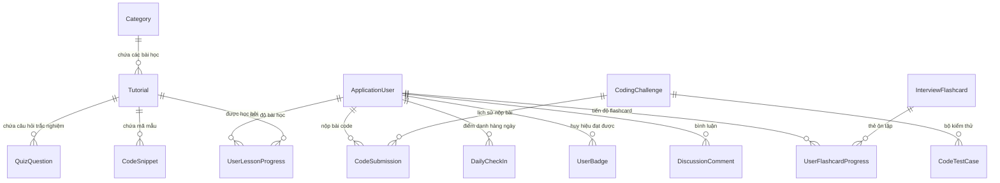

# 05. MÔ HÌNH DỮ LIỆU & ĐẶC TẢ GIAO TIẾP API (DATA MODELS & API SPECIFICATIONS)

> **Tài liệu đặc tả cơ sở dữ liệu & giao diện lập trình ứng dụng (Data Schema & API Contracts)**  
> **Chức danh thực hiện:** Senior Business Analyst / Data Architect  
> **Hệ thống:** Nền tảng Học tập & Đào tạo Lập trình .NET Toàn diện (.NET Tutos Platform)  
> **Mã tài liệu:** SPEC-API-DB-2026-V2  

---

## 1. Sơ đồ thực thể dữ liệu tổng thể (Entity Relationship Diagram - ERD)



---

## 2. Danh mục các bảng thực thể dữ liệu cốt lõi (Domain Entity Specifications)

### 1. Thực thể `ApplicationUser` (Kế thừa từ `IdentityUser`)
- `Id` (GUID / String): Khóa chính nhận diện người dùng.
- `UserName`, `Email`: Tài khoản đăng nhập và liên hệ.
- `FullName` (NVarChar 150): Tên đầy đủ hiển thị trên hệ thống và chứng chỉ.
- `AvatarUrl` (NVarChar 500): Đường dẫn ảnh đại diện.
- `ExperiencePoints` (Int): Tổng điểm kinh nghiệm (XP) tích lũy.
- `CurrentStreak` (Int): Số ngày học liên tiếp hiện tại.
- `LastActiveDate` (DateTime): Thời điểm hoạt động gần nhất để tính toán Streak.

### 2. Thực thể `Tutorial` & `Category`
- `Tutorial.Id` (Int, PK), `Title` (NVarChar 250), `Slug` (NVarChar 250, Unique).
- `Summary` (NVarChar 600): Tóm tắt bài học.
- `ContentMarkdown` (NVarChar MAX): Toàn văn nội dung bài giảng định dạng Markdown.
- `EstimatedReadingMinutes` (Int): Thời lượng ước tính.
- `Difficulty` (Enum: Beginner, Intermediate, Advanced).
- `CategoryId` (Int, FK): Khóa ngoại liên kết bảng `Category`.

### 3. Thực thể `CodingChallenge` & `CodeTestCase`
- `CodingChallenge`: `Id`, `Title`, `Slug`, `DescriptionMarkdown`, `DifficultyLevel`, `InitialCode`, `SolutionTemplate`, `XpReward`.
- `CodeTestCase`: `Id`, `ChallengeId` (FK), `InputParameters` (Json/String), `ExpectedOutput` (String), `IsHidden` (Boolean - dùng để chống gian lận nộp bài).

### 4. Thực thể `InterviewFlashcard` & `UserFlashcardProgress`
- `InterviewFlashcard`: `Id`, `Slug`, `Topic` (Enum: CSharpCore, AsyncConcurrency, EfCoreDatabase, AspNetCoreWebAPI, ArchitectureCloud), `Difficulty`, `QuestionVi`, `QuestionEn`, `AnswerMarkdownVi`, `AnswerMarkdownEn`, `InterviewTipVi`, `InterviewTipEn`.
- `UserFlashcardProgress`: `Id`, `UserId` (FK), `FlashcardId` (FK), `BoxLevel` (1 - 5 theo phương pháp lặp lại ngắt quãng Leitner), `ReviewCount`, `LastRating`, `NextReviewDate`, `IsMastered`.

---

## 3. Quy chuẩn API RESTful Mobile & Web Integration (API Contracts)

### Nhóm 1: Xác thực & Quản lý Tài khoản Mobile (`/api/mobile/auth`)

#### `POST /api/mobile/auth/login`
- **Mô tả:** Đăng nhập từ ứng dụng di động bằng tài khoản Web, cấp phát JWT Bearer Token.
- **Request Body (JSON):**
  ```json
  {
    "usernameOrEmail": "student@nettutos.com",
    "password": "Password123@"
  }
  ```
- **Response Success (200 OK):**
  ```json
  {
    "isSuccess": true,
    "message": "Đăng nhập thành công!",
    "token": "eyJhbGciOiJIUzI1NiIsInR5cCI6IkpXVCJ9...",
    "user": {
      "id": "user-uuid",
      "username": "student",
      "email": "student@nettutos.com",
      "fullName": "Nguyễn Văn An",
      "avatarUrl": "/images/avatars/default.png",
      "totalXp": 450,
      "level": 5,
      "streakDays": 7,
      "completedLessonsCount": 18
    }
  }
  ```

#### `GET /api/mobile/auth/profile`
- **Mô tả:** Lấy thông tin người dùng hiện tại (kèm theo Authorization: Bearer `<token>`).

---

### Nhóm 2: Bài học & Đồng bộ Tiến độ Mobile (`/api/mobile`)

#### `GET /api/mobile/tutorials`
- **Mô tả:** Lấy danh sách bài học có phân trang, lọc theo danh mục hoặc từ khóa tìm kiếm.
- **Response (200 OK):** Mảng các đối tượng bài học tóm tắt kèm trạng thái `isCompleted` riêng cho từng người dùng đang đăng nhập.

#### `POST /api/mobile/tutorials/complete`
- **Mô tả:** Đánh dấu hoàn thành bài học từ điện thoại, ghi nhận tiến độ vào Database, tự động cộng XP và duy trì Streak.
- **Headers:** `Authorization: Bearer <token>`
- **Request Body:** `{ "tutorialId": 14 }`
- **Response (200 OK):**
  ```json
  {
    "isSuccess": true,
    "tutorialId": 14,
    "isCompleted": true,
    "xpEarned": 15,
    "newTotalXp": 465,
    "streakDays": 7
  }
  ```

---

### Nhóm 3: Trợ lý AI & Lập trình Tương tác (`/AiTutor`)

#### `POST /AiTutor/AnalyzeComplexity`
- **Mô tả:** Đo độ phức tạp thuật toán Big-O thời gian và không gian cho đoạn mã trong Monaco Editor.
- **Request Body:** `{ "sourceCode": "for(int i=0; i<n; i++) { for(int j=0; j<n; j++) { ... } }" }`
- **Response (200 OK):**
  ```json
  {
    "success": true,
    "timeComplexity": "O(N^2)",
    "spaceComplexity": "O(1)",
    "efficiencyScore": 60,
    "summary": "Thuật toán sử dụng 2 vòng lặp lồng nhau duyệt qua n phần tử...",
    "bottlenecks": ["Vòng lặp lồng nhau bậc hai khiến chi phí thời gian tăng vọt khi n lớn."],
    "optimizations": ["Có thể sử dụng Dictionary hoặc HashSet để giảm độ phức tạp xuống O(N)."]
  }
  ```

#### `POST /AiTutor/DiagnoseTestFailure`
- **Mô tả:** Chẩn đoán nguyên nhân rớt Test Case trong Coding Challenge và đề xuất code sửa mẫu.
- **Request Body:**
  ```json
  {
    "challengeId": 3,
    "sourceCode": "public int[] TwoSum(int[] nums, int target) { ... }",
    "testIndex": 2,
    "inputParameters": "[3, 3], target = 6",
    "expectedOutput": "[0, 1]",
    "actualOutput": "[0, 0]"
  }
  ```
- **Response (200 OK):**
  ```json
  {
    "success": true,
    "failureCategory": "Duplicate Element / Index Reuse",
    "diagnosticTitle": "Dùng trùng lặp cùng một phần tử tại vị trí index",
    "analysis": "Thuật toán đã lấy phần tử nums[0] cộng với chính nó thay vì tìm một phần tử khác...",
    "guidanceHint": "Hãy đảm bảo điều kiện kiểm tra chỉ số khác nhau: i != j khi tìm cặp.",
    "suggestedFixSnippet": "if (map.ContainsKey(diff) && map[diff] != i) return new int[] { map[diff], i };"
  }
  ```

---

### Nhóm 4: Phòng Phỏng vấn Kỹ thuật Giả lập AI (`/Interview`)

#### `POST /Interview/EvaluateAiAnswer`
- **Mô tả:** AI Tech Lead chấm điểm câu trả lời thực tế của ứng viên theo 3 tiêu chuẩn tuyển dụng.
- **Request Body:**
  ```json
  {
    "flashcardId": 12,
    "question": "Phân biệt sự khác nhau giữa value type và reference type trong C#?",
    "candidateAnswer": "Value type lưu trên Stack còn Reference type lưu trên Heap. Khi gán thì value type copy giá trị, reference type copy địa chỉ con trỏ.",
    "topic": "CSharpCore",
    "difficulty": "Intermediate"
  }
  ```
- **Response (200 OK):**
  ```json
  {
    "success": true,
    "overallScore": 82,
    "technicalAccuracyScore": 85,
    "clarityStructureScore": 80,
    "depthPracticalScore": 75,
    "performanceRating": "Trình độ Middle .NET (Khá vững)",
    "feedback": "Câu trả lời đúng trọng tâm và phân biệt chuẩn xác cơ chế lưu trữ bộ nhớ Stack vs Heap...",
    "strengths": [
      "Phân biệt rành mạch giữa bộ nhớ Stack và Managed Heap.",
      "Chỉ rõ sự khác biệt giữa copy giá trị và copy địa chỉ tham chiếu."
    ],
    "missingPoints": [
      "Nên lưu ý thêm trường hợp struct nằm bên trong class thì vẫn được cấp phát trên Heap.",
      "Cần nhắc tới hiện tượng boxing/unboxing gây hao tổn GC."
    ],
    "followUpQuestion": "Câu hỏi xoáy từ Tech Lead: Trong trường hợp nào một struct (Value Type) lại được cấp phát trên bộ nhớ Heap?",
    "modelAnswerSample": "### Đáp án chuẩn Senior\nValue types (struct, int, bool...) mặc định được phân bổ..."
  }
  ```

#### `POST /Interview/SubmitAiMockReport`
- **Mô tả:** Tổng hợp toàn bộ câu trả lời trong phiên phỏng vấn, xuất báo cáo năng lực 5 kỹ năng, đề xuất bài học bổ sung và cộng điểm thưởng XP.
- **Response (200 OK):**
  ```json
  {
    "success": true,
    "averageScore": 78,
    "readinessLevel": "Sẵn sàng Phỏng vấn Middle .NET Developer",
    "readinessBadgeClass": "primary",
    "executiveAssessment": "Nền tảng vững vàng về Modern C# và ASP.NET Core...",
    "skillBreakdowns": [
      { "skillName": "Bản chất C# & Quản lý Bộ nhớ", "score": 80, "level": "Senior" },
      { "skillName": "Lập trình Bất đồng bộ & Xử lý Đồng thời", "score": 75, "level": "Mid" },
      { "skillName": "Entity Framework Core & Tối ưu Truy vấn", "score": 79, "level": "Mid" },
      { "skillName": "Kiến trúc ASP.NET Core & Web API", "score": 82, "level": "Solid" },
      { "skillName": "Clean Architecture & Mẫu Thiết kế SOLID", "score": 77, "level": "Proficient" }
    ],
    "recommendedLessons": [
      {
        "title": "Lập trình Bất đồng bộ (Async/Await) nâng cao trong .NET",
        "slug": "async-await-csharp-nang-cao",
        "reason": "Kiến thức bắt buộc để làm chủ Web API chịu tải cao."
      }
    ],
    "xpAwarded": 70,
    "timeSpentSeconds": 485
  }
  ```
