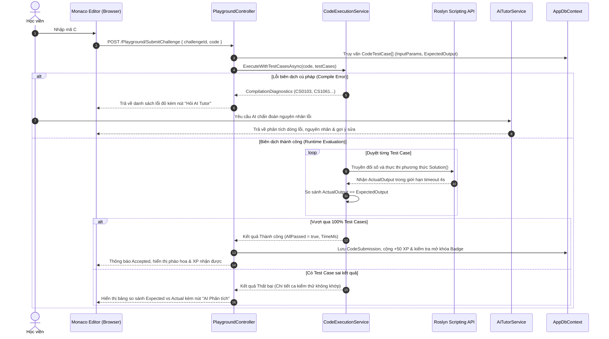
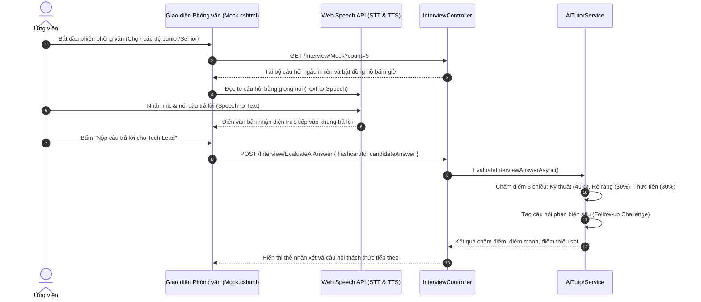

# 06. System Architecture, Clean Code Blueprint & UI/UX Design

Document Type: Technical Solution Architecture & UI/UX Specification Suite  
Author: Senior Solution Architect & Lead Software Engineer  
System: .NET Tutos - Comprehensive .NET Learning & Assessment Platform  
Scope: Web Application (ASP.NET Core 10), Mobile Client (.NET MAUI 10), Database ERD, UI/UX Wireframes  
Version: Release 2.0  
Status: Verified & Approved for Production  

---

## 1. Bản đồ Cấu trúc Thư mục Phân lớp (Clean Code Directory Tree)

Dự án được tổ chức theo giải pháp hiện đại `.NET 10 Solution` (`NET-Tutos.slnx`) với sự phân tách độc lập giữa **Web/Backend API**, **Mobile Client** và **Đặc tả Kỹ thuật**.

### 1.1. Cấu trúc Tổng thể Dự án

```text
d:\NET-Tutos\
├── 📄 NET-Tutos.slnx                  # Solution File định dạng mới của .NET 10 (XML nhẹ, sạch)
├── 📄 docker-compose.yml              # Điều phối đa container (PostgreSQL 17, Web App, pgAdmin 4)
├── 📄 Dockerfile                      # Multi-stage Docker build cho ASP.NET Core 10 Web App
├── 📄 README.md                       # Tài liệu định hướng tổng quan dự án và hướng dẫn khởi chạy
├── 📄 .gitignore                      # Bộ lọc Git chuẩn hóa cho C# / .NET / Visual Studio
│
├── 📂 docs/                           # [Đặc tả Hệ thống] Tài liệu Single Source of Truth (SSOT)
├── 📂 web/                            # [Web & REST API] ASP.NET Core 10 MVC + RESTful API + SignalR
└── 📂 mobile/                         # [Mobile Client] Ứng dụng di động .NET MAUI 10 đa nền tảng
```

---

### 1.2. Phân rã Chi tiết Phân hệ Web & REST API (`web/`)

Dự án Web tuân thủ kiến trúc phân tầng rõ ràng (Separation of Concerns), phân tách giữa Presentation (Controllers/Views), Business Logic (Services), Data Access (EF Core / DbContext), và Real-Time Communication (Hubs).

```text
web/
├── 📄 Program.cs                      # Cấu hình DI, Middleware, Localization, Auth & PostgreSQL / Fallback DB
├── 📄 appsettings.json                # Chuỗi kết nối PostgreSQL (Docker), SQLite, JWT Keys, Logging levels
├── 📄 web.csproj                      # Khai báo NuGet: Npgsql EF Core 10, Roslyn, QuestPDF, QRCoder, Markdig
│
├── 📂 Controllers/                    # [Tầng Điều khiển] Tiếp nhận Request, xác thực và điều phối dữ liệu
│   │
│   ├── 📂 Api/                        # RESTful API Endpoints phục vụ Mobile Client & Third-party
│   │   ├── 📄 MobileAuthController.cs        # Xác thực JWT, đăng ký, đăng nhập & lấy hồ sơ cá nhân
│   │   ├── 📄 MobileTutorialsController.cs   # Lấy bài học, danh mục, lộ trình, cập nhật tiến độ
│   │   └── 📄 MobileFlashcardsController.cs  # API ôn tập Flashcards thuật toán Spaced Repetition
│   │
│   ├── 📂 Admin/                      # Bộ điều khiển dành cho Quản trị viên LMS (Role: Admin)
│   │   ├── 📄 AdminController.cs             # Dashboard tổng quan, KPI thống kê học viên
│   │   ├── 📄 AdminTutorialsController.cs    # Quản lý bài giảng Markdown (WYSIWYG split-screen)
│   │   ├── 📄 AdminQuizzesController.cs      # Soạn thảo ngân hàng câu hỏi trắc nghiệm
│   │   ├── 📄 AdminProjectsController.cs     # Chấm điểm & nhận xét đồ án tốt nghiệp Capstone
│   │   └── 📄 AdminUsersController.cs        # Quản lý phân quyền, điều chỉnh điểm XP học viên
│   │
│   ├── 📂 Learning & Practice/        # Phân hệ Học tập & Rèn luyện kỹ năng
│   │   ├── 📄 TutorialsController.cs         # Đọc bài giảng Markdown, theo dõi tiến độ
│   │   ├── 📄 RoadmapController.cs           # Lộ trình học 4 chặng từ cơ bản đến Enterprise
│   │   ├── 📄 CurriculumController.cs        # Mục lục chi tiết 101 bài học chuẩn hóa
│   │   ├── 📄 CheatSheetController.cs        # Sổ tay tra cứu nhanh cú pháp Modern C# 14
│   │   ├── 📄 PlaygroundController.cs        # Sân chơi Monaco Editor, chấm code Roslyn online
│   │   ├── 📄 QuizController.cs              # Làm bài trắc nghiệm kiến thức theo bài học
│   │   └── 📄 ExamController.cs              # Thi sát hạch tính giờ & cấp chứng chỉ
│   │
│   ├── 📂 AI & Career Prep/           # Phân hệ Trợ lý Trí tuệ Nhân tạo & Chuẩn bị Việc làm
│   │   ├── 📄 AiTutorController.cs           # Phân tích độ phức tạp Big-O, giải thích lỗi code
│   │   └── 📄 InterviewController.cs         # Phỏng vấn kỹ thuật 1-1 AI Tech Lead (Voice STT/TTS)
│   │
│   ├── 📂 Community & Gamification/   # Phân hệ Tương tác Xã hội & Động lực Học tập
│   │   ├── 📄 LeaderboardController.cs       # Bảng vàng xếp hạng Top học viên (Hall of Fame)
│   │   ├── 📄 StreakController.cs            # Check-in hàng ngày, chuỗi ngọn lửa (Flame Streaks)
│   │   ├── 📄 DiscussionController.cs        # Diễn đàn Q&A dưới mỗi bài học (SignalR)
│   │   ├── 📄 ActivityController.cs          # Dòng thời gian hoạt động cộng đồng (Feed)
│   │   ├── 📄 ProjectController.cs           # Nộp đồ án tốt nghiệp Capstone (GitHub / Demo)
│   │   └── 📄 CertificateController.cs       # Xem chứng chỉ PDF & quét QR xác thực công khai
│   │
│   └── 📂 User & Core/                # Phân hệ Tài khoản & Tiện ích Nền tảng
│       ├── 📄 AccountController.cs           # Đăng nhập, đăng ký, hồ sơ, đổi mật khẩu Identity
│       ├── 📄 ProfileController.cs           # Trang Profile công khai (/u/{username})
│       ├── 📄 PlannerController.cs           # Lập kế hoạch học tập cá nhân hóa
│       ├── 📄 NotificationController.cs     # Thông báo hệ thống thời gian thực
│       ├── 📄 LanguageController.cs          # Chuyển đổi ngôn ngữ Song ngữ (Tiếng Việt / English)
│       └── 📄 HomeController.cs              # Landing page, giới thiệu, chính sách & trang lỗi
│
├── 📂 Services/                       # [Tầng Nghiệp vụ] Chứa toàn bộ Business Logic độc lập
│   ├── 📄 CodeExecutionService.cs     # Roslyn Sandbox chạy mã C#, đo thời gian & chấm test case
│   ├── 📄 AiTutorService.cs           # Đánh giá thuật toán Big-O, chấm phỏng vấn 3 chiều
│   ├── 📄 CertificateService.cs       # Tạo chứng chỉ Vector PDF bằng QuestPDF & mã QR
│   ├── 📄 MarkdownService.cs          # Render Markdown thành HTML an toàn hỗ trợ Prism.js
│   ├── 📄 TutorialService.cs          # Truy vấn & lọc bài học, danh mục
│   ├── 📄 LearningProgressService.cs  # Tính toán tỷ lệ hoàn thành khóa học & cộng XP
│   ├── 📄 StreakService.cs            # Thuật toán tính chuỗi ngày học liên tục
│   ├── 📄 FlashcardService.cs         # Thuật toán Spaced Repetition (Leitner System)
│   ├── 📄 DiscussionService.cs        # Xử lý bình luận lồng nhau, upvote, accepted solution
│   ├── 📄 INavMenuService.cs          # Interface Cache điều hướng & tìm kiếm Command Palette
│   ├── 📄 NavMenuService.cs           # Triển khai bộ nhớ đệm IMemoryCache cho Navigation & Search
│   ├── 📄 MobileAuthService.cs        # Sinh mã token xác thực cho ứng dụng Mobile
│   ├── 📄 LocalizationHelper.cs       # Helper hỗ trợ đa ngôn ngữ VI/EN trên toàn hệ thống
│   └── 📄 *Translations.cs            # Dữ liệu nội dung song ngữ chuẩn bị sẵn
│
├── 📂 Data/                           # [Tầng Dữ liệu] Tương tác Cơ sở Dữ liệu & Seeding
│   ├── 📄 AppDbContext.cs             # IdentityDbContext định nghĩa 23 bảng thực thể & quan hệ
│   ├── 📄 DbInitializer.cs            # Tự động tạo bảng & seed dữ liệu mẫu giáo trình, user
│   ├── 📄 InterviewFlashcardSeeder.cs # Seed ngân hàng câu hỏi phỏng vấn kỹ thuật
│   └── 📄 MockUserSeeder.cs           # Seed danh sách học viên mô phỏng cho Bảng xếp hạng
│
├── 📂 Hubs/                           # [Tầng Thời gian thực] WebSockets qua SignalR
│   ├── 📄 DiscussionHub.cs            # Broadcast bình luận mới, số người đang online học
│   └── 📄 NotificationHub.cs          # Bắn thông báo realtime (lên cấp, được upvote, có điểm)
│
├── 📂 Models/                         # [Tầng Mô hình] Định nghĩa Entity, DTO và ViewModel
│   ├── 📂 Entities/                   # 23 Entity POCO ánh xạ trực tiếp vào Database
│   │   ├── 📄 ApplicationUser.cs      # Kế thừa IdentityUser, bổ sung XP, Streak, Avatar, Bio
│   │   ├── 📄 Tutorial.cs / Category.cs # Bài học và chuyên mục
│   │   ├── 📄 CodingChallenge.cs / CodeTestCase.cs / CodeSubmission.cs # Bài tập thuật toán
│   │   ├── 📄 DiscussionComment.cs / CommentUpvote.cs # Bình luận Q&A
│   │   ├── 📄 InterviewFlashcard.cs / UserFlashcardProgress.cs # Thẻ ôn phỏng vấn
│   │   ├── 📄 Certificate.cs / CapstoneProject.cs # Chứng chỉ và đồ án
│   │   └── 📄 DailyCheckIn.cs / UserBadge.cs # Gamification entities
│   ├── 📂 DTOs/Mobile/                # Data Transfer Objects dành riêng cho API Mobile
│   └── 📂 ViewModels/                 # Models truyền dữ liệu ra màn hình Razor Views
│
├── 📂 Views/                          # [Tầng Giao diện Web] Razor Views (.cshtml)
│   ├── 📂 Shared/                     # Layout chung, Navigation, Modal Streak, Discussion partial
│   ├── 📂 Home/ / Tutorials/ / Playground/ / Interview/ / Exam/ ... # Views tương ứng các Controller
│   └── 📄 _ViewImports.cshtml / _ViewStart.cshtml
│
└── 📂 wwwroot/                        # [Tài nguyên Tĩnh] Static assets phục vụ Client
    ├── 📂 css/                        # CSS tùy biến (site.css, dark-mode tokens)
    ├── 📂 js/                         # JavaScript (Monaco config, Web Speech API, SignalR client)
    ├── 📂 lib/                        # Thư viện ngoài (Bootstrap 5, Monaco Editor, Prism.js)
    ├── 📂 images/                     # Huy hiệu, logo C#, cờ quốc gia song ngữ
    ├── 📄 manifest.json               # Cấu hình PWA (Progressive Web App)
    ├── 📄 sw.js                       # Service Worker xử lý bộ nhớ đệm Offline
    └── 📄 offline.html                # Màn hình hiển thị khi người dùng mất mạng
```

---

### 1.3. Phân rã Chi tiết Phân hệ Mobile (`mobile/`)

Ứng dụng Mobile áp dụng kiến trúc **MVVM (Model-View-ViewModel)** thuần túy thông qua `CommunityToolkit.Mvvm`, giúp tách biệt tuyệt đối giữa giao diện hiển thị XAML và luồng xử lý logic.

```text
mobile/
├── 📄 MauiProgram.cs                  # Khởi tạo MAUI Builder, đăng ký Dependency Injection
├── 📄 App.xaml / App.xaml.cs          # Vòng đời ứng dụng & Resource Dictionary màu sắc
├── 📄 AppShell.xaml / AppShell.xaml.cs# Điều hướng Flyout/Tab Menu (Home, Tutorials, Roadmap, Flashcards)
├── 📄 NET_Tutos.Mobile.csproj         # Cấu hình target Android API 21-36, iOS, Windows
│
├── 📂 Models/                         # Client Data Models
│   └── 📄 MobileModels.cs             # Định nghĩa UserProfile, TutorialSummary, FlashcardItem...
│
├── 📂 Services/                       # Tầng giao tiếp mạng & Hệ điều hành
│   ├── 📄 ApiService.cs               # HttpClient gọi REST API WebApp, quản lý Bearer Token
│   └── 📄 ThemeService.cs             # Quản lý Dark/Light Theme đồng bộ với OS Preferences
│
├── 📂 ViewModels/                     # Lớp trung gian xử lý dữ liệu (MVVM)
│   ├── 📄 BaseViewModel.cs            # ViewModel cha (IsBusy, Title, INotifyPropertyChanged)
│   ├── 📄 HomeViewModel.cs            # Thống kê cá nhân, chuỗi Streak, danh mục nổi bật
│   ├── 📄 TutorialsViewModel.cs       # Tìm kiếm, lọc bài học theo chuyên mục, phân trang
│   ├── 📄 TutorialDetailViewModel.cs  # Đọc Markdown bài học, bấm hoàn thành bài (+20 XP)
│   ├── 📄 RoadmapViewModel.cs         # Trực quan hóa các chặng học tập
│   ├── 📄 FlashcardsViewModel.cs      # Lật thẻ phỏng vấn, đánh giá độ khó (Leitner)
│   ├── 📄 LoginViewModel.cs           # Đăng nhập, lưu token an toàn vào Preferences
│   └── 📄 SettingsViewModel.cs        # Đổi Dark/Light mode, cấu hình URL máy chủ API
│
├── 📂 Views/                          # Giao diện XAML Native
│   ├── 📄 HomePage.xaml               # Màn hình chính tổng hợp tiến độ và bài học mới
│   ├── 📄 TutorialsPage.xaml          # Danh sách bài học kèm thanh tìm kiếm
│   ├── 📄 TutorialDetailPage.xaml    # Giao diện đọc bài giảng tối ưu cho di động
│   ├── 📄 RoadmapPage.xaml            # Sơ đồ chặng đường học tập
│   ├── 📄 FlashcardsPage.xaml         # Trải nghiệm lật thẻ 3D ôn luyện phỏng vấn
│   ├── 📄 LoginPage.xaml              # Form đăng nhập với 1-click Demo Account
│   └── 📄 SettingsPage.xaml           # Thiết lập giao diện và API host (10.0.2.2)
│
├── 📂 Platforms/                      # Mã nguồn cấu hình phần cứng đặc thù từng nền tảng
│   ├── 📂 Android/                    # AndroidManifest.xml, MainActivity.cs, API 36 target
│   ├── 📂 iOS/                        # Info.plist, AppDelegate.cs
│   └── 📂 Windows/                    # Package.appxmanifest, App.xaml.cs
│
└── 📂 Resources/                      # Tài nguyên đa phương tiện
    ├── 📂 AppIcon/ & 📂 Splash/       # Biểu tượng ứng dụng và màn hình khởi động vector
    ├── 📂 Fonts/                      # Phông chữ OpenSans-Regular, OpenSans-Semibold
    ├── 📂 Images/                     # Icon SVG cho thanh điều hướng TabBar
    └── 📂 Styles/                     # File Colors.xaml và Styles.xaml dùng chung
```

---

## 2. Sơ đồ Kiến trúc Hệ thống (System Architecture)

Hệ thống được thiết kế theo mô hình **Kiến trúc Đa tầng (N-Tier Architecture)** kết hợp với các dịch vụ chuyên biệt cho Sandbox biên dịch mã nguồn và Trí tuệ Nhân tạo.


---

## 3. Sơ đồ Luồng Dữ liệu (Key Sequence Flows)

### 3.1. Luồng Chấm mã nguồn Trực tiếp (Roslyn Sandbox Execution & AI Diagnosis)



### 3.2. Luồng Phỏng vấn Giả lập Giọng nói AI (AI Mock Voice Interview)



---

## 4. Thiết kế Cơ sở Dữ liệu & Sơ đồ Thực thể (Database ERD)

Hệ thống sở hữu **23 bảng thực thể** liên kết chặt chẽ qua EF Core 10. Dưới đây là lược đồ thực thể quan hệ trung tâm:

```mermaid
erDiagram
    ApplicationUser ||--o{ UserLessonProgress : "has"
    ApplicationUser ||--o{ CourseEnrollment : "enrolls"
    ApplicationUser ||--o{ QuizAttempt : "attempts"
    ApplicationUser ||--o{ Certificate : "earns"
    ApplicationUser ||--o{ CodeSubmission : "submits"
    ApplicationUser ||--o{ DiscussionComment : "writes"
    ApplicationUser ||--o{ CommentUpvote : "casts"
    ApplicationUser ||--o{ UserBadge : "collects"
    ApplicationUser ||--o{ DailyCheckIn : "logs"
    ApplicationUser ||--o{ UserNotification : "receives"
    ApplicationUser ||--o{ ProjectSubmission : "presents"
    ApplicationUser ||--o{ UserFlashcardProgress : "studies"
    ApplicationUser ||--o| DeveloperProfile : "owns"

    Category ||--o{ Tutorial : "contains"
    Category ||--o{ CodingChallenge : "organizes"
    Category ||--o{ CapstoneProject : "groups"

    Tutorial ||--o{ QuizQuestion : "has"
    Tutorial ||--o{ CodeSnippet : "embeds"
    Tutorial ||--o{ UserLessonProgress : "tracks"
    Tutorial ||--o{ DiscussionComment : "discusses"

    CodingChallenge ||--o{ CodeTestCase : "defines"
    CodingChallenge ||--o{ CodeSubmission : "evaluates"
    CodingChallenge ||--o{ DiscussionComment : "discusses"

    DiscussionComment ||--o{ DiscussionComment : "replies_to"
    DiscussionComment ||--o{ CommentUpvote : "receives"

    InterviewFlashcard ||--o{ UserFlashcardProgress : "repetition_state"

    CapstoneProject ||--o{ ProjectSubmission : "reviews"

    StudyPlan ||--o{ StudyPlanItem : "schedules"
    ApplicationUser ||--o{ StudyPlan : "creates"

    ApplicationUser {
        string Id PK
        string FullName
        string Email
        int ExperiencePoints
        int CurrentStreak
        int LongestStreak
        DateTime LastCheckInDate
        string AvatarUrl
        string Bio
    }

    Tutorial {
        int Id PK
        int CategoryId FK
        string Title
        string Slug UK
        string ContentMarkdown
        int EstimatedReadingMinutes
        int Difficulty
        int OrderIndex
        int XpReward
    }

    CodingChallenge {
        int Id PK
        int CategoryId FK
        string Title
        string Slug UK
        string DescriptionMarkdown
        string InitialCodeTemplate
        int Difficulty
        int XpReward
    }

    CodeTestCase {
        int Id PK
        int CodingChallengeId FK
        string InputParameters
        string ExpectedOutput
        bool IsHidden
    }

    Certificate {
        int Id PK
        string UserId FK
        int CategoryId FK
        string CertificateCode UK
        DateTime IssueDate
        double Score
    }

    InterviewFlashcard {
        int Id PK
        string Slug UK
        string Topic
        int Difficulty
        string QuestionVi
        string QuestionEn
        string AnswerMarkdownVi
        string AnswerMarkdownEn
    }
```



### 4.1. Phân nhóm Thực thể Nghiệp vụ

| Phân nhóm | Thực thể chính | Mục đích nghiệp vụ |
| :--- | :--- | :--- |
| **Giáo trình & Bài giảng** | `Category`, `Tutorial`, `CodeSnippet` | Lưu trữ 101 bài học Markdown, phân loại theo 4 cấp độ và nhúng code mẫu. |
| **Đánh giá & Chấm code** | `CodingChallenge`, `CodeTestCase`, `CodeSubmission` | Lưu trữ đề bài thuật toán, các bộ test case ẩn/hiện, lịch sử nộp code và thời gian chạy. |
| **Kiểm tra & Chứng chỉ** | `QuizQuestion`, `QuizAttempt`, `Certificate` | Ngân hàng trắc nghiệm, lịch sử thi sát hạch và mã chứng chỉ số có QR xác thực. |
| **Cộng đồng & Trao đổi** | `DiscussionComment`, `CommentUpvote` | Hệ thống bình luận lồng nhau theo bài học/thách thức, cơ chế upvote và đánh dấu "Accepted Solution". |
| **Gamification** | `DailyCheckIn`, `UserBadge`, `ActivityFeedItem` | Theo dõi chuỗi streak, huy hiệu thành tựu và bảng tin hoạt động thời gian thực. |
| **Phỏng vấn Kỹ thuật** | `InterviewFlashcard`, `UserFlashcardProgress` | Ngân hàng câu hỏi tuyển dụng C# / CLR / EF Core, thuật toán ngắt quãng Leitner. |
| **Đồ án Tốt nghiệp** | `CapstoneProject`, `ProjectSubmission` | Đề tài đồ án lớn, đường dẫn GitHub, URL Demo và nhận xét của Giảng viên/Admin. |
| **Lập kế hoạch & Hồ sơ** | `StudyPlan`, `StudyPlanItem`, `DeveloperProfile` | Kế hoạch học tập cá nhân hóa và trang Portfolio công khai (`/u/{username}`). |

---

## 5. Thiết kế Giao diện Người dùng (UI / UX Wireframe Architecture)

### 5.1. Kiến trúc Bố cục Màn hình Sân chơi Code (`Playground/Index.cshtml`)

Trang Playground được thiết kế theo tỷ lệ **Split-Screen chuẩn IDE** giúp người học tập trung tối đa mà không cần rời màn hình.

```text
+---------------------------------------------------------------------------------------------------+
|  [Logo C#] NET-Tutos    Giáo trình   Roadmap   Sân chơi C#   Phỏng vấn AI   [🔥 5 Ngày] [Avatar]  |
+---------------------------------------------------------------------------------------------------+
|  Thử thách: Đảo ngược chuỗi từ (Reverse Words)    [Độ khó: Medium]   [Thưởng: +40 XP]  [⏱️ 00:00]   |
+-------------------------------------------------+-------------------------------------------------+
|  MÔ TẢ BÀI TOÁN & VÍ DỤ                         |  TRÌNH SOẠN THẢO CODE (MONACO EDITOR)           |
|                                                 |                                                 |
|  Cho một chuỗi đầu vào s, hãy đảo ngược thứ tự  |  1 | using System;                              |
|  các từ trong chuỗi.                            |  2 |                                            |
|                                                 |  3 | public class Solution                      |
|  Ví dụ 1:                                       |  4 | {                                          |
|  Input: s = "the sky is blue"                   |  5 |     public string ReverseWords(string s)   |
|  Output: "blue is sky the"                      |  6 |     {                                      |
|                                                 |  7 |         // Viết code của bạn tại đây...    |
|  Ràng buộc:                                     |  8 |     }                                      |
|  - 1 <= s.Length <= 10^4                        |  9 | }                                          |
|  - Không dùng thêm bộ nhớ quá mức               |                                                 |
|                                                 |  [Phím tắt: Ctrl+Enter (Chạy) | Ctrl+S (Lưu)]   |
+-------------------------------------------------+-------------------------------------------------+
|  KẾT QUẢ KIỂM THỬ (TEST RESULTS)                                                                  |
|                                                                                                   |
|  [✅ Test Case 1: Đạt (12ms)]   [✅ Test Case 2: Đạt (8ms)]   [❌ Test Case 3: Sai đầu ra]        |
|  -----------------------------------------------------------------------------------------------  |
|  Test Case 3: Đầu vào: "  hello world  "  |  Kỳ vọng: "world hello"  |  Thực tế: "world hello "   |
|  👉 [🤖 Nhờ AI Tutor chẩn đoán lỗi này]      👉 [💡 Xem gợi ý Socratic]   [ Nộp bài chấm điểm 🚀 ] |
+---------------------------------------------------------------------------------------------------+
```

### 5.2. Kiến trúc Màn hình Đọc Bài giảng (`Tutorials/Details.cshtml`)

```text
+---------------------------------------------------------------------------------------------------+
|  [===] Thanh tiến độ đọc bài: 65% [=====================================================>       ] |
+----------------------------------+------------------------------------------------+---------------+
|  MỤC LỤC KHÓA HỌC (SIDEBAR)      |  NỘI DUNG BÀI GIẢNG (MARKDOWN VIEWER)          |  TRONG BÀI    |
|                                  |                                                |               |
|  Chương 2: C# Nâng cao           |  # Kỹ thuật Bất đồng bộ với async/await        |  - Khái niệm  |
|  ├─ 2.1 Concurrency cơ bản       |                                                |  - Task vs    |
|  ├─ 2.2 async và await (Hiện tại)|  Trong .NET, mô hình bất đồng bộ dựa trên      |    Thread     |
|  ├─ 2.3 CancellationToken        |  Task (TAP - Task-based Asynchronous Pattern)  |  - Tránh      |
|  └─ 2.4 Channels & Dataflow      |  giúp ứng dụng không bị block luồng UI/I-O...  |    Deadlock   |
|                                  |                                                |  - Bài tập    |
|  Chương 3: Entity Framework Core |  ```csharp                                     |               |
|  ├─ 3.1 Cấu hình DbContext       |  public async Task<List<User>> GetUsersAsync() |  [🔥 350 XP]  |
|  └─ 3.2 Tối ưu hóa truy vấn LINQ |  {                                             |  [Đánh dấu    |
|                                  |      return await _db.Users.ToListAsync();     |   hoàn thành  |
|                                  |  }                                             |   +20 XP]     |
|                                  |  ```                                           |               |
+----------------------------------+------------------------------------------------+---------------+
|  KHU VỰC THẢO LUẬN THỜI GIAN THỰC (SIGNALR DISCUSSION)                                            |
|                                                                                                   |
|  [ Viết bình luận hoặc câu hỏi của bạn... (Hỗ trợ Markdown)                 ]  [ Gửi bình luận ]  |
|                                                                                                   |
|  💬 Trần Minh: "Cho em hỏi dùng ConfigureAwait(false) trong ASP.NET Core có cần thiết không ạ?"    |
|     ↳ 🌟 Admin (Accepted Solution): "Từ ASP.NET Core không còn SynchronizationContext nên..."     |
+---------------------------------------------------------------------------------------------------+
```

### 5.3. Kiến trúc Giao diện Mobile App (.NET MAUI Tab Navigation)

```text
+-----------------------------------+
| 09:41                        📶 🔋 |
| .NET Tutos            [🌙] [🔔]   |
+-----------------------------------+
| Xin chào, Nguyễn Văn An! 👋       |
| 🔥 Chuỗi: 5 ngày  |  ⭐ 350 XP    |
+-----------------------------------+
| [TIẾP TỤC BÀI HỌC DỞ DANG]        |
| 📘 Bài 14: LINQ Deferred Exec...  |
| [================>      ] 70%     |
+-----------------------------------+
| LỘ TRÌNH MASTERY (4 CHẶNG)        |
| 🟢 Chặng 1: C# Fundamentals (100%)|
| 🟡 Chặng 2: OOP & LINQ (65%)      |
| ⚪ Chặng 3: EF Core & SQL (0%)    |
| ⚪ Chặng 4: ASP.NET Core Web API  |
+-----------------------------------+
| ÔN TẬP PHỎNG VẤN HÔM NAY (FLASHCARD)|
| +-------------------------------+ |
| | 🎴 Thẻ #12: Phân biệt         | |
| | IQueryable vs IEnumerable?    | |
| |                               | |
| |    [ Chạm để lật đáp án 👆 ]   | |
| +-------------------------------+ |
| [ 🔴 Cần ôn lại ]  [ 🟢 Đã thuộc ]|
+-----------------------------------+
| [ 🏠 Trang chủ | 📚 Bài học | 🗺️ Roadmap | 🎴 Flashcard | ⚙️ Cài đặt ] |
+-----------------------------------+
```

---

## 6. Tiêu chuẩn Mã nguồn & Quy ước Vibe Code (Code Style Conventions)

1. **C# 14 & .NET 10 Modern Features**:
   - Tận dụng triệt để `File-scoped namespaces`, `Primary Constructors`, `Target-typed new`, và biểu thức mẫu (`Pattern Matching`).
   - Mọi phương thức truy vấn I/O hoặc Database bắt buộc dùng `async/await` kết hợp `CancellationToken`.
2. **EF Core Best Practices**:
   - Sử dụng `AsNoTracking()` cho toàn bộ các thao tác chỉ đọc (Read-only queries) để giảm thiểu tiêu thụ RAM.
   - Luôn phân trang (`Skip()`, `Take()`) đối với các danh sách lớn (Tutorials, Activity Feed, Discussions).
3. **Bảo mật Sandbox (Security Boundaries)**:
   - Roslyn Scripting API chạy hoàn toàn trong AppDomain có kiểm soát từ khóa nguy hiểm và giới hạn `timeout` để triệt tiêu mã độc hoặc vòng lặp vô tận.
4. **Resilient Fallback**:
   - Hệ thống ưu tiên kết nối PostgreSQL 17 (chạy qua Docker Compose) và tự động giáng cấp sang SQLite khi Docker chưa khởi động, đảm bảo bất kỳ ai tải source code về luôn chạy được ngay sau lệnh `dotnet run` mà không bao giờ gặp lỗi gián đoạn.
