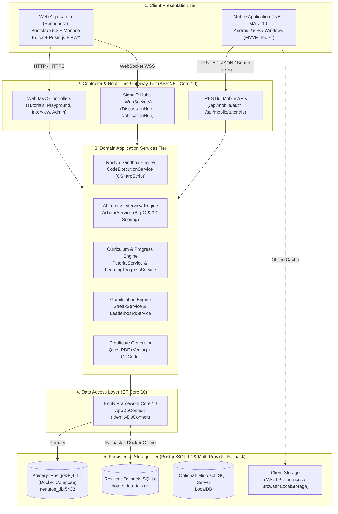
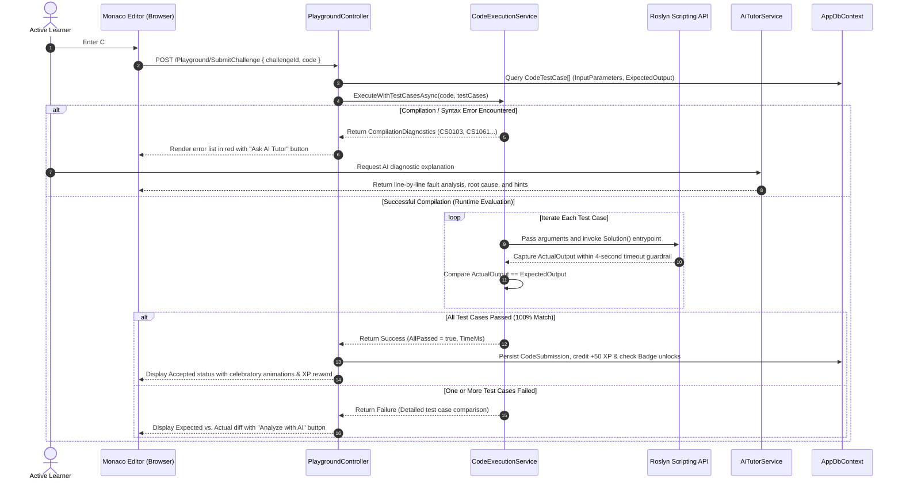
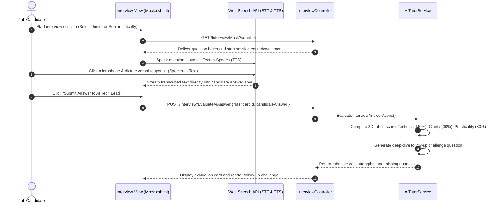

# 06. System Architecture, Clean Code Blueprint & UI/UX Design

Document Type: Technical Solution Architecture & UI/UX Specification Suite  
Author: Senior Solution Architect & Lead Software Engineer  
System: .NET Tutos - Comprehensive .NET Learning & Assessment Platform  
Scope: Web Application (ASP.NET Core 10), Mobile Client (.NET MAUI 10), Database ERD, UI/UX Wireframes  
Version: Release 2.5  
Status: Verified & Approved for Production (PostgreSQL 17 & Docker Orchestrated)  

---

## 1. Tiered Clean Code Directory Architecture

The project is structured according to the modern `.NET 10 Solution` specification (`NET-Tutos.slnx`), establishing clean architectural separation of concerns between **Web Application & REST API (`web/`)**, **Mobile Client (`mobile/`)**, and **System Specifications (`docs/`)**.

### 1.1. Overall Solution Root Structure

```text
d:\NET-Tutos\
├── 📄 NET-Tutos.slnx                  # Modern .NET 10 XML solution file (clean, lightweight)
├── 📄 docker-compose.yml              # Multi-container orchestration (PostgreSQL 17, Web App, pgAdmin 4)
├── 📄 Dockerfile                      # Multi-stage production build for ASP.NET Core 10 Web App
├── 📄 README.md                       # Comprehensive repository guide and quickstart manual
├── 📄 .gitignore                      # Standardized Git exclusion rules for .NET / C# / Visual Studio
│
├── 📂 docs/                           # [System Specifications] Single Source of Truth (SSOT) documentation
├── 📂 web/                            # [Web & REST API] ASP.NET Core 10 MVC + RESTful API + SignalR Hubs
└── 📂 mobile/                         # [Mobile Client] Cross-platform .NET MAUI 10 native client application
```

---

### 1.2. Web Subsystem & RESTful API Architecture (`web/`)

The web application follows an N-Tier Clean Architecture pattern, isolating presentation (Controllers and Razor Views), business domain logic (Application Services), data persistence (EF Core `DbContext`), and real-time networking (SignalR Hubs).

```text
web/
├── 📄 Program.cs                      # Dependency Injection, Middleware pipeline, Auth, and Resilient DB wiring
├── 📄 appsettings.json                # Connection strings (PostgreSQL Docker, SQLite fallback), JWT keys, Logging
├── 📄 web.csproj                      # NuGet packages: Npgsql EF Core 10, Roslyn, QuestPDF, QRCoder, Markdig
│
├── 📂 Controllers/                    # [Controller Tier] HTTP Request handling, validation, and dispatching
│   │
│   ├── 📂 Api/                        # RESTful API Endpoints for Mobile Client and third-party integrations
│   │   ├── 📄 MobileAuthController.cs        # JWT authentication, user registration, login, and profile fetching
│   │   ├── 📄 MobileTutorialsController.cs   # Curriculum endpoints, categories, roadmaps, and progress sync
│   │   └── 📄 MobileFlashcardsController.cs  # Spaced repetition flashcard retrieval and review submissions
│   │
│   ├── 📂 Admin/                      # LMS Administration Controllers (Role: Admin)
│   │   ├── 📄 AdminController.cs             # Administrative overview dashboard and cohort analytics
│   │   ├── 📄 AdminTutorialsController.cs    # Markdown CMS authoring studio with split-screen live preview
│   │   ├── 📄 AdminQuizzesController.cs      # Assessment quiz authoring and question bank curation
│   │   ├── 📄 AdminProjectsController.cs     # Capstone project review, scoring, and feedback evaluation
│   │   └── 📄 AdminUsersController.cs        # User account management, role elevation, and XP moderation
│   │
│   ├── 📂 Learning & Practice/        # Student Learning & Assessment Controllers
│   │   ├── 📄 TutorialsController.cs         # Markdown lesson viewer, reading progress tracking (+20 XP)
│   │   ├── 📄 RoadmapController.cs           # 4-stage learning path from fundamentals to enterprise architectures
│   │   ├── 📄 CurriculumController.cs        # Catalog of 101 structured, standards-compliant lessons
│   │   ├── 📄 CheatSheetController.cs        # Modern C# 14 syntax quick reference manual
│   │   ├── 📄 PlaygroundController.cs        # Monaco Editor sandbox, Roslyn compilation, algorithm test runner
│   │   ├── 📄 QuizController.cs              # Lesson knowledge quizzes with instant feedback
│   │   └── 📄 ExamController.cs              # Timed final examinations and certificate issuance
│   │
│   ├── 📂 AI & Career Prep/           # AI Assistant & Technical Interview Controllers
│   │   ├── 📄 AiTutorController.cs           # Algorithmic Big-O analysis, code diagnostics, xUnit generation
│   │   └── 📄 InterviewController.cs         # 1-on-1 AI Tech Lead technical mock interview with Voice STT/TTS
│   │
│   ├── 📂 Community & Gamification/   # Social Collaboration & Gamification Controllers
│   │   ├── 📄 LeaderboardController.cs       # Hall of Fame leaderboard ranking top learners
│   │   ├── 📄 StreakController.cs            # Daily check-in tracking with flame streak visualizers
│   │   ├── 📄 DiscussionController.cs        # Q&A discussion forum embedded under every tutorial (SignalR)
│   │   ├── 📄 ActivityController.cs          # Real-time community activity feed
│   │   ├── 📄 ProjectController.cs           # Capstone project submission (GitHub repository & Live Demo)
│   │   └── 📄 CertificateController.cs       # Vector PDF certificate viewer and cryptographic QR verification
│   │
│   └── 📂 User & Core/                # User Profile & Identity Controllers
│       ├── 📄 AccountController.cs           # ASP.NET Core Identity authentication (Login, Register, Logout)
│       ├── 📄 ProfileController.cs           # Public developer showcase portfolio (/u/{username})
│       ├── 📄 PlannerController.cs           # Personalized weekly learning planner
│       ├── 📄 NotificationController.cs     # Real-time learner notification center
│       ├── 📄 LanguageController.cs          # Bilingual localization switcher (English / Vietnamese)
│       └── 📄 HomeController.cs              # Landing page, value proposition, policies, and error handling
│
├── 📂 Services/                       # [Application Services Tier] Encapsulated Business Domain Logic
│   ├── 📄 CodeExecutionService.cs     # Roslyn Sandbox compiler, execution supervisor, and unit test runner
│   ├── 📄 AiTutorService.cs           # Big-O asymptotic analyzer and 3-dimensional interview scoring engine
│   ├── 📄 CertificateService.cs       # Vector PDF certificate generator (QuestPDF) and QR validation code
│   ├── 📄 MarkdownService.cs          # Markdig HTML renderer configured with security and Prism.js syntax
│   ├── 📄 TutorialService.cs          # Lesson and category querying, filtering, and caching
│   ├── 📄 LearningProgressService.cs  # Course completion calculation and automated XP award pipeline
│   ├── 📄 StreakService.cs            # Consecutive day check-in algorithm and streak retention rules
│   ├── 📄 FlashcardService.cs         # Leitner spaced repetition review scheduling algorithm
│   ├── 📄 DiscussionService.cs        # Threaded discussion replies, upvoting, and accepted solution awards
│   ├── 📄 INavMenuService.cs          # Navigation menu and universal Command Palette cache interface
│   ├── 📄 NavMenuService.cs           # In-memory cached implementation of navigation metadata
│   ├── 📄 MobileAuthService.cs        # Stateless JWT token generation and validation for mobile clients
│   ├── 📄 LocalizationHelper.cs       # Cross-cutting localization helper supporting EN and VI
│   └── 📄 *Translations.cs            # Pre-seeded bilingual localization dictionaries
│
├── 📂 Data/                           # [Data Persistence Tier] Database Context & Seeding Pipeline
│   ├── 📄 AppDbContext.cs             # IdentityDbContext managing 23 entity sets, configurations, and indexes
│   ├── 📄 DbInitializer.cs            # Schema bootstrap, migrations, and initial seed data for curriculum and users
│   ├── 📄 InterviewFlashcardSeeder.cs # Pre-seeded technical interview question repository
│   └── 📄 MockUserSeeder.cs           # Mock learner accounts for the Hall of Fame leaderboard
│
├── 📂 Hubs/                           # [Real-Time WebSocket Tier] SignalR Hubs
│   ├── 📄 DiscussionHub.cs            # Broadcasts new comments, peer upvotes, and online learner presence
│   └── 📄 NotificationHub.cs          # Real-time notifications for level-ups, badge unlocks, and exam results
│
├── 📂 Models/                         # [Data Model Tier] Entities, DTOs, and ViewModels
│   ├── 📂 Entities/                   # 23 POCO database entities mapped directly to relational tables
│   │   ├── 📄 ApplicationUser.cs      # Inherits IdentityUser, adds XP, Streak, Avatar, and Bio
│   │   ├── 📄 Tutorial.cs / Category.cs # Lesson content, taxonomy, and roadmap stages
│   │   ├── 📄 CodingChallenge.cs / CodeTestCase.cs / CodeSubmission.cs # Coding challenges & submissions
│   │   ├── 📄 DiscussionComment.cs / CommentUpvote.cs # Community Q&A forum threads
│   │   ├── 📄 InterviewFlashcard.cs / UserFlashcardProgress.cs # Interview flashcards and mastery states
│   │   ├── 📄 Certificate.cs / CapstoneProject.cs # Digital certificates and capstone submissions
│   │   └── 📄 DailyCheckIn.cs / UserBadge.cs # Gamification records and earned achievement badges
│   ├── 📂 DTOs/Mobile/                # Data Transfer Objects tailored for Mobile REST API responses
│   └── 📂 ViewModels/                 # Strongly-typed models binding application data to Razor Views
│
├── 📂 Views/                          # [Presentation Tier] Razor Views (.cshtml)
│   ├── 📂 Shared/                     # Master layout, navigation bars, Streak modals, discussion partials
│   ├── 📂 Home/ / Tutorials/ / Playground/ / Interview/ / Exam/ ... # Views mapped to each functional area
│   └── 📄 _ViewImports.cshtml / _ViewStart.cshtml
│
└── 📂 wwwroot/                        # [Static Client Assets]
    ├── 📂 css/                        # Custom stylesheets (site.css, design system tokens, dark mode)
    ├── 📂 js/                         # Client scripts (Monaco configuration, Web Speech API, SignalR listeners)
    ├── 📂 lib/                        # Vendor libraries (Bootstrap 5.3, Monaco Editor, Prism.js)
    ├── 📂 images/                     # Achievement badge graphics, C# technology logos, language flags
    ├── 📄 manifest.json               # Progressive Web App (PWA) manifest configuration
    ├── 📄 sw.js                       # Service Worker implementing offline caching strategies
    └── 📄 offline.html                # Friendly fallback UI displayed when offline connectivity is lost
```

---

### 1.3. Mobile Subsystem Architecture (`mobile/`)

The mobile client leverages the **MVVM (Model-View-ViewModel)** architectural pattern through `CommunityToolkit.Mvvm`, ensuring strict decoupling between the XAML declarative user interface and business logic.

```text
mobile/
├── 📄 MauiProgram.cs                  # MAUI App Builder, Dependency Injection, and service registrations
├── 📄 App.xaml / App.xaml.cs          # Application lifecycle handlers and shared Resource Dictionary tokens
├── 📄 AppShell.xaml / AppShell.xaml.cs# Navigation topology with Shell Flyout/Tab Menu (Home, Tutorials, Roadmap, Flashcards)
├── 📄 NET_Tutos.Mobile.csproj         # Target framework specifications (Android API 21-36, iOS, Windows)
│
├── 📂 Models/                         # Client Data Models
│   └── 📄 MobileModels.cs             # Client-side definitions: UserProfile, TutorialSummary, FlashcardItem
│
├── 📂 Services/                       # Network Communication & Platform Services
│   ├── 📄 ApiService.cs               # HttpClient wrapper calling Web APIs with Bearer Token management
│   └── 📄 ThemeService.cs             # Synchronizes dark/light themes with operating system preferences
│
├── 📂 ViewModels/                     # Reactive ViewModel Tier (MVVM)
│   ├── 📄 BaseViewModel.cs            # Root ViewModel providing IsBusy, Title, and INotifyPropertyChanged
│   ├── 📄 HomeViewModel.cs            # Learner dashboard stats, active streak indicators, featured categories
│   ├── 📄 TutorialsViewModel.cs       # Search, filtering by category taxonomy, and paginated lesson lists
│   ├── 📄 TutorialDetailViewModel.cs  # Markdown lesson reader and lesson completion trigger (+20 XP)
│   ├── 📄 RoadmapViewModel.cs         # Visual learner roadmap progress tracker
│   ├── 📄 FlashcardsViewModel.cs      # Interactive 3D flip card review session with Leitner ratings
│   ├── 📄 LoginViewModel.cs           # User authentication and secure token storage via MAUI Preferences
│   └── 📄 SettingsViewModel.cs        # Theme configuration and configurable API host URL (default: 10.0.2.2)
│
├── 📂 Views/                          # Native Declarative XAML User Interface
│   ├── 📄 HomePage.xaml               # Home dashboard with progress summaries and active course cards
│   ├── 📄 TutorialsPage.xaml          # Lesson catalog with real-time search and filter controls
│   ├── 📄 TutorialDetailPage.xaml    # Mobile-optimized Markdown reader with code syntax rendering
│   ├── 📄 RoadmapPage.xaml            # Step-by-step 4-stage learning path visualization
│   ├── 📄 FlashcardsPage.xaml         # 3D animated flashcard review interface
│   ├── 📄 LoginPage.xaml              # Authentication form with 1-click pre-configured demo accounts
│   └── 📄 SettingsPage.xaml           # Application preferences and backend API endpoint settings
│
├── 📂 Platforms/                      # Platform-Specific Native Code & Manifests
│   ├── 📂 Android/                    # AndroidManifest.xml, MainActivity.cs, API level 36 target
│   ├── 📂 iOS/                        # Info.plist, AppDelegate.cs
│   └── 📂 Windows/                    # Package.appxmanifest, App.xaml.cs
│
└── 📂 Resources/                      # Multi-Platform Visual & Font Assets
    ├── 📂 AppIcon/ & 📂 Splash/       # Vector SVG application icons and launch splash screens
    ├── 📂 Fonts/                      # Embedded typography (OpenSans-Regular, OpenSans-Semibold)
    ├── 📂 Images/                     # Vector SVG icons for bottom tab navigation
    └── 📂 Styles/                     # Global styling resources (Colors.xaml, Styles.xaml)
```

---

## 2. Multi-Tier System Topology & Interaction Architecture

The solution implements an **N-Tier Distributed Architecture**, combining server-side rendering for web clients with stateless RESTful APIs for mobile apps, sandboxed code execution, and AI evaluation services.



---

## 3. Key Sequence Flows

### 3.1. Live Roslyn Code Execution & Automated AI Diagnostic Flow



### 3.2. AI Mock Voice Technical Interview Flow



---

## 4. Relational Database Schema & Entity Relationship Diagram (ERD)

The persistence model consists of **23 relational entity tables** orchestrated via Entity Framework Core 10. Below is the central entity relationship blueprint:

```mermaid
erDiagram
    ApplicationUser ||--o{ UserLessonProgress : "tracks"
    ApplicationUser ||--o{ CourseEnrollment : "enrolls"
    ApplicationUser ||--o{ QuizAttempt : "attempts"
    ApplicationUser ||--o{ Certificate : "earns"
    ApplicationUser ||--o{ CodeSubmission : "submits"
    ApplicationUser ||--o{ DiscussionComment : "writes"
    ApplicationUser ||--o{ CommentUpvote : "casts"
    ApplicationUser ||--o{ UserBadge : "collects"
    ApplicationUser ||--o{ DailyCheckIn : "logs"
    ApplicationUser ||--o{ UserNotification : "receives"
    ApplicationUser ||--o{ ProjectSubmission : "presents"
    ApplicationUser ||--o{ UserFlashcardProgress : "reviews"
    ApplicationUser ||--o| DeveloperProfile : "owns"

    Category ||--o{ Tutorial : "contains"
    Category ||--o{ CodingChallenge : "organizes"
    Category ||--o{ CapstoneProject : "groups"

    Tutorial ||--o{ QuizQuestion : "has"
    Tutorial ||--o{ CodeSnippet : "embeds"
    Tutorial ||--o{ UserLessonProgress : "monitors"
    Tutorial ||--o{ DiscussionComment : "hosts"

    CodingChallenge ||--o{ CodeTestCase : "defines"
    CodingChallenge ||--o{ CodeSubmission : "evaluates"
    CodingChallenge ||--o{ DiscussionComment : "discusses"

    DiscussionComment ||--o{ DiscussionComment : "replies_to"
    DiscussionComment ||--o{ CommentUpvote : "receives"

    InterviewFlashcard ||--o{ UserFlashcardProgress : "repetition_state"

    CapstoneProject ||--o{ ProjectSubmission : "reviews"

    StudyPlan ||--o{ StudyPlanItem : "schedules"
    ApplicationUser ||--o{ StudyPlan : "creates"

    ApplicationUser {
        string Id PK
        string FullName
        string Email
        int ExperiencePoints
        int CurrentStreak
        int LongestStreak
        DateTime LastCheckInDate
        string AvatarUrl
        string Bio
    }

    Tutorial {
        int Id PK
        int CategoryId FK
        string Title
        string Slug UK
        string ContentMarkdown
        int EstimatedReadingMinutes
        int Difficulty
        int OrderIndex
        int XpReward
    }

    CodingChallenge {
        int Id PK
        int CategoryId FK
        string Title
        string Slug UK
        string DescriptionMarkdown
        string InitialCodeTemplate
        int Difficulty
        int XpReward
    }

    CodeTestCase {
        int Id PK
        int CodingChallengeId FK
        string InputParameters
        string ExpectedOutput
        bool IsHidden
    }

    Certificate {
        int Id PK
        string UserId FK
        int CategoryId FK
        string CertificateCode UK
        DateTime IssueDate
        double Score
    }

    InterviewFlashcard {
        int Id PK
        string Slug UK
        string Topic
        int Difficulty
        string QuestionVi
        string QuestionEn
        string AnswerMarkdownVi
        string AnswerMarkdownEn
    }
```



### 4.1. Business Entity Groupings

| Functional Domain | Core Entities | Business Purpose |
| :--- | :--- | :--- |
| **Curriculum & Lessons** | `Category`, `Tutorial`, `CodeSnippet` | Stores 101 structured Markdown tutorials across 4 mastery stages with embedded syntax examples. |
| **Evaluation & Judging** | `CodingChallenge`, `CodeTestCase`, `CodeSubmission` | Stores algorithmic problem descriptions, visible/hidden test cases, and historical user submissions. |
| **Quizzes & Certification** | `QuizQuestion`, `QuizAttempt`, `Certificate` | Question pool for timed assessment exams, scoring history, and cryptographic vector PDF certificates. |
| **Community & Discussion** | `DiscussionComment`, `CommentUpvote` | Threaded Q&A comments scoped by tutorial or coding challenge with peer upvoting and accepted answers. |
| **Gamification Engine** | `DailyCheckIn`, `UserBadge`, `ActivityFeedItem` | Consecutive day flame streaks, trigger-based unlockable achievement badges, and real-time community feed. |
| **Technical Interview** | `InterviewFlashcard`, `UserFlashcardProgress` | Curated C#, CLR, and EF Core question bank with Leitner spaced repetition review intervals. |
| **Capstone Projects** | `CapstoneProject`, `ProjectSubmission` | Real-world project assignments with GitHub repository URLs, live demo links, and instructor evaluations. |
| **Study Planning & Profiles** | `StudyPlan`, `StudyPlanItem`, `DeveloperProfile` | Personalized learner study schedules and shareable developer showcase profiles (`/u/{username}`). |

---

## 5. UI/UX Wireframe & Screen Architecture

### 5.1. Interactive Playground IDE Layout (`Playground/Index.cshtml`)

The Playground interface utilizes a **split-screen IDE layout**, enabling learners to review specifications and write code side-by-side without context switching.

```text
+---------------------------------------------------------------------------------------------------+
|  [Logo C#] NET-Tutos    Curriculum   Roadmap   C# Playground   AI Interview   [🔥 5 Days] [Avatar] |
+---------------------------------------------------------------------------------------------------+
|  Challenge: Reverse Words in a String         [Difficulty: Medium]   [Reward: +40 XP]  [⏱️ 00:00]   |
+-------------------------------------------------+-------------------------------------------------+
|  PROBLEM DESCRIPTION & EXAMPLES                 |  IN-BROWSER CODE EDITOR (MONACO ENGINE)         |
|                                                 |                                                 |
|  Given an input string s, reverse the order     |  1 | using System;                              |
|  of the words in the string.                    |  2 |                                            |
|                                                 |  3 | public class Solution                      |
|  Example 1:                                     |  4 | {                                          |
|  Input: s = "the sky is blue"                   |  5 |     public string ReverseWords(string s)   |
|  Output: "blue is sky the"                      |  6 |     {                                      |
|                                                 |  7 |         // Write your C# code here...      |
|  Constraints:                                   |  8 |     }                                      |
|  - 1 <= s.Length <= 10^4                        |  9 | }                                          |
|  - In-place memory efficiency encouraged        |                                                 |
|                                                 |  [Shortcuts: Ctrl+Enter (Run) | Ctrl+S (Save)]  |
+-------------------------------------------------+-------------------------------------------------+
|  AUTOMATED TEST RESULTS (ROSLYN SANDBOX)                                                          |
|                                                                                                   |
|  [✅ Test Case 1: Passed (12ms)]   [✅ Test Case 2: Passed (8ms)]   [❌ Test Case 3: Output Mismatch] |
|  -----------------------------------------------------------------------------------------------  |
|  Test Case 3: Input: "  hello world  "  |  Expected: "world hello"  |  Actual: "world hello "     |
|  👉 [🤖 Ask AI Tutor to Diagnose]            👉 [💡 View Socratic Hint]       [ Submit Solution 🚀 ] |
+---------------------------------------------------------------------------------------------------+
```

### 5.2. Lesson Markdown Reader Layout (`Tutorials/Details.cshtml`)

```text
+---------------------------------------------------------------------------------------------------+
|  [===] Reading Progress: 65% [=====================================================>             ] |
+----------------------------------+------------------------------------------------+---------------+
|  COURSE TABLE OF CONTENTS        |  LESSON CONTENT (MARKDOWN ENGINE)              |  ON THIS PAGE |
|                                  |                                                |               |
|  Chapter 2: Advanced C#          |  # Asynchronous Programming with async/await   |  - Concept    |
|  ├─ 2.1 Concurrency Basics       |                                                |  - Task vs    |
|  ├─ 2.2 async and await (Active) |  In .NET, asynchronous programming relies on   |    Thread     |
|  ├─ 2.3 CancellationToken        |  the Task-based Asynchronous Pattern (TAP)     |  - Deadlock   |
|  └─ 2.4 Channels & Dataflow      |  to prevent UI thread and I/O blocking...      |    Prevention |
|                                  |                                                |  - Exercises  |
|  Chapter 3: Entity Framework     |  ```csharp                                     |               |
|  ├─ 3.1 DbContext Configuration  |  public async Task<List<User>> GetUsersAsync() |  [🔥 350 XP]  |
|  └─ 3.2 LINQ Query Optimization  |  {                                             |  [Mark as     |
|                                  |      return await _db.Users.ToListAsync();     |   Complete    |
|                                  |  }                                             |   +20 XP]     |
|                                  |  ```                                           |               |
+----------------------------------+------------------------------------------------+---------------+
|  REAL-TIME PEER DISCUSSION (SIGNALR Q&A)                                                          |
|                                                                                                   |
|  [ Write a question or comment... (Markdown formatting supported)             ]  [ Post Comment ] |
|                                                                                                   |
|  💬 Alex Miller: "Is ConfigureAwait(false) still recommended in ASP.NET Core controllers?"         |
|     ↳ 🌟 Admin (Accepted Solution): "In ASP.NET Core, SynchronizationContext was removed, so..."   |
+---------------------------------------------------------------------------------------------------+
```

### 5.3. Mobile Client Layout (.NET MAUI Tab Navigation)

```text
+-----------------------------------+
| 09:41                        📶 🔋 |
| .NET Tutos            [🌙] [🔔]   |
+-----------------------------------+
| Welcome back, Alex Miller! 👋     |
| 🔥 Streak: 5 Days  |  ⭐ 350 XP   |
+-----------------------------------+
| [RESUME ACTIVE LESSON]            |
| 📘 Lesson 14: LINQ Execution...   |
| [================>      ] 70%     |
+-----------------------------------+
| 4-STAGE MASTERY ROADMAP           |
| 🟢 Stage 1: C# Fundamentals (100%)|
| 🟡 Stage 2: OOP & LINQ (65%)      |
| ⚪ Stage 3: EF Core & SQL (0%)    |
| ⚪ Stage 4: ASP.NET Core Web API  |
+-----------------------------------+
| TODAY'S INTERVIEW FLASHCARD       |
| +-------------------------------+ |
| | 🎴 Card #12: Key differences  | |
| | between IQueryable and        | |
| | IEnumerable in EF Core?       | |
| |                               | |
| |   [ Tap to flip answer 👆 ]   | |
| +-------------------------------+ |
| [ 🔴 Review Needed ] [ 🟢 Mastered ] |
+-----------------------------------+
| [ 🏠 Home | 📚 Lessons | 🗺️ Roadmap | 🎴 Flashcards | ⚙️ Settings ] |
+-----------------------------------+
```

---

## 6. Engineering Standards & Code Style Conventions

1. **C# 14 & .NET 10 Modern Idioms**:
   - Leverage `File-scoped namespaces`, `Primary Constructors`, `Target-typed new`, and recursive `Pattern Matching`.
   - All I/O and database operations must be asynchronous (`async/await`) accepting a `CancellationToken`.
2. **EF Core Best Practices**:
   - Enforce `AsNoTracking()` across all read-only queries to eliminate change tracker memory overhead.
   - Strictly paginate (`Skip()`, `Take()`) unbounded datasets (Tutorials, Activity Feed items, and Discussion comments).
3. **Sandbox Security Boundaries**:
   - The Roslyn Scripting API executes inside a controlled AppDomain guardrail with prohibited namespace filters and a strict 4-second timeout to mitigate infinite loops and resource exhaustion attacks.
4. **Resilient Dual-Provider Database Fallback**:
   - The platform targets PostgreSQL 17 (hosted in Docker Compose) as its primary enterprise database, with automatic transparent fallback to SQLite if the Docker daemon is offline. Developers cloning the repository can run `dotnet run` instantly with zero setup roadblocks.
