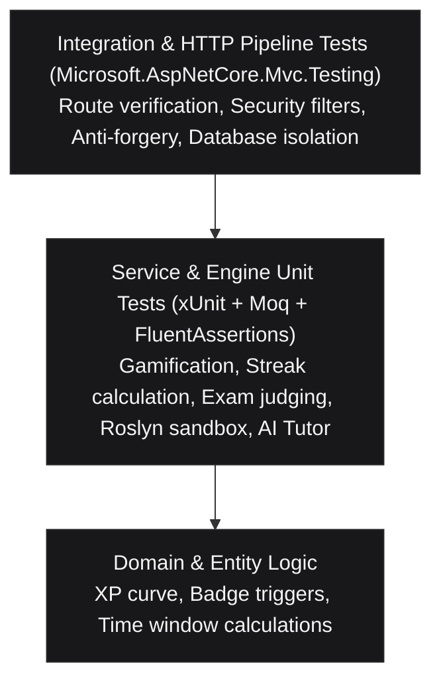
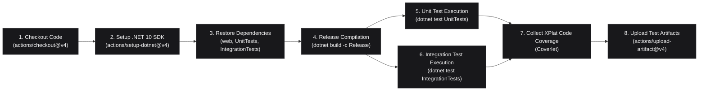

# Automated Testing Strategy, Test Case Matrix & Exception Handling Specifications

Document Type: Enterprise Quality Assurance & Automated Testing Specification  
System: .NET Tutos - Comprehensive .NET Learning & Assessment Platform  
Scope: Unit Testing, Integration Testing, Sandboxed Execution, CI/CD Automated Quality Gates  
Target Framework: .NET 10 (`net10.0`), C# 14  
Tooling: xUnit 2.9, FluentAssertions 7.2, Moq 4.20, Coverlet 6.0, Microsoft.AspNetCore.Mvc.Testing 10.0  
Status: Verified & Integrated in Automated CI Pipeline  

---

## 1. Quality Strategy & Testing Pyramid

The .NET Tutos testing architecture follows the classic **Automated Testing Pyramid**, balancing execution speed, diagnostic precision, and end-to-end integration fidelity.



### Architectural Principles:
1. **Zero External Dependency in Tests:** Unit tests run entirely in-memory with mocked dependencies (`Mock<UserManager<ApplicationUser>>`, `Mock<ICertificateService>`) and EF Core In-Memory providers.
2. **Self-Contained Integration Tests:** ASP.NET Core MVC integration tests utilize `CustomWebApplicationFactory` with an isolated SQLite test database, requiring no live Docker containers or external PostgreSQL instances to execute.
3. **Deterministic Sandbox Testing:** Code execution tests verify Roslyn compiler boundaries, timeout safety, keyword blacklisting, and exception containment without thread leaks or process hangs.
4. **Continuous Quality Gate:** Automated GitHub Actions pipeline (`.github/workflows/ci.yml`) compiles in Release configuration, runs all unit and integration suites, and enforces code coverage artifact retention.

---

## 2. Comprehensive Test Cases Matrix

The automated test suite covers all core business services, execution runtimes, and HTTP endpoints.

### 2.1. Streak & Retention Service (`StreakServiceTests`)

| Test ID | Test Method | Objective / Scenario | Input Data | Expected Result |
| :--- | :--- | :--- | :--- | :--- |
| `TC-STR-01` | `CheckInTodayAsync_FirstTimeUser_InitializesStreakAndAwardsBaseXP` | Verify first-ever user check-in initializes streak counter to 1 and awards 10 XP base. | New user with no check-in history | `IsSuccess = true`, `CurrentStreak = 1`, `XpEarned = 10`, `LongestStreak = 1` |
| `TC-STR-02` | `CheckInTodayAsync_ConsecutiveDay_IncrementsStreakAndAwardsBonus` | Verify consecutive day check-in increments streak and applies formula: $10 + \min(streak \times 2, 40)$. | User checked in yesterday (Streak = 1) | `CurrentStreak = 2`, `XpEarned = 14`, `StreakBonusXp = 4` |
| `TC-STR-03` | `CheckInTodayAsync_SameDayCheckIn_RejectsDuplicate` | Prevent duplicate daily check-ins on the same calendar day. | User already checked in today | `IsSuccess = false`, `Message` warns already checked in, XP not incremented |
| `TC-STR-04` | `CheckInTodayAsync_MissedOneDay_ResetsStreakToOne` | Reset streak to 1 when a user misses one or more full calendar days. | User last checked in 2 days ago (Streak = 5) | `CurrentStreak = 1`, `LongestStreak` preserved at 5 |
| `TC-STR-05` | `CheckInTodayAsync_ReachingMilestone_UnlocksBadge` | Award milestone badge when streak reaches 3 days (`streak-3`). | User at streak 2 checking in consecutively | `NewlyUnlockedBadges` contains `streak-3` badge |
| `TC-STR-06` | `CheckInTodayAsync_ReachingWeekMilestone_UnlocksBadge` | Award milestone badge when streak reaches 7 days (`streak-7`). | User at streak 6 checking in consecutively | `NewlyUnlockedBadges` contains `streak-7` badge |
| `TC-STR-07` | `CheckInTodayAsync_UserNotFound_ReturnsFailure` | Guard against non-existent user IDs gracefully without throwing unhandled exceptions. | Non-existent `userId = "non-existent"` | `IsSuccess = false`, `Message` indicates user not found |
| `TC-STR-08` | `GetUserStreakAsync_CalculatesDaysRemainingToNextMilestone` | Calculate remaining days until the next milestone tier (3 -> 7 -> 14 -> 30). | User with active streak of 4 days | Next milestone target is 7, `DaysToNextMilestone = 3` |

---

### 2.2. Gamification & Progression Service (`GamificationServiceTests`)

| Test ID | Test Method | Objective / Scenario | Input Data | Expected Result |
| :--- | :--- | :--- | :--- | :--- |
| `TC-GAM-01` | `CalculateLevel_VariousXpAmounts_ReturnsCorrectLevelAndProgress` | Verify quadratic XP level progression formula $XP_{req} = Level \times 100 \times 1.5$. | XP values: 0, 100, 300, 1000 | Levels: 1 (0 XP), 1 (100 XP), 2 (300 XP), 4 (1000 XP) with calculated percentage |
| `TC-GAM-02` | `GetAllBadgesAsync_ReturnsPredefinedBadgesWithUniqueCodes` | Validate predefined system badges contain non-empty unique identifier codes. | Seed badge catalog | Badges count $\ge 4$, all badge codes are distinct and valid |
| `TC-GAM-03` | `GetLeaderboardAsync_OrdersByTotalXpDescending` | Verify leaderboard correctly sorts learners by Total XP in descending order. | 3 users with 50 XP, 500 XP, 150 XP | Top 1 is User B (500 XP), Top 2 is User C (150 XP), Top 3 is User A (50 XP) |

---

### 2.3. Exam & Certification Service (`ExamServiceTests`)

| Test ID | Test Method | Objective / Scenario | Input Data | Expected Result |
| :--- | :--- | :--- | :--- | :--- |
| `TC-EXM-01` | `GetExamListAsync_ReturnsCategoryExamsWithConfiguredPassingThreshold` | Verify category exams have standardized passing score threshold and duration. | 2 Categories in database | Returns 3 exam topics (2 category exams + 1 full-course graduation assessment), 80% passing score, 15 min duration |
| `TC-EXM-02` | `GetExamListAsync_WithUserPassedAttempt_MarksHasPassedAsTrue` | Verify user attempt history reflects passed status and records best score. | User with completed attempt (Score = 90%, `IsPassed = true`) | Topic item `HasPassed = true`, `BestScore = 90` |

---

### 2.4. Sandboxed Code Execution Service (`CodeExecutionServiceTests`)

| Test ID | Test Method | Objective / Scenario | Input Data | Expected Result |
| :--- | :--- | :--- | :--- | :--- |
| `TC-EXE-01` | `ExecuteAsync_ValidConsoleCode_ReturnsSuccessWithCapturedOutput` | Execute standard C# code and capture stdout string output. | `Console.WriteLine("Hello .NET 10!");` | `IsSuccess = true`, `Output = "Hello .NET 10!"`, `ExecutionTimeMs >= 0` |
| `TC-EXE-02` | `ExecuteAsync_EmptyOrWhitespaceCode_ReturnsFailureWithoutExecuting` | Reject empty or null script submissions before initializing the compiler. | `""`, `"   "`, `null` | `IsSuccess = false`, `Error` explains code cannot be empty |
| `TC-EXE-03` | `ExecuteAsync_ForbiddenKeywords_BlocksExecutionWithSecurityError` | Enforce keyword blacklist preventing unauthorized process, file, or socket execution. | `Process.Start`, `File.WriteAllText`, `Directory.CreateDirectory`, `Environment.Exit` | `IsSuccess = false`, `Error` contains security restriction notice, output is empty |
| `TC-EXE-04` | `ExecuteAsync_CompilationError_ReturnsCompilerDiagnostics` | Capture Roslyn CSharpScript compilation errors with exact diagnostic codes. | `int a = "invalid string"` (missing semicolon and type mismatch) | `IsSuccess = false`, `Error` contains CS compiler error code and position |
| `TC-EXE-05` | `ExecuteAsync_RuntimeDivisionByZeroException_CapturesAndReturnsDetails` | Intercept runtime unhandled exceptions within user code without crashing the host process. | Division by zero: `100 / divisor` | `IsSuccess = false`, `Error` identifies `DivideByZeroException` |
| `TC-EXE-06` | `ExecuteAsync_InfiniteLoop_TimesOutGracefully` | Terminate scripts exceeding the allocated timeout threshold ($300\text{ms}$ in test, $4000\text{ms}$ in production). | Long-running asynchronous delay exceeding timeout | `IsSuccess = false`, `IsTimeout = true`, `Error` indicates execution timeout |
| `TC-EXE-07` | `EvaluateChallengeAsync_AllMatchingCases_ReturnsAllPassed` | Compile solution class, inject parameterized inputs, and assert matching outputs. | `Solution.Add(a, b)` tested against cases `(1, 2) -> 3`, `(10, -5) -> 5` | `AllPassed = true`, `PassedTestsCount = 2`, `TotalTestsCount = 2` |
| `TC-EXE-08` | `EvaluateChallengeAsync_FailingTestCase_IdentifiesMismatchedOutput` | Compare actual vs expected outputs and flag failing test cases accurately. | Subtraction solution `a - b` tested against addition challenge | `AllPassed = false`, `PassedTestsCount = 0`, actual `"2"` vs expected `"8"` |

---

### 2.5. AI Tutor & Intelligent Interview Engine (`AiTutorServiceTests`)

| Test ID | Test Method | Objective / Scenario | Input Data | Expected Result |
| :--- | :--- | :--- | :--- | :--- |
| `TC-AIT-01` | `ChatAsync_LinqQuery_ReturnsStructuredLinqKnowledge` | Synthesize structured technical response explaining LINQ deferred execution in Vietnamese and English. | "How does linq deferred execution work?" / "Giải thích linq" | `ResponseMarkdown` contains LINQ concepts, code snippet provided, suggested follow-ups returned |
| `TC-AIT-02` | `ExplainErrorAsync_MissingSemicolon_ReturnsDiagnosticAndFix` | Parse C# compiler error code `CS1002` and generate actionable code remedy. | Error message `CS1002: ; expected` | `Success = true`, `ErrorCode = "CS1002"`, `HowToFix` provides correction |
| `TC-AIT-03` | `AnalyzeComplexityAsync_SingleLoop_ReturnsOOfN` | Perform static code analysis to infer algorithmic time and space complexity. | Method with single loop summing array elements | `Success = true`, `TimeComplexity = "O(n)"`, `SpaceComplexity = "O(1)"` |
| `TC-AIT-04` | `GenerateUnitTestAsync_ValidMethod_ProducesArrangeActAssertSuite` | Automatically synthesize an xUnit test suite following the AAA pattern for target method. | Class `Calculator` with method `Multiply(a, b)` | `Success = true`, `TestCode` contains `[Fact]`, `// Arrange`, `// Act`, `// Assert`, framework is `xUnit (.NET 10)` |
| `TC-AIT-05` | `EvaluateInterviewAnswerAsync_StrongAnswer_ReturnsHighTechnicalScore` | Evaluate candidate technical interview response across 3 dimensions (Technical, Clarity, Depth). | Async/await answer discussing non-blocking model, compiler state machine, and CancellationToken | `Success = true`, `OverallScore >= 70`, `Strengths` highlights state machine and non-blocking insights |

---

### 2.6. Integration & HTTP Endpoint Pipeline (`BasicEndpointTests`)

| Test ID | Test Method | Route Tested | Protocol / Method | Expected Status / Behavior |
| :--- | :--- | :--- | :--- | :--- |
| `TC-INT-01` | `Get_PublicEndpoints_ReturnSuccessAndCorrectContentType` | `/` | `GET` | `200 OK`, `Content-Type: text/html` |
| `TC-INT-02` | `Get_PublicEndpoints_ReturnSuccessAndCorrectContentType` | `/Streak` | `GET` | `200 OK`, `Content-Type: text/html` |
| `TC-INT-03` | `Get_PublicEndpoints_ReturnSuccessAndCorrectContentType` | `/chuoi-ngay-hoc` | `GET` | `200 OK` (Vietnamese SEO friendly alias route) |
| `TC-INT-04` | `Get_PublicEndpoints_ReturnSuccessAndCorrectContentType` | `/Playground` | `GET` | `200 OK`, Monaco editor container loaded |
| `TC-INT-05` | `Get_PublicEndpoints_ReturnSuccessAndCorrectContentType` | `/Tutorials` | `GET` | `200 OK`, Curriculum syllabus rendered |
| `TC-INT-06` | `Get_PublicEndpoints_ReturnSuccessAndCorrectContentType` | `/AiTutor` | `GET` | `200 OK`, AI Assistant workspace ready |
| `TC-INT-07` | `Get_PublicEndpoints_ReturnSuccessAndCorrectContentType` | `/Exam` | `GET` | `200 OK`, Certification exam list ready |
| `TC-INT-08` | `Get_PublicEndpoints_ReturnSuccessAndCorrectContentType` | `/Leaderboard` | `GET` | `200 OK`, Hall of Fame table rendered |
| `TC-INT-09` | `Post_StreakCheckIn_WhenUnauthenticated_IsProtectedBySecurity` | `/Streak/CheckIn` | `POST` | Redirect to `/Account/Login` (302) or `401 Unauthorized` |
| `TC-INT-10` | `Post_PlaygroundExecute_WithValidConsoleCode_ReturnsSuccessOutput` | `/Playground/Execute` | `POST` | `200 OK`, JSON `{ isSuccess: true, output: "Integration Test OK" }` |
| `TC-INT-11` | `Post_PlaygroundExecute_WithMaliciousCode_ReturnsBlockedError` | `/Playground/Execute` | `POST` | `200 OK`, JSON `{ isSuccess: false, error: "...bị cấm vì lý do an toàn bảo mật..." }` |
| `TC-INT-12` | `Post_AiTutorChat_ReturnsValidMarkdownExplanation` | `/AiTutor/Chat` | `POST` | `200 OK`, JSON response containing non-empty Markdown advice |

---

## 3. Exceptions & Error Handling Matrix

This matrix catalogs all system exceptions, their triggering scenarios, internal mitigations, and user-facing resolutions.

| Exception Type | Trigger Scenario | Subsystem / Layer | System Handling & Defense | HTTP Status / Return Model | Remediation / Recovery Action |
| :--- | :--- | :--- | :--- | :--- | :--- |
| **`ArgumentException` / `ArgumentNullException`** | Null or whitespace C# code submitted to Playground; empty chat prompt submitted to AI Tutor. | `CodeExecutionService`, `AiTutorService` | Early parameter validation before compiler or LLM pipeline is invoked. | `200 OK` with `{ isSuccess: false, error: "Mã nguồn không được để trống." }` | Prompt user in Monaco editor / chat UI to provide non-empty input. |
| **`SecurityException`** | Script contains prohibited system calls (`System.Diagnostics.Process`, `System.IO.File`, `Environment.Exit`). | `CodeExecutionService` (Sandbox Security Filter) | Regex and keyword blacklist validation prior to Roslyn AST parsing. Lock is never acquired for malicious code. | `200 OK` with `{ isSuccess: false, error: "Từ chối thực thi: Mã nguồn chứa từ khóa bị cấm..." }` | Inform user of sandbox constraints; recommend pure algorithmic constructs. |
| **`CompilationErrorException`** | Syntax errors, unresolved symbols, missing namespaces in user code. | Roslyn CSharpScript Compiler | Catches `CompilationErrorException`, maps compiler diagnostic line and column coordinates. | `200 OK` with `{ isSuccess: false, error: "Lỗi biên dịch: [Dòng X, Cột Y] CS1002..." }` | Highlight error line in Monaco Editor gutter; offer AI Tutor diagnostic fix button. |
| **`TimeoutException` / `OperationCanceledException`** | Infinite loops (`while(true)`), heavy recursive algorithms exceeding timeout limit ($4\text{s}$). | `CodeExecutionService` (`Task.WhenAny` Timeout Monitor) | Timeout task cancels the execution token, stops stopwatch, and deterministically releases semaphore lock in `finally`. | `200 OK` with `{ isSuccess: false, isTimeout: true, error: "Thời gian chạy vượt quá giới hạn an toàn..." }` | Instruct learner to inspect loop termination conditions and recursion base cases. |
| **`DivideByZeroException`** | Mathematical runtime calculation error inside user script. | Roslyn Runtime Sandbox | Caught by generic runtime exception boundary; stdout buffer preserved. | `200 OK` with `{ isSuccess: false, error: "Lỗi thời gian chạy: DivideByZeroException..." }` | Display call stack in console output panel. |
| **`NullReferenceException`** | Uninitialized object reference dereferenced in user code. | Roslyn Runtime Sandbox | Intercepted by exception handler; prevents crash of ASP.NET Core worker thread. | `200 OK` with `{ isSuccess: false, error: "Lỗi thời gian chạy: NullReferenceException..." }` | Suggest null checking or C# nullable reference types (`?`). |
| **`UnauthorizedAccessException`** | Anonymous HTTP caller invokes `[Authorize]` endpoints (e.g. `/Streak/CheckIn`). | ASP.NET Core Identity & Authorization Middleware | Intercepted by cookie authentication scheme; prevents unauthenticated state modification. | `302 Redirect` to `/Account/Login?ReturnUrl=...` or `401 Unauthorized` | Redirect learner to login modal or sign-in page. |
| **`AntiforgeryValidationException`** | CSRF token missing or mismatch on POST actions. | ASP.NET Core AntiForgery Middleware | Rejects request before reaching controller action. | `400 Bad Request` | Refresh page to acquire valid anti-forgery token cookies. |
| **`DbUpdateConcurrencyException`** | Concurrent streak check-in or profile updates on the same account. | Entity Framework Core 10 | Optimistic concurrency token check; transaction rollback. | Handled gracefully with retry notice. | Inform user that state has already been synchronized. |
| **`SocketException` / `NpgsqlException`** | PostgreSQL container unavailable or network partition during startup. | Database Provider / Resilient Bootstrap (`Program.cs`) | Connection timeout test ($3\text{s}$); dynamic fallback to SQLite database (`dotnet_tutorials.db`). | System continues running; logs warning via `ILogger`. | Administrator launches `docker compose up -d postgres`. |

---

## 4. Continuous Integration (CI/CD) Workflow Specification

The automated testing pipeline is declared in `.github/workflows/ci.yml` and enforces strict quality gates on every Pull Request and branch push.

### Workflow Pipeline Stages:


### CI Quality Thresholds:
- **Build Quality:** Zero compilation warnings treated as errors in Release mode.
- **Test Pass Rate:** **100% Pass Rate required** (0 failed, 0 aborted).
- **Code Coverage Target:** $\ge 80\%$ on application business services (`StreakService`, `GamificationService`, `ExamService`, `CodeExecutionService`, `AiTutorService`).
- **Artifact Retention:** 14-day retention for test run logs and coverage summaries.

---

## 5. Local Developer Execution Guide

Developers can execute and debug the automated testing suite locally using standard .NET CLI commands.

### Run Unit Tests:
```powershell
dotnet test tests/NET-Tutos.UnitTests/NET-Tutos.UnitTests.csproj --verbosity normal
```

### Run Integration Tests:
```powershell
dotnet test tests/NET-Tutos.IntegrationTests/NET-Tutos.IntegrationTests.csproj --verbosity normal
```

### Run All Automated Tests with Code Coverage:
```powershell
dotnet test tests/NET-Tutos.UnitTests/NET-Tutos.UnitTests.csproj --collect:"XPlat Code Coverage"
dotnet test tests/NET-Tutos.IntegrationTests/NET-Tutos.IntegrationTests.csproj --collect:"XPlat Code Coverage"
```

### Filter Tests by Trait or Name:
```powershell
# Run only security-related execution sandbox tests
dotnet test tests/NET-Tutos.UnitTests/NET-Tutos.UnitTests.csproj --filter "FullyQualifiedName~Security"

# Run only streak calculation tests
dotnet test tests/NET-Tutos.UnitTests/NET-Tutos.UnitTests.csproj --filter "FullyQualifiedName~StreakServiceTests"
```
