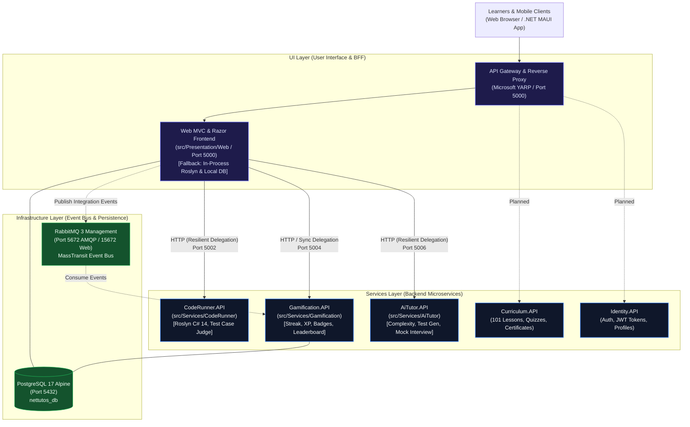
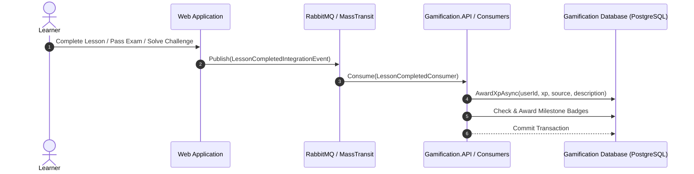

# 09. Microservices Architecture, Service Decomposition & Strangler Fig Migration

Document Type: Enterprise Distributed Architecture Specification & Migration Guide  
Author: Senior Principal Solution Architect & Lead Distributed Systems Engineer  
System: **.NET Tutos - Comprehensive .NET Learning & Assessment Platform**  
Target Framework: **.NET 10 (`net10.0`), C# 14, ASP.NET Core**  
Architecture Pattern: **Strangler Fig Migration, Domain-Driven Design (DDD), Clean Architecture, Event-Driven Architecture (EDA)**  
Container Orchestration: **Docker Compose (12 Containers: YARP Gateway, Web BFF, CodeRunner, Gamification, AiTutor, Catalog, PostgreSQL 17, Redis 7, RabbitMQ 3, Kafka KRaft, Prometheus, Grafana)**  
Status: **Phase 1 – Phase 22 Implemented & Verified (210/210 Automated Tests Passing)**  

---

## 1. System Transformation & Architectural Drivers

To overcome monolithic scaling limitations and eliminate CPU contention caused by in-process Roslyn C# compilation, .NET Tutos is transitioning from a modular monolith to a distributed **Microservices Architecture**.

### Key Architectural Drivers:
1. **Compute & Security Isolation:** C# Roslyn compilation and dynamic script execution run in an isolated service process ([`CodeRunner.API`](file:///d:/NET-Tutos/src/Services/CodeRunner/NET-Tutos.CodeRunner.API)), ensuring heavy loops or memory spikes never degrade the web frontend or database transactions.
2. **Event-Driven Gamification & Retention:** Gamification metrics (streaks, XP curves, badges, leaderboards) are decoupled into a dedicated service ([`Gamification.API`](file:///d:/NET-Tutos/src/Services/Gamification/NET-Tutos.Gamification.API)) consuming asynchronous domain events via MassTransit and RabbitMQ.
3. **Zero-Downtime Migration (Strangler Fig Pattern):** Rather than a disruptive "big bang" rewrite, bounded contexts are extracted incrementally. The monolithic web app delegates to microservices with automatic, resilient fallback to in-process execution.
4. **Standardized Solution Folders & Explicit Layer Taxonomy:** The solution index ([`NET-Tutos.slnx`](file:///d:/NET-Tutos/NET-Tutos.slnx)) organizes projects into `/01. UI/`, `/02. Services/`, `/03. Infrastructure/`, and `/04. Tests/`.



---

## 2. Shared Infrastructure Layer (`src/Infrastructure`)

The platform defines reusable, enterprise-grade building blocks referenced by all microservices:

### 2.1. `NET-Tutos.BuildingBlocks.Common`
- **Location:** [`src/Infrastructure/Common/`](file:///d:/NET-Tutos/src/Infrastructure/Common)
- **Namespace:** `NET_Tutos.BuildingBlocks.Common`
- **Artifacts:**
  - `ApiResponse<T>`: Standardized JSON envelope providing `Success`, `Data`, `Message`, `Errors`, and ISO-8601 `Timestamp`.
  - `Result<T>` and `Result`: Result pattern implementation enabling expressive, exception-free functional error handling across domain boundaries.

### 2.2. `NET-Tutos.BuildingBlocks.EventBus`
- **Location:** [`src/Infrastructure/EventBus/`](file:///d:/NET-Tutos/src/Infrastructure/EventBus)
- **Namespace:** `NET_Tutos.BuildingBlocks.EventBus`
- **Artifacts:**
  - `IIntegrationEvent` & `IntegrationEvent`: Base records assigning a unique `Guid EventId` and `DateTime OccurredOn`.
  - `ChallengeSolvedIntegrationEvent`: Emitted upon accepted code challenge evaluations. Transports `UserId`, `ChallengeId`, `ChallengeTitle`, `XpAwarded`, and `ExecutionDurationMs`.
  - `LessonCompletedIntegrationEvent`: Emitted upon tutorial completion. Transports `UserId`, `TutorialId`, `TutorialTitle`, and `XpAwarded`.
  - `ExamPassedIntegrationEvent`: Emitted upon passing certification assessments. Transports `UserId`, `CategoryId`, `ExamTitle`, `ScorePercentage`, and `XpAwarded`.

---

## 3. Microservice Deep-Dive: `CodeRunner` (Enterprise Clean Architecture 4-Layer Structure)

Encapsulates Roslyn C# script compilation, sandboxed runtime execution, and algorithmic test judging following the **Enterprise Clean Architecture 4-layer pattern**:

```text
src/Services/CodeRunner/
├── 📂 NET-Tutos.CodeRunner.Domain/         # Layer 1: Core constraints, Value Objects & security policies
│   ├── 📂 Common/                          # Base ValueObject abstractions
│   │   └── 📄 ValueObject.cs
│   ├── 📂 Rules/                           # Pure domain rules, blocked APIs, timeout thresholds
│   │   └── 📄 ExecutionConstraints.cs
│   ├── 📂 ValueObjects/                    # Immutable domain value objects
│   │   ├── 📄 SourceCode.cs                # AST-level validation and line counter
│   │   └── 📄 ExecutionTimeout.cs          # Clamped duration constraints (500ms - 30s)
│   ├── 📂 Exceptions/                      # Domain-specific exceptions
│   │   ├── 📄 CodeRunnerDomainException.cs
│   │   ├── 📄 ForbiddenSyntaxException.cs
│   │   └── 📄 ExecutionTimeoutException.cs
│   └── 📄 NET-Tutos.CodeRunner.Domain.csproj
│
├── 📂 NET-Tutos.CodeRunner.Application/    # Layer 2: Contracts, Features & Engine abstraction interface
│   ├── 📂 Common/Exceptions/               # Application-level exceptions
│   │   └── 📄 CodeRunnerValidationException.cs
│   ├── 📂 Contracts/                       # Request/Response models & test evaluation DTOs
│   │   └── 📄 CodeExecutionContracts.cs
│   ├── 📂 Features/Execution/Commands/     # CQRS command definitions & handlers
│   │   ├── 📄 ExecuteScriptCommand.cs
│   │   └── 📄 EvaluateChallengeCommand.cs
│   ├── 📂 Services/                        # Engine port abstraction
│   │   └── 📄 ICodeRunnerEngine.cs
│   └── 📄 NET-Tutos.CodeRunner.Application.csproj
│
├── 📂 NET-Tutos.CodeRunner.Infrastructure/ # Layer 3: Roslyn compilation engine & execution adapters
│   ├── 📂 Engines/                         # CSharpScript compilation & isolation adapter
│   │   └── 📄 RoslynCodeRunnerEngine.cs
│   ├── 📂 Services/                        # Timing and diagnostics
│   │   └── 📄 ExecutionStopwatch.cs
│   └── 📄 NET-Tutos.CodeRunner.Infrastructure.csproj
│
└── 📂 NET-Tutos.CodeRunner.API/            # Layer 4: Minimal APIs, endpoint routing & container host
    ├── 📂 Endpoints/                       # Modularity route group mappings
    │   └── 📄 RunnerEndpoints.cs           # Map /api/v1/runner/*
    ├── 📂 Middlewares/                     # HTTP filters & ProblemDetails RFC 7807 handler
    │   └── 📄 GlobalExceptionHandlerMiddleware.cs
    ├── 📂 Extensions/                      # DI Service Collection registrations
    │   └── 📄 CodeRunnerServiceExtensions.cs
    ├── 📄 Program.cs                       # Clean composition root
    ├── 📄 Dockerfile                       # Multi-stage container build
    ├── 📄 appsettings.json                 # Service configuration
    └── 📄 NET-Tutos.CodeRunner.API.csproj
```

### 3.1. Layer Responsibilities & Dependencies

| Layer | Project | Role & Responsibilities | Upstream Dependencies |
| :--- | :--- | :--- | :--- |
| **Domain** | [`NET-Tutos.CodeRunner.Domain`](file:///d:/NET-Tutos/src/Services/CodeRunner/NET-Tutos.CodeRunner.Domain) | Zero external dependencies. Holds execution constraints, forbidden keyword blacklists (`System.IO`, `System.Net`, `System.Diagnostics.Process`), domain Value Objects (`SourceCode`, `ExecutionTimeout`), and domain exceptions. | None |
| **Application** | [`NET-Tutos.CodeRunner.Application`](file:///d:/NET-Tutos/src/Services/CodeRunner/NET-Tutos.CodeRunner.Application) | Defines request/response contracts, CQRS command handlers (`ExecuteScriptCommand`, `EvaluateChallengeCommand`), validation exceptions, and the `ICodeRunnerEngine` interface. | `Domain`, `BuildingBlocks.Common` |
| **Infrastructure** | [`NET-Tutos.CodeRunner.Infrastructure`](file:///d:/NET-Tutos/src/Services/CodeRunner/NET-Tutos.CodeRunner.Infrastructure) | Implements `ICodeRunnerEngine` using Roslyn (`Microsoft.CodeAnalysis.CSharp.Scripting` v5.0.0). Enforces domain constraints, executes tests, and captures console outputs. | `Application`, `Domain` |
| **API** | [`NET-Tutos.CodeRunner.API`](file:///d:/NET-Tutos/src/Services/CodeRunner/NET-Tutos.CodeRunner.API) | Host composition root (`Program.cs`). Maps Minimal API endpoint groups (`RunnerEndpoints.cs`), installs `GlobalExceptionHandlerMiddleware`, and configures health checks. | `Application`, `Infrastructure` |

### 3.2. RESTful API Endpoints
1. **Execute Arbitrary C# Script:** `POST /api/v1/runner/execute`
2. **Evaluate Coding Challenge:** `POST /api/v1/runner/evaluate`
3. **Health Check:** `GET /healthz`

---

## 4. Microservice Deep-Dive: `Gamification` (Enterprise Clean Architecture 4-Layer Structure)

Manages learner motivation mechanics: daily streak tracking, exponential XP leveling curves, achievement badge unlocks, and global leaderboards following the **Enterprise Clean Architecture 4-layer pattern**:

```text
src/Services/Gamification/
├── 📂 NET-Tutos.Gamification.Domain/         # Layer 1: Core domain entities, Value Objects, Events & Rules
│   ├── 📂 Common/                           # BaseEntity, IAggregateRoot, ValueObject
│   │   ├── 📄 BaseEntity.cs
│   │   ├── 📄 IAggregateRoot.cs
│   │   └── 📄 ValueObject.cs
│   ├── 📂 Entities/                         # Aggregate roots and entity models
│   │   └── 📄 GamificationEntities.cs       # UserStreak, DailyCheckIn, Badge, UserBadge, UserXpRecord
│   ├── 📂 ValueObjects/                     # Immutable value objects
│   │   ├── 📄 XpValue.cs                    # Non-negative XP calculation and addition operators
│   │   └── 📄 StreakCount.cs                # Streak incrementation and milestone rules (3, 7, 14, 30 days)
│   ├── 📂 Enums/                            # Domain enums
│   │   ├── 📄 BadgeTier.cs                  # Bronze, Silver, Gold, Platinum
│   │   └── 📄 XpSourceType.cs               # StreakCheckIn, ChallengeSolved, LessonCompleted, ExamPassed
│   ├── 📂 Events/                           # Internal Domain Events
│   │   ├── 📄 StreakMilestoneReachedDomainEvent.cs
│   │   └── 📄 BadgeUnlockedDomainEvent.cs
│   ├── 📂 Exceptions/                       # Domain-specific exceptions
│   │   ├── 📄 GamificationDomainException.cs
│   │   ├── 📄 NegativeXpValueException.cs
│   │   └── 📄 StreakAlreadyClaimedException.cs
│   └── 📄 NET-Tutos.Gamification.Domain.csproj
│
├── 📂 NET-Tutos.Gamification.Application/    # Layer 2: Use cases, CQRS Features, DTOs & service interfaces
│   ├── 📂 Common/
│   │   ├── 📂 Interfaces/                   # Abstraction interfaces
│   │   │   ├── 📄 IGamificationDbContext.cs
│   │   │   └── 📄 IDateTimeProvider.cs
│   │   └── 📂 Exceptions/                   # Application exceptions
│   │       ├── 📄 GamificationNotFoundException.cs
│   │       └── 📄 GamificationValidationException.cs
│   ├── 📂 Contracts/                        # StreakDto, CheckInResultDto, LeaderboardEntryDto
│   │   └── 📄 GamificationContracts.cs
│   ├── 📂 Features/                         # CQRS Commands & Queries organized by feature
│   │   ├── 📂 Streaks/                      # CheckInCommand, GetUserStreakQuery
│   │   ├── 📂 Badges/                       # GetUserBadgesQuery
│   │   ├── 📂 Leaderboard/                  # GetLeaderboardQuery
│   │   └── 📂 Xp/                           # AwardXpCommand
│   ├── 📂 Services/                         # Core domain services
│   │   ├── 📄 IGamificationService.cs
│   │   └── 📄 GamificationService.cs
│   └── 📄 NET-Tutos.Gamification.Application.csproj
│
├── 📂 NET-Tutos.Gamification.Infrastructure/ # Layer 3: EF Core, Configurations, PostgreSQL & MassTransit
│   ├── 📂 Data/                             # DbContext implementation
│   │   └── 📄 GamificationDbContext.cs
│   ├── 📂 Persistence/Configurations/       # Separate IEntityTypeConfiguration<T> Fluent API maps
│   │   ├── 📄 UserStreakConfiguration.cs
│   │   ├── 📄 DailyCheckInConfiguration.cs
│   │   ├── 📄 BadgeConfiguration.cs
│   │   ├── 📄 UserBadgeConfiguration.cs
│   │   └── 📄 UserXpRecordConfiguration.cs
│   ├── 📂 Consumers/                        # ChallengeSolved, LessonCompleted, ExamPassed consumers
│   │   └── 📄 GamificationEventConsumers.cs
│   ├── 📂 Services/                         # Infrastructure service implementations
│   │   └── 📄 DateTimeProvider.cs
│   └── 📄 NET-Tutos.Gamification.Infrastructure.csproj
│
└── 📂 NET-Tutos.Gamification.API/            # Layer 4: Minimal APIs, endpoint routing & container host
    ├── 📂 Endpoints/                        # Modular route group definitions
    │   ├── 📄 StreakEndpoints.cs            # Map /api/v1/gamification/streak/*
    │   ├── 📄 BadgeEndpoints.cs             # Map /api/v1/gamification/badges/*
    │   └── 📄 LeaderboardEndpoints.cs       # Map /api/v1/gamification/leaderboard/*
    ├── 📂 Middlewares/                      # Global exception handler returning RFC 7807 ProblemDetails
    │   └── 📄 GlobalExceptionHandlerMiddleware.cs
    ├── 📂 Extensions/                       # Clean DI registration
    │   └── 📄 GamificationServiceExtensions.cs
    ├── 📄 Program.cs                        # Minimal composition root
    ├── 📄 Dockerfile                        # Multi-stage container build
    ├── 📄 appsettings.json                  # PostgreSQL & RabbitMQ connection parameters
    └── 📄 NET-Tutos.Gamification.API.csproj
```

### 4.1. Layer Responsibilities & Dependencies

| Layer | Project | Role & Responsibilities | Upstream Dependencies |
| :--- | :--- | :--- | :--- |
| **Domain** | [`NET-Tutos.Gamification.Domain`](file:///d:/NET-Tutos/src/Services/Gamification/NET-Tutos.Gamification.Domain) | Pure entity models (`UserStreak`, `DailyCheckIn`, `Badge`, `UserBadge`, `UserXpRecord`), Value Objects (`XpValue`, `StreakCount`), Enums (`BadgeTier`, `XpSourceType`), and Domain Events. Contains zero database or transport dependencies. | None |
| **Application** | [`NET-Tutos.Gamification.Application`](file:///d:/NET-Tutos/src/Services/Gamification/NET-Tutos.Gamification.Application) | Implements `IGamificationService`, CQRS Commands & Queries (`CheckInCommand`, `GetUserStreakQuery`, `GetLeaderboardQuery`), defines `IGamificationDbContext`, and validation exceptions. | `Domain`, `BuildingBlocks.Common` |
| **Infrastructure** | [`NET-Tutos.Gamification.Infrastructure`](file:///d:/NET-Tutos/src/Services/Gamification/NET-Tutos.Gamification.Infrastructure) | Implements `IGamificationDbContext` via `GamificationDbContext` (applying all `IEntityTypeConfiguration<T>` classes from assembly) and hosts MassTransit integration event consumers. | `Application`, `Domain`, `BuildingBlocks.EventBus` |
| **API** | [`NET-Tutos.Gamification.API`](file:///d:/NET-Tutos/src/Services/Gamification/NET-Tutos.Gamification.API) | Host composition root (`Program.cs`). Configures modular endpoint groups (`StreakEndpoints`, `BadgeEndpoints`, `LeaderboardEndpoints`), installs `GlobalExceptionHandlerMiddleware`, and runs database migrations on startup. | `Application`, `Infrastructure` |

### 4.2. Event-Driven Architecture (MassTransit Consumers)
`Gamification.Infrastructure` hosts MassTransit consumers that subscribe to integration events emitted over RabbitMQ without requiring synchronous coordination:



- **`ChallengeSolvedConsumer`:** Awards challenge XP and unlocks the `"code-master"` badge upon achieving milestones.
- **`LessonCompletedConsumer`:** Awards tutorial XP and unlocks the `"scholar"` badge upon milestone completions.
- **`ExamPassedConsumer`:** Awards certification XP and unlocks the `"certified-pro"` badge upon achieving $\ge 80\%$ scores.

### 4.3. RESTful API Endpoints
1. **Get User Streak:** `GET /api/v1/gamification/streak/{userId}`
2. **Perform Daily Check-In:** `POST /api/v1/gamification/streak/check-in`
3. **List Badges Catalog & Unlocks:** `GET /api/v1/gamification/badges?userId={userId}`
4. **Retrieve Leaderboard:** `GET /api/v1/gamification/leaderboard?top=50`
5. **Health Check:** `GET /healthz`

---

## 4.5. Microservice Deep-Dive: `AiTutor` (Enterprise Clean Architecture 4-Layer Structure)

Decouples algorithmic Big-O complexity analysis, C# compiler error diagnostics, xUnit test suite synthesis, code reviews, and 3-dimensional technical mock interview evaluation into an isolated microservice ([`src/Services/AiTutor/`](file:///d:/NET-Tutos/src/Services/AiTutor)):

```text
src/Services/AiTutor/
├── 📂 NET-Tutos.AiTutor.Domain/            # Layer 1: Value Objects, Enums, AST/Complexity Rules & Exceptions
│   ├── 📂 Common/                          # ValueObject base abstraction
│   ├── 📂 Enums/                           # ComplexityTier, InterviewReadinessTier
│   ├── 📂 ValueObjects/                    # EfficiencyScore, InterviewRubricScore (50/25/25 weighted rubric)
│   ├── 📂 Rules/                           # AiAnalysisRules (Big-O detection & space allocation rules)
│   └── 📂 Exceptions/                      # AiTutorDomainException, EmptySourceCodeException, InvalidRubricScoreException
│
├── 📂 NET-Tutos.AiTutor.Application/       # Layer 2: Contracts, CQRS Commands & IAiTutorEngine port
│   ├── 📂 Common/Exceptions/               # AiTutorValidationException
│   ├── 📂 Contracts/                       # AiTutorContracts.cs (Chat, Complexity, Error, UnitTest, Interview DTOs)
│   ├── 📂 Features/                        # CQRS Commands & Handlers (Analysis & Interview)
│   └── 📂 Services/                        # IAiTutorEngine interface
│
├── 📂 NET-Tutos.AiTutor.Infrastructure/    # Layer 3: Deterministic & AI Agent Engine implementation
│   └── 📂 Engines/                         # DeterministicAiTutorEngine.cs
│
└── 📂 NET-Tutos.AiTutor.API/               # Layer 4: Minimal APIs, endpoint routing & container host
    ├── 📂 Endpoints/                       # AiAnalysisEndpoints.cs & AiInterviewEndpoints.cs (/api/v1/aitutor/*)
    ├── 📂 Middlewares/                     # GlobalExceptionHandlerMiddleware.cs (RFC 7807 ProblemDetails)
    ├── 📂 Extensions/                      # AiTutorServiceExtensions.cs
    ├── 📄 Program.cs                       # Clean composition root
    └── 📄 Dockerfile                       # Multi-stage container build
```

---

## 5. Resilient Delegation & Strangler Fig Dual-Write Fallback Pattern

[`CodeExecutionService.cs`](file:///d:/NET-Tutos/src/Presentation/Web/Services/CodeExecutionService.cs), [`StreakService.cs`](file:///d:/NET-Tutos/src/Presentation/Web/Services/StreakService.cs), and [`AiTutorService.cs`](file:///d:/NET-Tutos/src/Presentation/Web/Services/AiTutorService.cs) implement the **Strangler Fig Pattern**:

1. **Intelligent HTTP Client Delegation:** If microservice endpoints are configured in `appsettings.json`, calls are dispatched over HTTP with short timeouts (5s–8s).
2. **Graceful Fallback:** If the microservice is unreachable, returns an error status code, or experiences a network failure, the call is logged as a warning, and the system seamlessly falls back to local in-process execution.
3. **Zero Learner Disruption:** End-users experience zero downtime or fatal exceptions during microservice restarts, redeployments, or temporary network partitions.

### Configuration (`src/Presentation/Web/appsettings.json`):
```json
"Services": {
  "CodeRunner": {
    "Url": "http://localhost:5002"
  },
  "Gamification": {
    "Url": "http://localhost:5004"
  },
  "AiTutor": {
    "Url": "http://localhost:5006"
  }
}
```

---

## 5.5. Ingress Layer: Microsoft YARP API Gateway (`src/Gateways/Gateway`)

To provide unified access control, TLS termination, distributed tracing, and rate limiting across services, .NET Tutos implements an enterprise API Gateway using **Microsoft YARP (Yet Another Reverse Proxy)**.

### Architectural Responsibilities:
1. **Single Entry Point (Ingress):** Listens on port `5000` (mapped to container port `8080`) and terminates all external client traffic from browsers, mobile applications, and external integrators.
2. **Reverse Proxy & Route Mapping:**
   - `/api/v1/runner/{**catch-all}` -> Routed to `coderunner-cluster` (`http://coderunner:8080`).
   - `/api/v1/gamification/{**catch-all}` -> Routed to `gamification-cluster` (`http://gamification:8080`).
   - `/api/v1/aitutor/{**catch-all}` -> Routed to `aitutor-cluster` (`http://aitutor:8080`).
   - `/{**catch-all}` -> Routed to `web-cluster` (`http://web:5000`).
3. **Correlation ID Middleware:** Automatically inspects incoming HTTP requests for `X-Correlation-ID`. If missing, generates a new unique `Guid` and stamps it onto both response headers and forwarded upstream requests for distributed tracing.
4. **Endpoint Rate Limiting:** Enforces ASP.NET Core Fixed-Window Rate Limiter (`runner-policy`: 60 requests/minute per client IP) on compute-intensive Roslyn execution endpoints to defend against denial-of-service abuse.
5. **Gateway Health, Telemetry & OpenMetrics:** Exposes `/healthz` for load-balancer probes, `/api/v1/gateway/status` for real-time cluster/route discovery, `/api/v1/gateway/telemetry`, and `/metrics` for Prometheus scraping.

---

## 6. Docker Compose Multi-Container Orchestration (12 Containers)

The platform is orchestrated via [`docker-compose.yml`](file:///d:/NET-Tutos/docker-compose.yml) on a shared bridge network:

| Container Name | Service | Image / Dockerfile | Ports | Purpose |
| :--- | :--- | :--- | :--- | :--- |
| **`nettutos-gateway`** | `gateway` | `src/Gateways/Gateway/Dockerfile` | `5000:8080` | Microsoft YARP API Gateway, Rate Limiter & `/metrics` |
| **`nettutos-web`** | `web` | `src/Presentation/Web/Dockerfile` | `5001:5000` | ASP.NET Core 10 Web BFF, Multi-Source RAG, TTS, IDE Bridge & `/metrics` |
| **`nettutos-coderunner`** | `coderunner` | `src/Services/CodeRunner/NET-Tutos.CodeRunner.API/Dockerfile` | `5002:8080` | Sandboxed Roslyn script compilation, challenge judge & `/metrics` |
| **`nettutos-gamification`** | `gamification` | `src/Services/Gamification/NET-Tutos.Gamification.API/Dockerfile` | `5004:8080` | Gamification microservice (`MassTransit.RabbitMQ 8.3.7`) & `/metrics` |
| **`nettutos-aitutor`** | `aitutor` | `src/Services/AiTutor/NET-Tutos.AiTutor.API/Dockerfile` | `5006:8080` | AI Tutor analysis, technical mock interview microservice & `/metrics` |
| **`nettutos-catalog`** | `catalog` | `src/Services/Catalog/NET-Tutos.Catalog.API/Dockerfile` | `5008:8080` | Catalog, 7-stage curriculum, exam grading, certification & `/metrics` |
| **`nettutos-prometheus`** | `prometheus` | `prom/prometheus:latest` | `9090:9090` | Prometheus time-series scraper polling `/metrics` across 7 targets (`5s`) |
| **`nettutos-grafana`** | `grafana` | `grafana/grafana:latest` | `3000:3000` | Pre-provisioned Grafana dashboards (`nettutos-overview`, 12 panels) |
| **`nettutos-kafka`** | `kafka` | `apache/kafka:latest` | `9092:9092`<br/>`29092:29092` | Apache Kafka KRaft event streaming for AI, Roslyn & Learning telemetry |
| **`nettutos-redis`** | `redis` | `redis:7-alpine` | `6379:6379` | L2 Distributed Cache (Roslyn SHA-256, Neural TTS, Catalog & SEO Sitemap) |
| **`nettutos-rabbitmq`** | `rabbitmq` | `rabbitmq:3-management-alpine` | `5672:5672`<br/>`15672:15672` | AMQP Message Broker & Management Web Console |
| **`nettutos-postgres`** | `postgres` | `postgres:17-alpine` | `5432:5432` | Relational storage for Identity, Web, and Gamification |

To spin up the entire distributed ecosystem:
```powershell
docker compose up -d --build
```

---

## 7. Verification & Automated Quality Gates

The distributed microservices architecture, `.NET Aspire` AppHost & IDE tooling are verified by **210 automated tests**:

```powershell
# 1. Run API Gateway routing, correlation ID, Prometheus /metrics & Aspire/Helm spec tests (7 tests)
dotnet test tests/NET-Tutos.Gateway.Tests/NET-Tutos.Gateway.Tests.csproj

# 2. Run Gamification microservice domain & consumer tests (16 tests)
dotnet test tests/NET-Tutos.Gamification.Tests/NET-Tutos.Gamification.Tests.csproj

# 3. Run CodeRunner microservice Roslyn sandbox tests (11 tests)
dotnet test tests/NET-Tutos.CodeRunner.Tests/NET-Tutos.CodeRunner.Tests.csproj

# 4. Run AiTutor microservice domain & engine tests (16 tests)
dotnet test tests/NET-Tutos.AiTutor.Tests/NET-Tutos.AiTutor.Tests.csproj

# 5. Run Catalog & Assessment microservice tests (17 tests)
dotnet test tests/NET-Tutos.Catalog.Tests/NET-Tutos.Catalog.Tests.csproj

# 6. Run Web application unit & service tests (101 tests)
dotnet test tests/NET-Tutos.UnitTests/NET-Tutos.UnitTests.csproj

# 7. Run HTTP integration pipeline tests (37 tests)
dotnet test tests/NET-Tutos.IntegrationTests/NET-Tutos.IntegrationTests.csproj

# 8. Run VS Code Extension TypeScript unit tests (5 tests)
npm --prefix extensions/vscode-atus test
```

**Quality Gate Result:** **210/210 Tests Passing (205 `.NET` across 7 Test Projects + 5 VS Code Node Tests — 0 Failed, 0 Skipped).**  
All `.NET` test suites are enforced in GitHub Actions continuous delivery via [`.github/workflows/ci.yml`](file:///d:/NET-Tutos/.github/workflows/ci.yml). For the full phase-by-phase roadmap and AI context memory, see [**10. Master Project Roadmap & AI Context Memory**](file:///d:/NET-Tutos/docs/10_project_roadmap_and_ai_memory.md).
