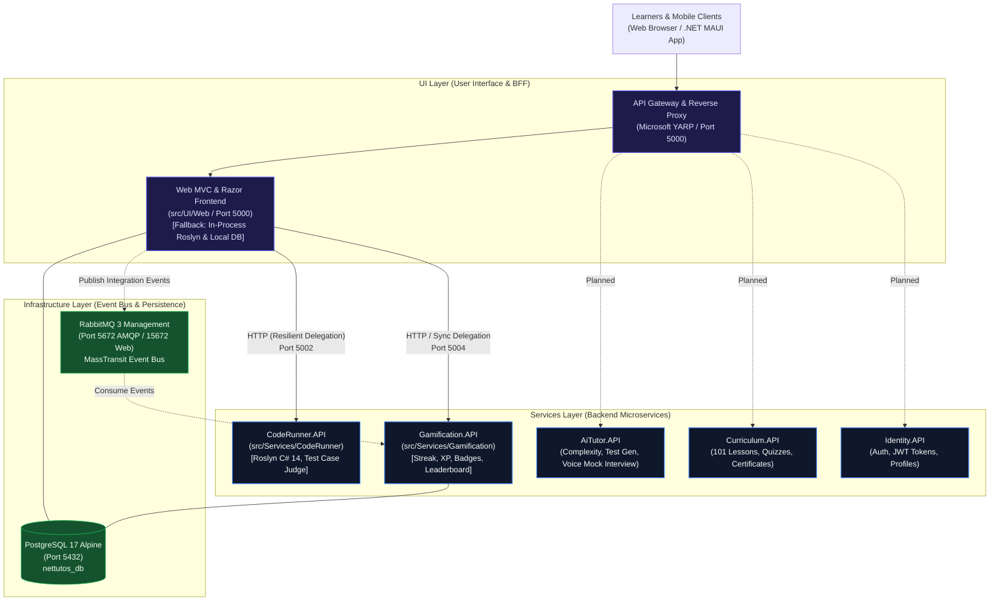
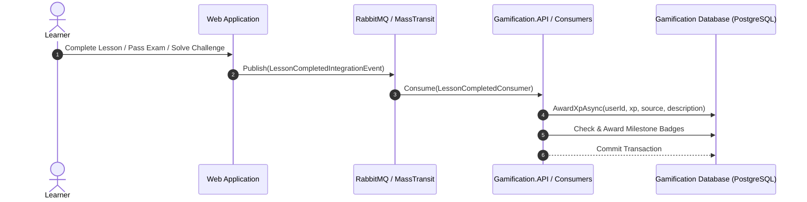

# 09. Microservices Architecture, Service Decomposition & Strangler Fig Migration

Document Type: Enterprise Distributed Architecture Specification & Migration Guide  
Author: Senior Principal Solution Architect & Lead Distributed Systems Engineer  
System: **.NET Tutos - Comprehensive .NET Learning & Assessment Platform**  
Target Framework: **.NET 10 (`net10.0`), C# 14, ASP.NET Core**  
Architecture Pattern: **Strangler Fig Migration, Domain-Driven Design (DDD), Clean Architecture, Event-Driven Architecture (EDA)**  
Container Orchestration: **Docker Compose (PostgreSQL 17, RabbitMQ 3, CodeRunner.API, Gamification.API, Web BFF)**  
Status: **Phase 1, Phase 2 & Phase 3 Implemented & Verified in CI Pipeline (67/67 Tests Passing)**  

---

## 1. System Transformation & Architectural Drivers

To overcome monolithic scaling limitations and eliminate CPU contention caused by in-process Roslyn C# compilation, .NET Tutos is transitioning from a modular monolith to a distributed **Microservices Architecture**.

### Key Architectural Drivers:
1. **Compute & Security Isolation:** C# Roslyn compilation and dynamic script execution run in an isolated service process ([`CodeRunner.API`](file:///d:/NET-Tutos/src/Services/CodeRunner/NET-Tutos.CodeRunner.API)), ensuring heavy loops or memory spikes never degrade the web frontend or database transactions.
2. **Event-Driven Gamification & Retention:** Gamification metrics (streaks, XP curves, badges, leaderboards) are decoupled into a dedicated service ([`Gamification.API`](file:///d:/NET-Tutos/src/Services/Gamification/NET-Tutos.Gamification.API)) consuming asynchronous domain events via MassTransit and RabbitMQ.
3. **Zero-Downtime Migration (Strangler Fig Pattern):** Rather than a disruptive "big bang" rewrite, bounded contexts are extracted incrementally. The monolithic web app delegates to microservices with automatic, resilient fallback to in-process execution.
4. **Standardized Solution Folders & Explicit Layer Taxonomy:** The solution index ([`NET-Tutos.slnx`](file:///d:/NET-Tutos/NET-Tutos.slnx)) organizes projects into `/01. UI/`, `/02. Services/`, `/03. Infrastructure/`, and `/04. Tests/`.



---

## 2. Shared Infrastructure Layer (`src/Infrastructure`)

The platform defines reusable, enterprise-grade building blocks referenced by all microservices:

### 2.1. `NET-Tutos.BuildingBlocks.Common`
- **Location:** [`src/Infrastructure/Common/`](file:///d:/NET-Tutos/src/Infrastructure/Common)
- **Namespace:** `NET_Tutos.BuildingBlocks.Common`
- **Artifacts:**
  - `ApiResponse<T>`: Standardized JSON envelope providing `Success`, `Data`, `Message`, `Errors`, and ISO-8601 `Timestamp`.
  - `Result<T>` and `Result`: Result pattern implementation enabling expressive, exception-free functional error handling across domain boundaries.

### 2.2. `NET-Tutos.BuildingBlocks.EventBus`
- **Location:** [`src/Infrastructure/EventBus/`](file:///d:/NET-Tutos/src/Infrastructure/EventBus)
- **Namespace:** `NET_Tutos.BuildingBlocks.EventBus`
- **Artifacts:**
  - `IIntegrationEvent` & `IntegrationEvent`: Base records assigning a unique `Guid EventId` and `DateTime OccurredOn`.
  - `ChallengeSolvedIntegrationEvent`: Emitted upon accepted code challenge evaluations. Transports `UserId`, `ChallengeId`, `ChallengeTitle`, `XpAwarded`, and `ExecutionDurationMs`.
  - `LessonCompletedIntegrationEvent`: Emitted upon tutorial completion. Transports `UserId`, `TutorialId`, `TutorialTitle`, and `XpAwarded`.
  - `ExamPassedIntegrationEvent`: Emitted upon passing certification assessments. Transports `UserId`, `CategoryId`, `ExamTitle`, `ScorePercentage`, and `XpAwarded`.

---

## 3. Microservice Deep-Dive: `CodeRunner` (Clean Architecture 4-Layer Decomposition)

Encapsulates Roslyn C# script compilation, sandboxed runtime execution, and algorithmic test judging following the **Clean Architecture 4-layer pattern**:

```text
src/Services/CodeRunner/
├── 📂 NET-Tutos.CodeRunner.Domain/         # Layer 1: Core constraints, validation rules & execution policies
│   ├── 📄 ExecutionConstraints.cs          # Pure domain rules, blocked APIs, timeout thresholds
│   └── 📄 NET-Tutos.CodeRunner.Domain.csproj
├── 📂 NET-Tutos.CodeRunner.Application/    # Layer 2: Contracts, DTOs & Engine abstraction interface
│   ├── 📄 ICodeRunnerEngine.cs             # Engine port abstraction
│   ├── 📂 Contracts/                       # Request/Response models & test evaluation DTOs
│   │   └── 📄 CodeExecutionContracts.cs
│   └── 📄 NET-Tutos.CodeRunner.Application.csproj
├── 📂 NET-Tutos.CodeRunner.Infrastructure/ # Layer 3: Roslyn compilation engine & sandboxed adapter
│   ├── 📄 RoslynCodeRunnerEngine.cs        # CSharpScript compilation & isolation adapter
│   └── 📄 NET-Tutos.CodeRunner.Infrastructure.csproj
└── 📂 NET-Tutos.CodeRunner.API/            # Layer 4: Minimal APIs, endpoint routing & container host
    ├── 📄 Program.cs                       # Composition root, HTTP pipeline, DI configuration
    ├── 📄 Dockerfile                       # Multi-stage container build
    ├── 📄 appsettings.json                 # Service configuration
    └── 📄 NET-Tutos.CodeRunner.API.csproj
```

### 3.1. Layer Responsibilities & Dependencies

| Layer | Project | Role & Responsibilities | Upstream Dependencies |
| :--- | :--- | :--- | :--- |
| **Domain** | [`NET-Tutos.CodeRunner.Domain`](file:///d:/NET-Tutos/src/Services/CodeRunner/NET-Tutos.CodeRunner.Domain) | Zero external dependencies. Holds execution constraints, forbidden keyword blacklists (`System.IO`, `System.Net`, `System.Diagnostics.Process`), and runtime security policies. | None |
| **Application** | [`NET-Tutos.CodeRunner.Application`](file:///d:/NET-Tutos/src/Services/CodeRunner/NET-Tutos.CodeRunner.Application) | Defines request/response contracts (`ExecuteScriptRequest`, `EvaluateChallengeRequest`, etc.) and the `ICodeRunnerEngine` interface. | `Domain`, `BuildingBlocks.Common` |
| **Infrastructure** | [`NET-Tutos.CodeRunner.Infrastructure`](file:///d:/NET-Tutos/src/Services/CodeRunner/NET-Tutos.CodeRunner.Infrastructure) | Implements `ICodeRunnerEngine` using Roslyn (`Microsoft.CodeAnalysis.CSharp.Scripting` v5.0.0). Enforces domain constraints, executes tests, and captures console outputs. | `Application`, `Domain` |
| **API** | [`NET-Tutos.CodeRunner.API`](file:///d:/NET-Tutos/src/Services/CodeRunner/NET-Tutos.CodeRunner.API) | Host composition root (`Program.cs`). Maps Minimal API endpoints, configures health checks, and exports OpenAPI specifications. | `Application`, `Infrastructure` |

### 3.2. RESTful API Endpoints
1. **Execute Arbitrary C# Script:** `POST /api/v1/runner/execute`
2. **Evaluate Coding Challenge:** `POST /api/v1/runner/evaluate`
3. **Health Check:** `GET /healthz`

---

## 4. Microservice Deep-Dive: `Gamification` (Clean Architecture 4-Layer Decomposition)

Manages learner motivation mechanics: daily streak tracking, exponential XP leveling curves, achievement badge unlocks, and global leaderboards following the **Clean Architecture 4-layer pattern**:

```text
src/Services/Gamification/
├── 📂 NET-Tutos.Gamification.Domain/         # Layer 1: Core domain entities & business rules
│   ├── 📂 Entities/                         # UserStreak, DailyCheckIn, Badge, UserBadge, UserXpRecord
│   │   └── 📄 GamificationEntities.cs
│   └── 📄 NET-Tutos.Gamification.Domain.csproj
├── 📂 NET-Tutos.Gamification.Application/    # Layer 2: Use cases, DTOs & service interfaces
│   ├── 📄 IGamificationService.cs           # Gamification business contract
│   ├── 📄 IGamificationDbContext.cs         # Database abstraction interface
│   ├── 📄 GamificationService.cs            # Core leveling algorithms, streaks, and badge logic
│   ├── 📂 Contracts/                        # StreakDto, CheckInResultDto, LeaderboardEntryDto
│   │   └── 📄 GamificationContracts.cs
│   └── 📄 NET-Tutos.Gamification.Application.csproj
├── 📂 NET-Tutos.Gamification.Infrastructure/ # Layer 3: EF Core, PostgreSQL & MassTransit consumers
│   ├── 📂 Data/                             # GamificationDbContext implementation
│   │   └── 📄 GamificationDbContext.cs
│   ├── 📂 Consumers/                        # ChallengeSolved, LessonCompleted, ExamPassed consumers
│   │   └── 📄 GamificationEventConsumers.cs
│   └── 📄 NET-Tutos.Gamification.Infrastructure.csproj
└── 📂 NET-Tutos.Gamification.API/            # Layer 4: Minimal APIs, endpoint routing & container host
    ├── 📄 Program.cs                        # Composition root, MassTransit RabbitMQ host, DI setup
    ├── 📄 Dockerfile                        # Multi-stage container build
    ├── 📄 appsettings.json                  # PostgreSQL & RabbitMQ connection parameters
    └── 📄 NET-Tutos.Gamification.API.csproj
```

### 4.1. Layer Responsibilities & Dependencies

| Layer | Project | Role & Responsibilities | Upstream Dependencies |
| :--- | :--- | :--- | :--- |
| **Domain** | [`NET-Tutos.Gamification.Domain`](file:///d:/NET-Tutos/src/Services/Gamification/NET-Tutos.Gamification.Domain) | Pure entity models (`UserStreak`, `DailyCheckIn`, `Badge`, `UserBadge`, `UserXpRecord`). Contains zero database or transport dependencies. | None |
| **Application** | [`NET-Tutos.Gamification.Application`](file:///d:/NET-Tutos/src/Services/Gamification/NET-Tutos.Gamification.Application) | Implements `IGamificationService` containing business calculations (XP curves, streak calculation, milestone checks) and defines `IGamificationDbContext`. | `Domain`, `BuildingBlocks.Common` |
| **Infrastructure** | [`NET-Tutos.Gamification.Infrastructure`](file:///d:/NET-Tutos/src/Services/Gamification/NET-Tutos.Gamification.Infrastructure) | Implements `IGamificationDbContext` via `GamificationDbContext` (Npgsql EF Core 10) and hosts MassTransit integration event consumers. | `Application`, `Domain`, `BuildingBlocks.EventBus` |
| **API** | [`NET-Tutos.Gamification.API`](file:///d:/NET-Tutos/src/Services/Gamification/NET-Tutos.Gamification.API) | Host composition root (`Program.cs`). Configures ASP.NET Core Minimal APIs, connects MassTransit with RabbitMQ, and runs database migrations on startup. | `Application`, `Infrastructure` |

### 4.2. Event-Driven Architecture (MassTransit Consumers)
`Gamification.Infrastructure` hosts MassTransit consumers that subscribe to integration events emitted over RabbitMQ without requiring synchronous coordination:



- **`ChallengeSolvedConsumer`:** Awards challenge XP and unlocks the `"code-master"` badge upon achieving milestones.
- **`LessonCompletedConsumer`:** Awards tutorial XP and unlocks the `"scholar"` badge upon milestone completions.
- **`ExamPassedConsumer`:** Awards certification XP and unlocks the `"certified-pro"` badge upon achieving $\ge 80\%$ scores.

### 4.3. RESTful API Endpoints
1. **Get User Streak:** `GET /api/v1/gamification/streak/{userId}`
2. **Perform Daily Check-In:** `POST /api/v1/gamification/streak/check-in`
3. **List Badges Catalog & Unlocks:** `GET /api/v1/gamification/badges?userId={userId}`
4. **Retrieve Leaderboard:** `GET /api/v1/gamification/leaderboard?top=50`
5. **Health Check:** `GET /healthz`

---

## 5. Resilient Delegation & Strangler Fig Dual-Write Fallback Pattern

Both [`CodeExecutionService.cs`](file:///d:/NET-Tutos/src/UI/Web/Services/CodeExecutionService.cs) and [`StreakService.cs`](file:///d:/NET-Tutos/src/UI/Web/Services/StreakService.cs) implement the **Strangler Fig Pattern**:

1. **Intelligent HTTP Client Delegation:** If microservice endpoints are configured in `appsettings.json`, calls are dispatched over HTTP with short timeouts (5s–8s).
2. **Graceful Fallback:** If the microservice is unreachable, returns an error status code, or experiences a network failure, the call is logged as a warning, and the system seamlessly falls back to local in-process execution (in-process Roslyn execution or local database transaction).
3. **Zero Learner Disruption:** End-users experience zero downtime or fatal exceptions during microservice restarts, redeployments, or temporary network partitions.

### Configuration (`src/UI/Web/appsettings.json`):
```json
"Services": {
  "CodeRunner": {
    "Url": "http://localhost:5002"
  },
  "Gamification": {
    "Url": "http://localhost:5004"
  }
}
```

---

## 6. Docker Compose Multi-Container Orchestration

The platform is orchestrated via [`docker-compose.yml`](file:///d:/NET-Tutos/docker-compose.yml) on a shared bridge network:

| Container Name | Service | Image / Dockerfile | Ports | Purpose |
| :--- | :--- | :--- | :--- | :--- |
| **`nettutos-postgres`** | `postgres` | `postgres:17-alpine` | `5432:5432` | Relational storage for Identity, Web, and Gamification |
| **`nettutos-rabbitmq`** | `rabbitmq` | `rabbitmq:3-management-alpine` | `5672:5672`<br/>`15672:15672` | AMQP Message Broker & Management Web Console |
| **`nettutos-coderunner`** | `coderunner` | `src/Services/CodeRunner/NET-Tutos.CodeRunner.API/Dockerfile` | `5002:8080` | Sandboxed Roslyn script compilation & challenge judge |
| **`nettutos-gamification`** | `gamification` | `src/Services/Gamification/NET-Tutos.Gamification.API/Dockerfile` | `5004:8080` | Gamification microservice with MassTransit consumers |
| **`nettutos-web`** | `web` | `src/UI/Web/Dockerfile` | `5000:5000` | ASP.NET Core 10 Web Application & BFF Frontend |

To spin up the entire distributed ecosystem:
```powershell
docker compose up -d --build
```

---

## 7. Verification & Automated Quality Gates

The distributed microservices architecture is verified by a 67-test automated suite executed across all projects:

```powershell
# 1. Run Gamification microservice domain & consumer tests (7 tests)
dotnet test tests/NET-Tutos.Gamification.Tests/NET-Tutos.Gamification.Tests.csproj

# 2. Run CodeRunner microservice Roslyn sandbox tests (6 tests)
dotnet test tests/NET-Tutos.CodeRunner.Tests/NET-Tutos.CodeRunner.Tests.csproj

# 3. Run Web application unit & service tests (42 tests)
dotnet test tests/NET-Tutos.UnitTests/NET-Tutos.UnitTests.csproj

# 4. Run HTTP integration pipeline tests (12 tests)
dotnet test tests/NET-Tutos.IntegrationTests/NET-Tutos.IntegrationTests.csproj
```

**Quality Gate Result:** **67/67 Tests Passing (100% Pass Rate, 0 Failed, 0 Skipped).**  
All test suites are permanently enforced in GitHub Actions continuous delivery via [`.github/workflows/ci.yml`](file:///d:/NET-Tutos/.github/workflows/ci.yml).
