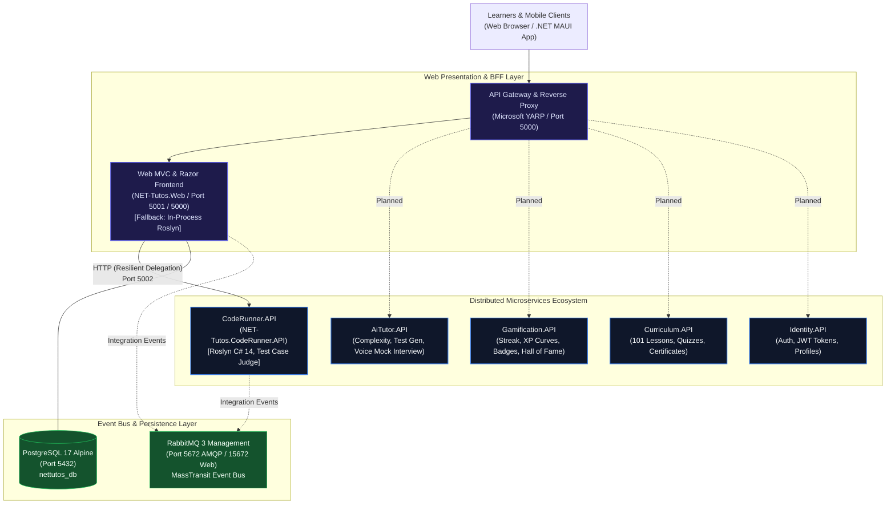
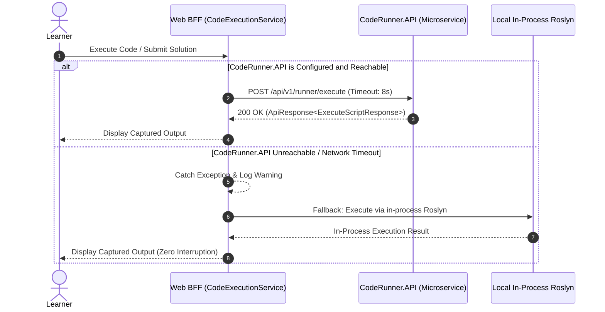

# 09. Microservices Architecture, Service Decomposition & Strangler Fig Migration

Document Type: Enterprise Distributed Architecture Specification & Migration Guide  
Author: Senior Principal Solution Architect & Lead Distributed Systems Engineer  
System: **.NET Tutos - Comprehensive .NET Learning & Assessment Platform**  
Target Framework: **.NET 10 (`net10.0`), C# 14, ASP.NET Core**  
Architecture Pattern: **Strangler Fig Migration, Domain-Driven Design (DDD), Clean Architecture, Event-Driven Architecture (EDA)**  
Container Orchestration: **Docker Compose (PostgreSQL 17, RabbitMQ 3, CodeRunner.API, Web BFF)**  
Status: **Phase 1 & Phase 2 Implemented & Verified in CI Pipeline**  

---

## 1. System Transformation & Architectural Drivers

To overcome monolithic scaling limitations and eliminate CPU contention caused by in-process Roslyn C# compilation, .NET Tutos is transitioning from a modular monolith to a distributed **Microservices Architecture**.

### Key Architectural Drivers:
1. **Compute & Security Isolation:** C# Roslyn compilation and dynamic script execution run in an isolated service process (`CodeRunner.API`), ensuring heavy loops or memory spikes never degrade the web frontend or database transactions.
2. **Zero-Downtime Migration (Strangler Fig Pattern):** Rather than a disruptive "big bang" rewrite, bounded contexts are extracted incrementally. The monolithic web app delegates to microservices with automatic, resilient fallback to in-process execution.
3. **Event-Driven Decoupling:** Asynchronous events (`ChallengeSolvedIntegrationEvent`, `LessonCompletedIntegrationEvent`, `ExamPassedIntegrationEvent`) decouple domain actions via an event bus (RabbitMQ / MassTransit).
4. **Standardized Solution Folders:** The solution index ([`NET-Tutos.slnx`](file:///d:/NET-Tutos/NET-Tutos.slnx)) organizes projects into `/BuildingBlocks/`, `/Services/`, `/Apps/`, and `/Tests/`.



---

## 2. Shared BuildingBlocks Infrastructure (`src/BuildingBlocks`)

The platform defines reusable, enterprise-grade building blocks referenced by all microservices:

### 2.1. `NET-Tutos.BuildingBlocks.Common`
- **Location:** [`src/BuildingBlocks/Common/`](file:///d:/NET-Tutos/src/BuildingBlocks/Common)
- **Namespace:** `NET_Tutos.BuildingBlocks.Common`
- **Artifacts:**
  - `ApiResponse<T>`: Standardized JSON envelope providing `Success`, `Data`, `Message`, `Errors`, and ISO-8601 `Timestamp`.
  - `Result<T>` and `Result`: Result pattern implementation enabling expressive, exception-free functional error handling across domain boundaries.

### 2.2. `NET-Tutos.BuildingBlocks.EventBus`
- **Location:** [`src/BuildingBlocks/EventBus/`](file:///d:/NET-Tutos/src/BuildingBlocks/EventBus)
- **Namespace:** `NET_Tutos.BuildingBlocks.EventBus`
- **Artifacts:**
  - `IIntegrationEvent` & `IntegrationEvent`: Base records assigning a unique `Guid EventId` and `DateTime OccurredOn`.
  - `ChallengeSolvedIntegrationEvent`: Emitted upon accepted code challenge evaluations. Transports `UserId`, `ChallengeId`, `ChallengeTitle`, `XpAwarded`, and `ExecutionDurationMs`.
  - `LessonCompletedIntegrationEvent`: Emitted upon tutorial completion. Transports `UserId`, `TutorialId`, `TutorialTitle`, and `XpAwarded`.
  - `ExamPassedIntegrationEvent`: Emitted upon passing certification assessments. Transports `UserId`, `CategoryId`, `ExamTitle`, `ScorePercentage`, and `XpAwarded`.

---

## 3. Microservice Deep-Dive: `CodeRunner.API`

The first decoupled microservice encapsulates Roslyn C# script execution and algorithmic test judging.

### 3.1. Project Metadata & Dependencies
- **Project File:** [`src/Services/CodeRunner/NET-Tutos.CodeRunner.API/NET-Tutos.CodeRunner.API.csproj`](file:///d:/NET-Tutos/src/Services/CodeRunner/NET-Tutos.CodeRunner.API/NET-Tutos.CodeRunner.API.csproj)
- **Target Framework:** `net10.0` (ASP.NET Core Web SDK)
- **Key Dependencies:**
  - `Microsoft.CodeAnalysis.CSharp.Scripting` (v5.0.0)
  - `NET-Tutos.BuildingBlocks.Common` (Project Reference)

### 3.2. RESTful API Contract

#### 1. Execute Arbitrary C# Script
- **Endpoint:** `POST /api/v1/runner/execute`
- **Request Body:**
  ```json
  {
    "code": "Console.WriteLine(\"Hello .NET 10!\");",
    "timeoutMs": 4000
  }
  ```
- **Response (`ApiResponse<ExecuteScriptResponse>`):**
  ```json
  {
    "success": true,
    "data": {
      "isSuccess": true,
      "output": "Hello .NET 10!\n",
      "error": null,
      "executionTimeMs": 142,
      "isTimeout": false
    },
    "message": null,
    "errors": [],
    "timestamp": "2026-11-02T11:45:00Z"
  }
  ```

#### 2. Evaluate Coding Challenge
- **Endpoint:** `POST /api/v1/runner/evaluate`
- **Request Body:**
  ```json
  {
    "challengeId": 1,
    "solutionCode": "public class Solution { public static int Add(int a, int b) => a + b; }",
    "testCases": [
      { "id": 101, "inputParameters": "1, 2", "expectedOutput": "3", "isHidden": false },
      { "id": 102, "inputParameters": "10, -5", "expectedOutput": "5", "isHidden": true }
    ]
  }
  ```
- **Response (`ApiResponse<EvaluateChallengeResponse>`):**
  ```json
  {
    "success": true,
    "data": {
      "challengeId": 1,
      "allPassed": true,
      "passedTestsCount": 2,
      "totalTestsCount": 2,
      "executionTimeMs": 210,
      "compileError": null,
      "details": [
        {
          "testCaseId": 101,
          "input": "1, 2",
          "expected": "3",
          "actual": "3",
          "passed": true,
          "isHidden": false,
          "error": null
        },
        {
          "testCaseId": 102,
          "input": "Tham số kiểm thử bảo mật [Hidden]",
          "expected": "[Hidden]",
          "actual": "Chính xác",
          "passed": true,
          "isHidden": true,
          "error": null
        }
      ]
    }
  }
  ```

#### 3. Health Check
- **Endpoint:** `GET /healthz`
- **Response:** `200 OK` with `{ "status": "Healthy", "service": "CodeRunner.API" }`.

---

## 4. Resilient Delegation & Graceful Fallback Pattern

In [`web/Services/CodeExecutionService.cs`](file:///d:/NET-Tutos/web/Services/CodeExecutionService.cs), the Web application uses an intelligent proxy pattern:



### Configuration:
In [`web/appsettings.json`](file:///d:/NET-Tutos/web/appsettings.json):
```json
"Services": {
  "CodeRunner": {
    "Url": "http://localhost:5002"
  }
}
```
In Docker Compose: `Services__CodeRunner__Url=http://coderunner:8080`.

---

## 5. Docker Compose Multi-Container Topology

The [`docker-compose.yml`](file:///d:/NET-Tutos/docker-compose.yml) orchestrates four interconnected services on the `net-tutos_default` virtual bridge network:

| Container Name | Service | Image / Dockerfile | Exposed Ports | Role |
| :--- | :--- | :--- | :--- | :--- |
| **`nettutos-postgres`** | `postgres` | `postgres:17-alpine` | `5432:5432` | Primary relational database for Web App & Identity |
| **`nettutos-rabbitmq`** | `rabbitmq` | `rabbitmq:3-management-alpine` | `5672:5672`<br/>`15672:15672` | AMQP Message Broker & Web Management Dashboard |
| **`nettutos-coderunner`** | `coderunner` | `src/Services/CodeRunner/NET-Tutos.CodeRunner.API/Dockerfile` | `5002:8080` | Dedicated Roslyn C# sandbox execution microservice |
| **`nettutos-web`** | `web` | `Dockerfile` | `5000:5000` | ASP.NET Core 10 Web App & BFF. Proxies to `coderunner:8080` |

---

## 6. Verification & Automated Quality Gates

The microservices architecture is verified by a 60-test automated suite executed across all projects:

```powershell
# Run dedicated CodeRunner microservice unit tests (6 tests)
dotnet test tests/NET-Tutos.CodeRunner.Tests/NET-Tutos.CodeRunner.Tests.csproj

# Run Web & Domain unit tests (42 tests)
dotnet test tests/NET-Tutos.UnitTests/NET-Tutos.UnitTests.csproj

# Run HTTP integration pipeline tests (12 tests)
dotnet test tests/NET-Tutos.IntegrationTests/NET-Tutos.IntegrationTests.csproj
```

**Quality Status:** **60/60 Tests Passing (100% Pass Rate, 0 Failed, 0 Skipped).**
All test suites are integrated into GitHub Actions continuous delivery via [`.github/workflows/ci.yml`](file:///d:/NET-Tutos/.github/workflows/ci.yml).
